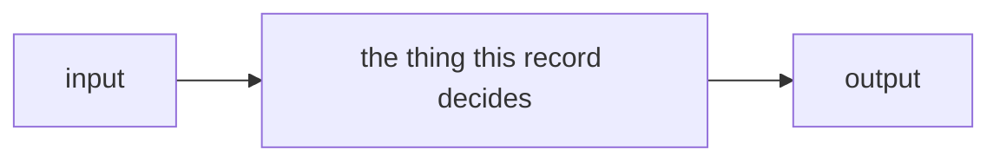
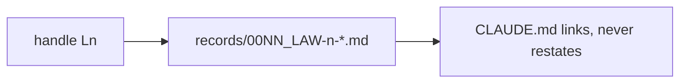

# WORK-SYSTEM — the fux work mechanism, portable

**What this is.** One self-contained document that lets Claude stand up the
whole *work mechanism* used in the fux repository inside **any other
repository**: Standing Records with Laws, a single live work queue, a backlog,
blockers as files, the session files that let a cold session arrive warm, the
one archive, the Claude Code hooks that enforce the loop, and the commit guard
that keeps the records honest.

**What it is not.** It carries nothing about fux the product — no index, no
ranking, no golden benchmark, no release pipeline. Tests are **deliberately
left out** of this bootstrap (§9 names the ones to add later); the hooks and
the commit guard are the only mechanical enforcement installed on day one.

**The human decider is the git user — never a hard-coded name.** This
document assumes the target is a **git repository**. "The decider" means the
person `git config user.name` returns in that clone. The queue heading is the
fixed string `## Blocked on the decider` (hooks grep it), and every hook that
names a person reads `git config user.name` at run time. Nothing in the
installed tree spells a person's name except authorship lines (`filed_by`,
`Filed by …`, rulings quoted with their date), which record who actually did it.

---

## 0 · How to use this document

### For the human

1. Copy this file into the target repository root as `WORK-SYSTEM.md` and
   commit it.
2. Open Claude Code in that repository and paste the prompt below.
3. Review the first commit; install the commit guard once by hand (§7 step 9
   prints the line); done.

**The prompt to paste:**

```text
Read WORK-SYSTEM.md at the repo root, whole, before anything else. Then set up
the work system it describes by following its §7 "Setup procedure" exactly, in
order, in one branch. Create every file §5 lists from the templates in §6,
copy each normative rule block from §3 into the record §7 names for it, make
the hooks executable, and finish with §8's verification checklist printed
with a ✅/❌ per line. Do not invent rules the document does not state; where
it says "judgment", leave it unenforced and say so. Stop and ask me only on a
decision §7 marks as mine.
```

### For Claude

This document is **a bootstrap, not a rulebook**. Once §7 has run, every rule
in §3 lives in exactly one record under `records/`, and **this file is moved to
`archive/bootstrap/WORK-SYSTEM.md`** by the last setup step. From then on the
records are the source and this file may be *named* and never *cited*.

---

## 1 · The model on one page

The system answers four questions, each with exactly one home:

| question | home | shape |
|---|---|---|
| **What is true now?** (decisions, rules, who owns what) | `records/` — Standing Records (SRs) | one record per subject, cited by **name**, never by number |
| **What is being done?** | `work/OPEN-WORK.md` + `work/open/W-nn-*.md` | one row + one detail file per item, one ball per row |
| **What has been named and nobody is doing?** | `work/BACKLOG.md` | one row per item, five classes, no detail files |
| **What happened?** | `work/WORKLOG.md`, `work/IMPLEMENTATION.md`, `archive/` | append-only; closed items are archived, never deleted |

```text
                          ┌─────────────────────────────┐
                          │   records/  — WHAT IS TRUE  │
                          │  Laws (L0, L1) outrank all  │
                          │  WORK records: how work is  │
                          │  done; one subject, one home│
                          └──────────────┬──────────────┘
          links to, never restates       │  owns / describes components
   ┌─────────────────────────────────────┼─────────────────────────────┐
   │                                     ▼                             │
   │  CLAUDE.md ──reads first──▶  work/OPEN-WORK.md  ◀── the ONE queue │
   │  (agent contract, pointers)  ┌─────────────────┐                  │
   │                              │ Blocked on      │ ◀─ 🔴 inbox      │
   │                              │   the decider   │                  │
   │                              │ Open items      │ ◀─ 🟢 🟡 🟣 rows  │
   │                              └────────┬────────┘                  │
   │          work/open/W-nn-slug.md ◀──────┘ one detail file per item │
   │          work/BACKLOG.md   ◀── B-nnn: named, unclaimed            │
   │          work/BLOCKED.json ◀── a blocker is a FILE, not a remark  │
   │          work/NOW.md · WORKLOG.md · INTERVIEW.md · IMPLEMENTATION │
   └───────────────────────────────┬───────────────────────────────────┘
                                   │ closed items, retired docs: MOVED
                                   ▼
                          archive/  — may be NAMED, never CITED
                          archive/README.md maps each to its successor

   enforcement:  .claude/hooks/*  (inbox injected · stop-if-blocked ·
                 require-progress · per-asset lock · inbox-shape guard)
                 scripts/sr-guard.sh (commit-msg: owned component ⇒ its record)
```

**The lifecycle of one piece of work:**

```text
named in a record / proposal ──▶ B-nnn row in BACKLOG (no file)
                                      │ somebody is about to do it
                                      ▼
            W-nn detail file + OPEN-WORK row, with a ball (same change)
                                      │
        🔴 blocked on the decider ──▶ inbox row + "↳ blocks:" sub-row
        🟣 gated on a date  ──▶ row names YYYY-MM-DD
        🟡 waiting on W-mm  ──▶ row names the id (file one if none exists)
        🟢 no blockers      ──▶ an agent may pick it up
                                      │ the work happens
                                      ▼
          outcome in IMPLEMENTATION.md · record amended in the same change
                                      │
                                      ▼
   row DELETED · file MOVED to archive/open/ · archive/README.md row — one change
```

**The one sentence to carry:** *every rule is stated once, in a record; every
other file points at it; the queue is the list and nothing else; a blocker is
a file; nothing closed is ever deleted.*

---

## 2 · Vocabulary

| term | meaning |
|---|---|
| **SR / Standing Record** | a maintained specification in `records/`. Amended in the same change as the code it governs; cited by name (`SR-WORK-SESSION`), never by number. Not an ADR: it must be **true now** and carries no history. |
| **decider** | the human who rules: whoever `git config user.name` returns in the clone. Never written into a heading, hook or rule as a literal name. |
| **Law (`L0`, `L1`, …)** | a rule that outranks every other record. Lives in its own `SR-LAW-n` record. Changes only on the decider's ruling, named in the record. |
| **WORK record** | a `kind: process` record stating how work is done — `SR-WORK-<SUBJECT>`, numbered `0051`–`0100`. |
| **kind** | `law` · `component` · `process`. Answers *what would have to change for this record to become wrong?* — the decider rules differently / the code changes / the way work is done changes. |
| **owns / describes** | `owns`: exactly one record per component path. `describes`: any number of records whose subject reaches into a component they do not own. The guard demands the owner **and** every describer be touched in the same change. |
| **`no SR affected`** | the escape line in a commit message, on its own line — a claim under your name that the change touches no recorded decision. |
| **W-nn** | an open work item: a row in `OPEN-WORK.md` + a file in `work/open/`. Ids never reused. |
| **B-nnn** | a backlog row: named somewhere, nobody doing it. No file. Ids never reused. |
| **ball** | the one marker every queue row opens with: 🔴 blocked on the decider · 🟣 gated on a date · 🟡 waiting on another item · 🟢 no blockers. Optional after it: 🧨 getting worse · 🔺 do first (the decider only). |
| **lane** | `arpit` (needs a human's hands) · `agent` (an agent alone) · `cowork` (research, chat-only). Ordered within a lane, never across. |
| **inbox** | the `## Blocked on the decider` table at the top of the queue — every decision the decider owes, with its age. |
| **blocker** | `work/BLOCKED.json` with a decision other than `PROCEED`. The session stops. |
| **veto condition** | the checkable condition under which a record's decision reopens — a condition, never an event to await. |
| **archive** | `archive/` at the repo root, the only one. Things are moved there, mapped in `archive/README.md`, and may be named but never cited. |

---

## 3 · The rules — stated once, by subject

Each block below becomes the normative §2 of one record on setup (§7 says
which). **After setup, the record is the home and this file is history.**
Rule numbers inside a block are part of its contract: a new rule is appended,
never inserted.

### 3.0 · L0 — authority (→ `SR-LAW-0`)

1. **Source.** Every rule has exactly one home, a record. Every other artifact
   — `CLAUDE.md`, a README, a comment, a skill, a diagram — **links to it and
   never restates it**. A change is made in the record first.
1a. **The records are always up to date — in the change that makes them
   wrong.** Three obligations: (i) no behaviour change lands without its record
   updated in the **same commit**; (ii) a change that touches no recorded
   decision says so — `no SR affected`, on its own line of the commit message;
   (iii) before a session ends, re-read every record you changed code under.
   (i) and (ii) are enforced by the guard; (iii) is judgment and is the only
   thing covering coherence — a record can be amended into self-contradiction
   and every check passes.
2. **Precedence.** Law records outrank every other record. A record that
   conflicts with a Law is **void in the conflicting part** — a defect, never a
   trade-off.
2a. **On contact, the conflicting sentence is deleted from the lower document**
   — never softened, footnoted, or left beside a pointer.
3. **Amendment is entrenched.** A Law changes only on the decider's ruling, named in
   the record. An ordinary record a session may accept.
4. **The restatement test:** *could this artifact and the record disagree
   while both still look correct?* If yes it is a restatement and forbidden.
   If it would simply fail, it is an implementation (code naming a key) or an
   enforcement (a test, a hook) and permitted. Prose explaining *how* or *why*
   beside the code is permitted; a second statement of the rule is not.
5. **A generated view is permitted only while a test binds it byte-equal.**
   Remove the test and the view is an illegal restatement. (Not used by this
   bootstrap — tests are deferred — so `CLAUDE.md` links to the laws and
   carries none of their text.)

### 3.1 · L1 — a retired record is archived, never deleted (→ `SR-LAW-1`)

1. When a record's subject, rule or law is retired, the record is **moved** to
   `archive/records/`, mirroring its path, **in the same change** — with a row
   in `archive/README.md`, `status: archived`, and a top banner
   `ARCHIVED <date> — retired by <ruling>`.
2. An archived record may be **named, never cited** as grounding for a live
   claim.
3. A **superseded** record is different: it is rewritten or deleted in the
   change that supersedes it, and the successor says in prose what it replaced.
4. A retired law is written `ex-L<n>` in live text; its handle is never reused.

### 3.2 · The record convention (→ `records/README.md`, the register)

**Path and ranges.** `records/NNNN_<short-name>.md`, three ranges:

| range | holds | new record takes |
|---|---|---|
| `0001`–`0050` | Laws only — `0001` SR-LAWS (routing), `0002` SR-LAW-0, `0003` SR-LAW-1, … | next free after the highest law |
| `0051`–`0100` | WORK records only — `SR-WORK-<SUBJECT>` | next free after the highest |
| `0101`– | every other record | next free after the highest |

Gaps are reservations, not missing files. **The number is a filename ordinal,
not an identity.** Cite by name, always.

**Frontmatter — the metadata, never restated in the body.** Keys, in order:
`type` (`Standing Record`) · `kind` · `name` (`SR-<NAME>`) · `title`
(`SR-<NAME> (NNNN) — <short title>`) · `description` (one sentence) · `status`
(`proposed` · `accepted` · `superseded` · `archived`) · `date` · `feature` ·
`owns` (list of component paths, `[]` when none) · `laws` (`[L0]`, `[]` when
none) · `timestamp` · `content_sha` (`""` until a stamping script exists).
Optional: `supersedes`, `ratifies`. **Quote any value containing `: `.**

**The three kinds.**

| `kind` | becomes wrong when | the extra gate it answers to |
|---|---|---|
| `law` | The decider rules differently | precedence (3.0 rule 2) |
| `component` | the code changes | the owning record is touched in the same change (guard) |
| `process` | the way work is done changes | it owns its own enforcement — a hook or a test |

**A record states what is true now and carries no history.** No `Amended`
sections. When a decision changes, rewrite the sentence in place. The one
exception is an argument that still binds — a rejected alternative belongs in
*Alternatives considered* because it is why the current shape is current.

**Two sections and a bibliography.** §1 *For humans* — one screen, present
tense, a diagram (Mermaid plus a collapsed ASCII twin, updated together). §2
*For agents* — Context · Decision (numbered) · Consequences · Alternatives
considered · Reference (required) · Veto condition. *References* — every
source cited, grouped; nothing new, never an archived document.

**The reference is grounded** — code at a path, a live doc, measured evidence.
Never an archived doc. **The veto condition is a condition, not an event**:
what would have to become true, checkable today with a command.

**Ownership is a table, not a judgment.** `## Ownership` between
`<!-- OWNERSHIP-TABLE-START/END -->` and `## Describes` between
`<!-- DESCRIBES-TABLE-START/END -->` in the register. Every component path
under the code roots the register names appears in Ownership exactly once.
Most specific wins; a carve-out is justified by a *different decision*, not a
different concern. A component with no decision yet is owned by an open
`W-nn`. A record's `owns:` key and the table must agree in both directions.

### 3.3 · The queue (→ `SR-WORK-OPEN-QUEUE`)

**A · What the file is**

1. `work/OPEN-WORK.md` is the single live queue. Ordering lives in it.
2. No second document names what to do next; a second one is the stale one.
3. Its length is the signal of how much is pending. It narrates no history.
4. It is an index: one or two lines per item; detail in `work/open/W-nn-slug.md`.

**B · An item's lifecycle**

5. Maintained **in the same change as the work**, never afterwards.
6. An item gets its file and id before it gets a row; the row gets its ball the
   day it is filed.
7. `W-nn` ids are never reused — including an id withdrawn before its file
   existed (the id is still spent; the rows are simply removed).
8. Completed items are **removed, never ticked**: the row is deleted and the
   detail file moves to `archive/open/`.
9. Closing is legal only once the outcome is in `work/IMPLEMENTATION.md`.
10. A resolved thing leaves the queue entirely — no tombstones, no DONE rows.
11. Before deleting a row, check what it was the only home of; move that
    statement to a record first.
12. On every execution — success, failure, blocked, interrupted, abandoned —
    the affected rows are updated before the session ends. A failed run records
    the failure with a one-line why. **Never mark an item done with failing
    checks.**

**C · The shape of a row**

13. One or two lines per item, always.
14. A row is: ball · optional 🧨 · optional 🔺 · `**W-nn**` · `` `lane` `` ·
    what is open · `Filed by <person> (<surface>).` (rule 63) ·
    `[detail](open/W-nn-slug.md)`.
15. At most 280 characters.
16. No body — no nested bullet, no table, no indented paragraph.
17. Every row links its own detail file, and the id in the row matches it.
18. A *Blocked on the decider* row is short too.
19. Everything else — status, evidence, records, rulings, hazards, history —
    goes in the item's file.

**D · The balls**

20. A ball on every row, always, and exactly one.
21. 🔴 blocked on the decider's decision — directly, or through any chain of items
    ending at one.
22. 🟣 gated on a named date — the row that owns the gate names `YYYY-MM-DD`;
    a row behind it names the item it waits on.
23. 🟡 waiting on another item whose chain ends at neither the decider nor a date —
    the row says `waiting on W-mm`, the bare id right after the verb.
23a. **A 🟡 row names a queue item; if none exists, the same edit files one.**
    *"Waiting on a run"*, *"waiting on an endpoint"* — each is an unfiled item
    wearing a blocker's clothes. The filed item states what the missing thing
    is, what producing it takes, and who or what can produce it. **A blocker
    that cannot be turned into an item is a reason to close**, or to put the
    fork to the decider — never a reason to stay 🟡.
24. 🟢 no blockers, good to go.
25. Red wins, then purple.
26. A date-gated item is not in the inbox.
27. **The chain is read from the row's own words, by a fixed verb list:**
    `blocked on` · `after` · `waiting on` · `waits on`, followed by the id.
28. When a state changes, re-ball that row and every row waiting on it.
29. 🧨 broken, or getting worse every day it waits. Any session sets or clears
    it, on any ball.
30. 🔺 do first — set and removed only by the decider. An agent never adds one.
31. Mark order: the ball, then 🧨, then 🔺, then the id.
32. **An agent picks from 🟢 only:** 🟢🧨🔺 → 🟢🔺 → 🟢🧨 → 🟢. 🔴, 🟣 and 🟡
    wait. A Claude Code session never picks from the `research` section.
33. A session names every 🔴 decision in its first output, 🔺 first.
34. A 🔺 item waiting on an item without 🔺 is flagged to the decider, never fixed by
    giving the blocker a 🔺.

**E · Ordering**

35. Three lanes, ordered independently: `arpit` · `agent` · `cowork`.
36. Priority is damage that accrues with elapsed time, above damage that is
    merely present.
37. Grouped by what closing it takes — `build` (code) · `testing` (a run or a
    harness) · `record update` (a ruling or a record; no code) · `research`
    (a proposal or compare doc reached by reading; no code; closes on the decider
    picking a shape).
37a. **The `research` section runs in a chat/Cowork session, never in Claude
    Code.** Its rows' lane is `cowork`; its files say `**Model:** Cowork`.
38. Each item's file names the record its change will update, or says
    **"no SR affected"** out loud.

**F · The Blocked-on-the-decider inbox**

39. The header carries the inbox; each item's file carries its `filed` date.
40. `age` is arithmetic — today minus `filed`, recomputed on every read, never
    copied.
41. Any inbox row older than 5 days is named, with its age, in the session's
    first output.
42. Every inbox row is followed by a `↳ **blocks:**` sub-row naming every item
    the decision holds up, or `nothing else in the queue`.
43. An item waiting on a decision joins that sub-row in the same edit.
44. An inbox row is always 🔴.
45. A row points only at things that exist.
45a. **The inbox section carries its table and nothing else.** When rulings are
    owed, the table has rows and the section closes. When none is owed, the
    table stays (header + separator only) and the line directly beneath it
    begins `*Empty since YYYY-MM-DD` and names the next gate. **Nothing else
    follows the table** — no recap, no summary. (Enforced in-session by
    `.claude/hooks/guard-open-work-inbox.sh`.)

**G · Standing, and forbidden**

46. The markers are assertions, not evidence. Reconcile against
    `work/IMPLEMENTATION.md` and the repo before treating anything as pending
    or done.
47. **No git housekeeping, ever.** Nothing in the queue says what is or is not
    committed, staged or pushed. If repo state blocks work, name what the work
    needs.
48. A WORKLOG entry per substantive exchange — a chat-only session counts.
49. The queue and the item file on any status change; INTERVIEW kept current
    *during* the session.
50. Reconcile before you report.
51. Records are cited by name, never by number.
52. No behaviour change lands without its record updated in the same change.

**H · Closing an item — archive, never delete**

53. An item's detail file is **never deleted**. Closing moves
    `work/open/W-nn-slug.md` to `archive/open/`, byte for byte, in the same
    change that deletes its row.
54. Every closure archives, whatever the outcome — shipped, superseded,
    renumbered, merged, withdrawn, won't-do. A closure with no code is still a
    closure, and its file is the one worth most.
55. The mover is the noticer: an item some other change already closed is
    archived by the session that notices it.
56. Archiving is not done until `archive/README.md` §`open/` names a
    successor — the file, the close date, and where the live answer lives now.
57. `archive/open/` is history, not evidence.

**I · An item's file opens with its meeting view**

58. **The first thing under an item file's `# W-nn` title is `## At a glance`,
    and the first thing under that is a table or a diagram** — a Markdown
    table, a fenced `mermaid` or `text` diagram, or an image. Nothing comes
    before it, not the ruling and not the `**Model:**` line.
59. The view says **what we are going to do, in plain English, fit to put on a
    screen in a meeting.** Default shape: `| step | what we do | what it gives
    us | state |`, state ✅ done · ⏳ not yet · 🔴 the decider decides. Ids, metric
    names and paths go in the body below.
60. The view changes in the same change as the item; a view that disagrees
    with its body is wrong, and the body wins.

**J · Who filed it, and who last updated it**

61. An item file's frontmatter carries `filed_by`, `updated` and `updated_by`
    beside `filed`. Each `_by` is `"<person> (<surface>, <model>)"` — the person
    whose ask it is, then the session that wrote it. The model is left out only
    when no record of it survives; never guessed.
62. Every change to an item file re-sets `updated` and `updated_by`; `updated`
    is never earlier than `filed`.
63. An *Open items* row ends `Filed by <person> (<surface>).` — the file's
    `filed_by` without the model — just before its detail link. Inbox rows do
    not carry it.

**The legend** — the one rule text the queue carries, exactly these two lines
under its header:

```text
**A ball on every row, always one:** 🔴 blocked on the decider, directly or through another item · 🟣 gated on a named date, directly or through another item · 🟡 waiting on another item · 🟢 no blockers.
**Optional, after the ball:** 🧨 broken or getting worse · 🔺 do first (the decider only). Full legend: [SR-WORK-OPEN-QUEUE](../records/0051_WORK-open-queue.md) rules 20–34.
```

### 3.4 · The backlog (→ `SR-WORK-BACKLOG`)

1. `work/BACKLOG.md` is the single list of named-but-unclaimed work.
   Everything in it is stated somewhere else; nothing in it is being done.
2. It is an index of pointers, not a home. The source is the authority.
3. **Its length is not a signal** — it inverts the queue's rule 3. A longer
   backlog means more honest records. Never trim it to look better.
4. It carries no rule text.
5. It is not evidence and not a commitment.
6. Three sources only: a record naming something outstanding; every file in
   `work/proposals/`; an idea from a session that earns neither.
7. **An item is never in both `BACKLOG.md` and `OPEN-WORK.md`.** The queue
   wins; the moment it has a `W-nn`, its backlog row is gone.
8. A live fork with two implementations is a `compare/` doc, not a row.
9. A veto condition is not a backlog item. 10. A rejected alternative is not
   one; *deferred, not dismissed* is.
11. `B-nnn` ids, filing order, never reused.
12. **No detail file.** The source is the brief.
13. One line, ≤ 400 characters, no body.
14. A row is: id · the outstanding thing in the source's words · the source
    cited by name with a link and a location inside it · what would close it.
    The class is the group heading.
15. Every row cites a source that exists and a location inside it.
16. Every row names what would close it.
17–21. **Five classes, exhaustive:** `unbuilt` (ratified, not implemented) ·
    `ungated` (a rule nothing checks) · `unmeasured` (a default or claim with
    no measurement) · `unruled` (a fork not decided — **only the decider closes
    one**) · `cost` (a consequence accepted deliberately — **never
    graduates**; leaves when paid or when its decision reopens).
22. One class per row: what would have to happen first.
23. Promotion = opening a `W-nn` (file, row, ball) **and deleting the backlog
    row in the same change**.
24. Deleted, never ticked; nothing to archive, a row has no file.
25. Check what the row was the only home of before deleting it.
26. A row whose source is rewritten so the item no longer exists is deleted in
    that change.
27. A proposal's row follows its proposal: `graduated` and parked → stays,
    names the successor; `rejected` or gone → the row goes.
28. Grouped by class, then by source. No priority order here.
29. **A record that names something outstanding gets its backlog row in the
    same change.** The one obligation this record adds.
30. Nothing regenerates this file; *named as outstanding* is a judgment.
31. A law, then the queue, outrank this record.

### 3.5 · The lifecycle of a feature (→ `SR-WORK-LIFECYCLE`)

1. **On a fork, a compare doc first** — `work/compare/<name>.compare.md`:
   verdict block on top, context, options, matrix, consequences, references,
   **reopen-trigger** (a condition, not a date). The decider accepts or overrides the
   verdict.
2. **On a parked idea, a proposal** — `work/proposals/<name>.md`, `status:
   proposed`, with a **graduation trigger**. Every proposal has one `B-nnn` row.
3. The design of record is the record itself, updated **before** building.
4. **The handoff lives in the item's own detail file** — context, definition
   of done, constraints, key files, edge cases, open questions. There is no
   handoff directory.
5. The prompt is paste-ready and sits beside its handoff: explore → plan →
   implement → verify.
6. **Every handoff names the model that should execute it** — a `**Model:**`
   line with one sentence of why. `**Model:** NONE — <who, and why>` is legal;
   a blank is the only wrong answer.
7. By task: **Opus** when the output quality *is* the deliverable and no test
   catches a bad one (design, debate, ambiguous diagnosis, calling a gate,
   anything touching a law) · **Sonnet** for a written definition of done with
   checks to verify it · **Haiku** for mechanical bulk edits with an exact rule.
8. When borderline, say Opus and say why it was close.
9. One feature, one record, written from `records/TEMPLATE.md` on completion,
   with its components added to the ownership table in the same change.
10. Every rule, record and material decision carries a reference.
11. An implemented proposal is archived in the change that writes its record.

### 3.6 · What a session owes (→ `SR-WORK-SESSION`)

1. **Every session appends one worklog entry before it ends** —
   `work/WORKLOG.md`: asked, done, decided or left open, the single next step.
   A chat-only session counts.
2. The worklog is append-only, newest on top; a wrong old entry is corrected
   by a new one.
3. **`work/INTERVIEW.md` is kept current DURING the session.** Four
   maintained sections: state of play · in flight and the immediate next step ·
   standing constraints · lessons learned.
4. **`work/IMPLEMENTATION.md` is the evidence store** the queue reconciles
   against. A row is earned by landing, never by being planned.
5. **`work/NOW.md` carries one line, overwritten.** A session that dies
   mid-task leaves a note, not a mystery. `idle` when nothing is in flight.
6. **Announce every transition in one line — a marker, never a summary.**
   `→ W-12: building the parser` on start; `✓ W-12 · → W-13: …` on finish.
   A finish with no next is a stop, and a stop is its own sentence.
7. Keep a todo list for anything with more than two steps, current during the
   work.
8. **Ten lines or fewer unless more was asked for, and lead with the answer.**
9. Never summarise work you just did — the diff showed it. No closing offers.
10. **Concurrent sessions are real.** Re-derive `git status` right before
    staging; re-apply your `work/*.md` edits right before committing; commit
    with explicit pathspecs when the index carries another session's work.
11. **Ground truth over prose.** Before any status claim, check `git log`,
    the code, or a command that reproduces it.
12. Say what you are running, and when, to anyone sharing the machine.
13. 🔴 **Two strikes → a gate.** A failure class the worklog records twice
    becomes a check — a hook, a script, or (once tests exist) a test — **in the
    same change that records the second occurrence.**
14. The worklog is cut at each major release into `archive/worklog/`.

### 3.7 · The documentation contract (→ `SR-WORK-DOCS`)

1. No large paragraphs: 3–4 lines, one idea per point.
2. Roomy: blank lines, tables for comparisons, headings.
3. Lead each point with the takeaway, bolded where it helps scanning.
4. Fix form on contact — a wall of text you touch, you split.
5. Chat answers follow the same rule.
6. **An agent may edit the agent-steering files directly**, `CLAUDE.md`
   included — no proposal step.
7. Under two obligations, both judgment: **(a) say it out loud** — a change to
   `CLAUDE.md` is named in the session output and the worklog entry; **(b) a
   ruling of the decider's, or a fact** — never latitude you were not given.
8. Statements of fact are exempt from every ceremony: fixed on contact.
9. The split is `docs/` (what the project *is*) and `work/` (what is
   *happening* to it). `work/README.md` is the map.
10. **Every task updates, before it is done, in this order:** (1)
    `work/OPEN-WORK.md` · (2) the register · (3) `work/WORKLOG.md` · (4)
    `work/INTERVIEW.md` · (5) the registry row of any doc touched · (6)
    `README.md` / `CHANGELOG.md` when public-facing · (7) the relevant record,
    the glossary for any new term, every check the change needs.
11. The registry's rules are `SR-WORK-REGISTRY`'s.
12. Every relative link in a live document resolves (judgment until a link
    test exists).
13. Durable repo-wide knowledge is folded into `CLAUDE.md` concisely, as a
    pointer to its record.

### 3.8 · Blockers (→ `SR-WORK-BLOCKERS`)

1. **A blocker is a file, not a remark.** The moment you cannot proceed
   without the decider, write `work/BLOCKED.json` and stop.
2. Shape:
   ```json
   {"decision":"ASK","reason":"one line","questions":["the minimum question"],
    "safe_alternative":"what you can do meanwhile, or \"\"","surfaced":false,"filed":"YYYY-MM-DD"}
   ```
3. `decision` takes exactly four values — `ASK` (the decider can unblock you) ·
   `REFUSE` (disallowed or unsafe) · `UNKNOWN` (out of scope to answer
   reliably) · `PROCEED` (nothing is blocked).
4. `questions` carries the **minimum** question.
5. `safe_alternative` is what can be done meanwhile — never a guess at what the decider
   would have said.
6. **Do not work around a blocker.** Say it, set `surfaced: true`, stop.
7. Three hooks enforce it: `UserPromptSubmit` injects the blocker and the
   inbox into every prompt (`inject-inbox.sh`); `Stop` refuses to end a turn
   while a blocker is unsurfaced, three times, then relents
   (`stop-if-blocked.sh`); `PreToolUse` on writes is a **per-asset** lock
   (`session-lock.sh`, TTL 900 s).
8. The `Stop` hook relents after three refusals deliberately — a hook that
   never relents is a hang. Taking the third exit while still blocked breaks
   rule 6.
9. The lock is per asset, not per session; two sessions are expected.
10. When the decider rules, the file is set back to `PROCEED` with the ruling as
    `reason` and the resulting item re-balled in the same change.

### 3.9 · The archive (→ `SR-WORK-ARCHIVE`)

1. Exactly one archive: `archive/` at the repo root.
2. Anything archived is **moved** there into a directory mirroring where it
   came from (`archive/open/`, `archive/records/`, `archive/compare/`, …).
3. Every archived document gets a row in `archive/README.md` naming its live
   successor, or saying it has none.
4. An archived document may be **named** in prose, with a link.
5. It may **never back a live claim** — nothing guarantees it was not
   overwritten after retirement.
6. When repointing a citation away from an archived doc, point at the live
   successor; never just delete the link.
7. If an archived doc was a claim's only support, the claim needs new
   grounding.
8. A superseded record is never archived (rewritten or deleted); a **retired**
   record is archived (L1).
9. Links inside `archive/` are never repaired; the tree is frozen.

### 3.10 · Ownership and the guard (→ `SR-WORK-OWNERSHIP`)

1. Two relations: `owns` (exactly one record per component) and `describes`
   (any number). `describes` never substitutes for `owns`.
2. Both are declared in the register, in two marked tables.
3. **The guard demands the owner and every describer** be staged in the same
   commit as a change to the component — or the commit message carries
   `no SR affected` on its own line.
4. A `describes` row states **why**, in its note cell.
5. Most specific wins, for `owns` only.
6. `scripts/sr-guard.sh` runs as a **`commit-msg`** hook — never `pre-commit`,
   because the escape line has to be read from the message, which does not
   exist at `pre-commit` time. Install once:
   `ln -sf ../../scripts/sr-guard.sh .git/hooks/commit-msg`.
7. `--no-verify` leaves no trace; when CI exists it runs the same check from
   history (`records/RULE-SINCE` is its baseline).
8. The guard proves a record was **touched**, never that it is coherent.

### 3.11 · The governance map (→ `SR-WORK-GOVERNANCE`)

Four layers; every governing file sits in exactly one. The map names homes
and restates no rule. **It carries no counts** — a count in prose is a fact
with an expiry date.

| layer | files | audience | enforced by | update trigger |
|---|---|---|---|---|
| root steering | `CLAUDE.md` · `README.md` · `CHANGELOG.md` | agent / human | hooks + guard | any rule or pointer changes |
| `work/` | `OPEN-WORK.md` · `BACKLOG.md` · `open/` · `BLOCKED.json` · `NOW.md` · `WORKLOG.md` · `INTERVIEW.md` · `IMPLEMENTATION.md` · `LESSONS.md` · `MACHINE.md` · `compare/` · `proposals/` | both | hooks (`inject-inbox`, `stop-if-blocked`, `require-progress`, `session-lock`, `guard-open-work-inbox`) | the same change as the work |
| `records/` + `docs/` | `records/README.md` (register) · `records/NNNN_*.md` · `records/TEMPLATE.md` · `records/RULE-SINCE` · `docs/GLOSSARY.md` | both | `scripts/sr-guard.sh` | the owning code or the decision changes |
| `archive/` | everything retired, mirroring the live tree | both | judgment (no second `archive/` anywhere) | a closure or a retirement |

A governing file gets its row in the change that adds it and loses it in the
change that retires it.

### 3.12 · The doc registry (→ `SR-WORK-REGISTRY`)

1. The registry is §3 of this record — a table, no other file.
2. Every maintained document has an **update trigger** and a **last verified**
   date; a task that fires a trigger updates the document *and* bumps its row
   in the same change.
3. A row is `| Document | Update trigger | Last verified | Notes |`.
4. Live documents only; an archived document loses its row in the same change.
5. No row points into `archive/`. 6. Every row's target exists. 7. One row
   per document. 8. A new maintained document gets its row in the same change.
9. A row older than about thirty days is a review prompt, not a failure.
10. At task end, scan the trigger column.

---

## 4 · The session loop — what CLAUDE.md binds every session to

1. **Read** `CLAUDE.md`, then `work/INTERVIEW.md` (state of play), then
   `work/OPEN-WORK.md`, then `work/BACKLOG.md` before filing anything new.
2. **Triage first.** If `work/BLOCKED.json` is not `PROCEED`, the first
   sentence says so. Name every inbox row and its age (any > 5 days called out).
   If no item is agent-closable (no 🟢 outside `research`, for Claude Code),
   the session's first output is the blocked-on-the-decider list and it **stops**.
3. **Pick** from 🟢 by rule 32. Announce `→ W-nn: …`. Write `work/NOW.md`.
4. **Work**, record first (L0): amend the owning record in the same change as
   the code. Keep the item file, the queue and INTERVIEW current as you go.
5. **If blocked**, write `work/BLOCKED.json`, say it, `surfaced: true`, stop.
6. **Close**: outcome row in `IMPLEMENTATION.md` → row deleted → file moved to
   `archive/open/` → `archive/README.md` row — one change. Re-ball dependants.
7. **Before ending**: WORKLOG entry · INTERVIEW true · NOW overwritten (or
   `idle`) · registry rows bumped · `✓ W-nn · → next` or a stop sentence.
8. **Commit** with explicit pathspecs; the guard will refuse an owned
   component without its record unless the message says `no SR affected`.

---

## 5 · The tree to create

```text
CLAUDE.md                         the agent contract — pointers, never rules
WORK-SYSTEM.md                    this file (moved to archive/bootstrap/ by setup)
records/
  README.md                       the register: convention, register table, Ownership, Describes
  TEMPLATE.md                     the record template
  RULE-SINCE                      the guard's audit baseline (a commit sha)
  0001_LAWS.md                    SR-LAWS — routes L0, L1 to their records
  0002_LAW-0-authority.md         SR-LAW-0
  0003_LAW-1-retired-records-archived.md   SR-LAW-1
  0051_WORK-open-queue.md         SR-WORK-OPEN-QUEUE    ← §3.3
  0052_WORK-backlog.md            SR-WORK-BACKLOG       ← §3.4
  0053_WORK-lifecycle.md          SR-WORK-LIFECYCLE     ← §3.5
  0054_WORK-session.md            SR-WORK-SESSION       ← §3.6
  0055_WORK-docs.md               SR-WORK-DOCS          ← §3.7
  0056_WORK-blockers.md           SR-WORK-BLOCKERS      ← §3.8
  0057_WORK-archive.md            SR-WORK-ARCHIVE       ← §3.9
  0058_WORK-ownership.md          SR-WORK-OWNERSHIP     ← §3.10
  0059_WORK-governance.md         SR-WORK-GOVERNANCE    ← §3.11
  0060_WORK-registry.md           SR-WORK-REGISTRY      ← §3.12 (+ the table)
work/
  README.md                       the map of work/
  OPEN-WORK.md                    the queue — list only
  BACKLOG.md                      the backlog — list only
  NOW.md                          one line
  BLOCKED.json                    {"decision":"PROCEED", …}
  WORKLOG.md                      append-only, newest first
  INTERVIEW.md                    cold-start state of play
  IMPLEMENTATION.md               what landed, when
  LESSONS.md                      dated lessons, newest first
  MACHINE.md                      environment quirks
  open/README.md                  contract for item files
  compare/README.md               live forks
  proposals/README.md             parked ideas
docs/
  GLOSSARY.md                     recurring terms
archive/
  README.md                       the map — every archived thing → its successor
  open/.gitkeep  records/.gitkeep  compare/.gitkeep  proposals/.gitkeep  worklog/.gitkeep  bootstrap/.gitkeep
scripts/
  sr-guard.sh                     commit-msg guard (executable)
  check-open-work-inbox.py        inbox-shape check (rule 45a)
.claude/
  settings.json                   hook wiring
  hooks/inject-inbox.sh  stop-if-blocked.sh  require-progress.sh  session-lock.sh  guard-open-work-inbox.sh
```

`.gitignore` additions: `.claude/.locks/`, `.claude/.stop-attempts`,
`.claude/.progress-nudged`.

---

## 6 · File templates

Write each file **exactly** as below, substituting only `<PROJECT>` (the
repository's name), `<DATE>` (today, `YYYY-MM-DD`), `<TIMESTAMP>` (ISO 8601
UTC) and `<CODE ROOTS>` (the directories the ownership table must cover, e.g.
`src/`, `tools/`). The WORK records' §2 blocks are copied from §3 verbatim.

### 6.1 · `CLAUDE.md`

````markdown
# CLAUDE.md — the agent contract for <PROJECT>

This file is binding. It carries **pointers, never rules**: every rule lives in
exactly one record under [`records/`](records/README.md) and nothing here
restates one ([SR-LAW-0](records/0002_LAW-0-authority.md)). Read this, then
[`work/INTERVIEW.md`](work/INTERVIEW.md), before your first substantive change.

## Law zero — the records are always up to date

Stated once in [SR-LAW-0](records/0002_LAW-0-authority.md) decision 1a — three
obligations; the third cannot be enforced and is the only thing covering
coherence. The gate for the first two is [SR-WORK-OWNERSHIP](records/0058_WORK-ownership.md)
decisions 3 and 6. Install its `commit-msg` hook once:

```bash
ln -sf ../../scripts/sr-guard.sh .git/hooks/commit-msg
```

## Triage first — a human-blocked queue stops the session

**Before any work, read [`work/OPEN-WORK.md`](work/OPEN-WORK.md)** and ask: *is
any item agent-closable right now?* If none is, the session's **first** output
is the blocked-on-the-decider list and it then **stops**. What the first output must
name, the inbox, the 5-day rule, the `↳ blocks:` sub-row and which balls an
agent may pick from are [SR-WORK-OPEN-QUEUE](records/0051_WORK-open-queue.md)
rules 32–34 and 39–45. **Claude Code never picks from the `research` section**
(rule 37a). **Two strikes → a gate**: [SR-WORK-SESSION](records/0054_WORK-session.md)
decision 13.

## Where the state of play lives

| you want | read |
|---|---|
| what to work on next | [`work/OPEN-WORK.md`](work/OPEN-WORK.md) — **the single live queue** |
| what has been named and nobody is doing | [`work/BACKLOG.md`](work/BACKLOG.md) |
| the judgment behind the current state | [`work/INTERVIEW.md`](work/INTERVIEW.md) |
| what has actually shipped | [`work/IMPLEMENTATION.md`](work/IMPLEMENTATION.md) |
| the spec for anything | [the register](records/README.md) |
| a closed fork and its reopen-trigger | [`work/compare/`](work/compare/README.md) |
| a word you don't recognise | [`docs/GLOSSARY.md`](docs/GLOSSARY.md) |
| why a command fails on *this* machine | [`work/MACHINE.md`](work/MACHINE.md) |
| the stages a feature moves through | [SR-WORK-LIFECYCLE](records/0053_WORK-lifecycle.md) |
| what a session owes before it ends, and how long an answer may be | [SR-WORK-SESSION](records/0054_WORK-session.md) |
| what a task owes the documentation | [SR-WORK-DOCS](records/0055_WORK-docs.md) |
| what to do when you cannot proceed without the decider | [SR-WORK-BLOCKERS](records/0056_WORK-blockers.md) |
| whether a claim may be grounded in an archived doc | [SR-WORK-ARCHIVE](records/0057_WORK-archive.md) |
| which record owns a module | [`records/README.md`](records/README.md) §Ownership |
| which file governs what | [SR-WORK-GOVERNANCE](records/0059_WORK-governance.md) |
| the whole set of rules about how work is done | the **WORK** records `0051`–`0060` |

Any work item that starts, finishes, blocks or is descoped updates
`OPEN-WORK.md` **in the same change as the work**. The record is the spec;
OPEN-WORK is the state; `IMPLEMENTATION.md` is the record of what landed.

## The laws

Each law is stated in exactly one record and is **not restated here**:

- **L0** — SRs are the only source of truth; Law records outrank every other record — [SR-LAW-0](records/0002_LAW-0-authority.md)
- **L1** — a retired record is archived, never deleted — [SR-LAW-1](records/0003_LAW-1-retired-records-archived.md)

[SR-LAWS](records/0001_LAWS.md) assigns the handles and routes each to its
record; that is all it does. Add a law by adding a record in the law range and
a line here, on the decider's ruling named in the record.

## Documentation (required)

Three rule groups, one home — [SR-WORK-DOCS](records/0055_WORK-docs.md): how a
doc is written (decisions 1–5); who may edit the agent-steering files, this one
included, and under what two obligations (6–8 — **read before editing
`CLAUDE.md`**); the documents every task updates before it is done (10). The
registry is [SR-WORK-REGISTRY](records/0060_WORK-registry.md) §3.

**The shared memory between sessions is [`work/`](work/README.md)**; `docs/`
holds what the project *is*. Read `work/README.md` once; it is the map.

## Session continuity (required)

The worklog entry (a chat-only session counts), the interview kept current
*during* the session, the one-line `work/NOW.md`, the transition markers and
how long an answer may be — [SR-WORK-SESSION](records/0054_WORK-session.md).

## Blockers stop the session (required)

A blocker is a file — [`work/BLOCKED.json`](work/BLOCKED.json) — and the
session stops. Its shape, the four values, the prohibition on working around
one and the hooks that enforce it — [SR-WORK-BLOCKERS](records/0056_WORK-blockers.md).

## Archive is not evidence

One archive, [`archive/`](archive/README.md), at the repo root. What may be
named, what may never be cited — [SR-WORK-ARCHIVE](records/0057_WORK-archive.md).

## Hard-won build knowledge

Dated lessons live in [`work/LESSONS.md`](work/LESSONS.md), newest first.
Three that bind hard enough to name here: **re-derive `git status` right before
staging** — concurrent sessions commit too; **ground truth over prose** — a doc
repeating another doc is not a second source; **a loaded machine produces a
clean, localised anomaly** that reads like a finding — say what you are
running.

## Layout

```
work/        THE SHARED MEMORY between sessions — start at work/README.md
records/     THE STANDING RECORDS — the register, the template, the laws, the WORK records
docs/        WHAT THE PROJECT IS — the glossary
archive/     THE ONE ARCHIVE — everything retired, mirroring the live tree
scripts/     the commit guard and the inbox check
.claude/     hooks and their wiring
```
````

### 6.2 · `records/README.md` — the register

````markdown
---
type: Register
description: "The SR register: the convention, the ownership table, and the state of every record."
---

# SRs — the decision records

**How to use this file.** The naming convention, the record shape, the
ownership table and the rules every record obeys. Read it before writing a
record, before citing one, and before adding a module under <CODE ROOTS>.

One record per completed feature or ruled measurement. **Every record is cited
by NAME in prose, never by number.**

## What an SR is — and what it is not

A Standing Record is a **maintained specification**, not a decision-log entry:
amended in the same change as the code (law zero); superseded records are
rewritten or deleted; retired records are archived (L1); cited by name because
the content moves; it **owns** components and carries a veto condition to check
*today*. The decision-log role lives in `work/compare/` (the fork, its verdict,
its reopen-trigger) and `work/WORKLOG.md`.

## One directory, one state

`records/` is the only home a LIVE record has. A superseded record is rewritten
or deleted in the change that supersedes it; a **retired** record is moved to
`archive/records/` with `status: archived`, a dated banner and an
`archive/README.md` row (L1), and from then on is named, never cited.

Three files here are NOT records and carry no number: this register,
`TEMPLATE.md`, and `RULE-SINCE`.

## The three kinds

Every record declares a `kind`; it answers *what would have to change for this
record to become wrong?*

| `kind` | becomes wrong when | the gate the kind selects |
|---|---|---|
| `law` | The decider rules differently | precedence: a record conflicting with a law is void in the conflicting part |
| `component` | the code changes | `scripts/sr-guard.sh` — the owning record is touched in the same change |
| `process` | the way work is done changes | it owns its enforcement — a hook or script today, a test once tests exist |

## The convention

**Path.** `records/NNNN_<short-name>.md`, on three ranges:

| range | holds | a new record takes |
|---|---|---|
| `0001`–`0050` | the **Law** records only — `0001` SR-LAWS, `0002` SR-LAW-0, `0003` SR-LAW-1 | the next free number after the highest law |
| `0051`–`0100` | the **WORK** records only — how work is done | the next free number after the highest |
| `0101`– | every other record | the next free number after the highest |

Gaps are reservations; no placeholder files. The number is a filename ordinal,
**not an identity**. **Cite by NAME, never by number.**

### Frontmatter is the metadata, and the body never restates it

Keys, in this order: `type` · `kind` · `name` · `title` · `description` ·
`status` · `date` · `feature` · `owns` · `laws` · `timestamp` · `content_sha`;
optional `supersedes`, `ratifies`. See `TEMPLATE.md` for each value. **Quote
any value containing `: `.** The body opens at §1 and restates none of it.

### A record states what is true now. It carries no history.

No `Amended` sections. When a decision changes, rewrite the sentence in place,
in the same commit. The one exception is an argument that still binds — it
belongs in *Alternatives considered*.

### Two sections and a bibliography

**§1 — For humans**: one screen; a diagram (Mermaid and a collapsed ASCII
twin, updated together). **§2 — For agents**: Context · Decision (numbered) ·
Consequences · Alternatives considered · Reference (required) · Veto
condition. **References**: every source cited, grouped; nothing new; never an
archived document.

**The reference is grounded** — never an archived doc. **The veto condition is
a condition, not an event** — checkable today with a command.

**A record that restates a cross-cutting principle is a bug.** Each law lives
in its own `SR-LAW-n` record; every other record names it in `laws:` and moves
on.

### Records are kept current by a check, not by good intentions

| where | what it does |
|---|---|
| `scripts/sr-guard.sh` | a `commit-msg` hook: refuses a commit that changes an owned component without staging its owning record and every describer — unless the message carries `no SR affected` on its own line. Install: `ln -sf ../../scripts/sr-guard.sh .git/hooks/commit-msg` |
| `records/RULE-SINCE` | the baseline commit sha from which the rule applies, for a CI replay once one exists |

**The escape hatch is a claim in git history under your name**, not a silent
skip. What none of this proves: that a touched record is **coherent**.

Start from `TEMPLATE.md`.

---

## The register

| # | name | title | status | built |
|---|------|-------|--------|-------|
| [0001](0001_LAWS.md) | **SR-LAWS** | The laws have exactly one home each; this record routes the handles | accepted | yes |
| [0002](0002_LAW-0-authority.md) | **SR-LAW-0** | **L0** — records are the only source of truth; Law records outrank every other record | accepted | yes |
| [0003](0003_LAW-1-retired-records-archived.md) | **SR-LAW-1** | **L1** — a retired record is archived, never deleted | accepted | yes |
| [0051](0051_WORK-open-queue.md) | **SR-WORK-OPEN-QUEUE** | How `OPEN-WORK.md` works — the queue discipline in eight groups | accepted | yes |
| [0052](0052_WORK-backlog.md) | **SR-WORK-BACKLOG** | How `BACKLOG.md` works — the named-but-unclaimed in five classes | accepted | yes |
| [0053](0053_WORK-lifecycle.md) | **SR-WORK-LIFECYCLE** | How a feature travels — compare, proposal, handoff in the item file, the model line, one record | accepted | yes |
| [0054](0054_WORK-session.md) | **SR-WORK-SESSION** | What a session owes before it ends; the two-strikes rule | accepted | yes |
| [0055](0055_WORK-docs.md) | **SR-WORK-DOCS** | The documentation contract — form, steering-file edits, the documents every task updates | accepted | yes |
| [0056](0056_WORK-blockers.md) | **SR-WORK-BLOCKERS** | A blocker is a file, not a remark — `work/BLOCKED.json` and the three hooks | accepted | yes |
| [0057](0057_WORK-archive.md) | **SR-WORK-ARCHIVE** | One archive; named, never cited | accepted | yes |
| [0058](0058_WORK-ownership.md) | **SR-WORK-OWNERSHIP** | `owns` and `describes`, and the commit guard | accepted | yes |
| [0059](0059_WORK-governance.md) | **SR-WORK-GOVERNANCE** | The governance map — which file governs what; no counts | accepted | yes |
| [0060](0060_WORK-registry.md) | **SR-WORK-REGISTRY** | The doc registry — rules in §2, the table in §3 | accepted | yes |

---

## Ownership — which record owns which component

**This table is the answer, not a judgement call.** Every component under
<CODE ROOTS> appears here exactly once. Most specific wins; a carve-out is
justified by a *different decision*. A component with no decision yet is owned
by an open `W-nn`. A record's `owns:` key and this table agree in both
directions.

<!-- OWNERSHIP-TABLE-START -->

| component | owner | note |
|---|---|---|
| `scripts/sr-guard.sh` | SR-WORK-OWNERSHIP | the guard is the executable form of decisions 3 and 6 |
| `scripts/check-open-work-inbox.py` | SR-WORK-OPEN-QUEUE | rule 45a's check |
| `.claude/hooks/guard-open-work-inbox.sh` | SR-WORK-OPEN-QUEUE | rule 45a, in-session |
| `.claude/hooks/inject-inbox.sh` | SR-WORK-BLOCKERS | decision 7 |
| `.claude/hooks/stop-if-blocked.sh` | SR-WORK-BLOCKERS | decision 7 |
| `.claude/hooks/session-lock.sh` | SR-WORK-BLOCKERS | decision 7 |
| `.claude/hooks/require-progress.sh` | SR-WORK-SESSION | decision 5 |

<!-- OWNERSHIP-TABLE-END -->

## Describes — which record's subject REACHES INTO a component it does not own

Ownership stays one record per component; **describes is any number**, and the
guard demands the owner **and every describer**. Every row states its reason.
A component may be narrowed to symbols: `` `path::name,name` ``.

<!-- DESCRIBES-TABLE-START -->

| component | describer | why |
|---|---|---|

<!-- DESCRIBES-TABLE-END -->
````

### 6.3 · `records/TEMPLATE.md`

````markdown
---
type: SR Template
kind: component
name: SR-TEMPLATE
title: SR-TEMPLATE (0000) — the record template
description: "Copy for each completed feature or ruled measurement. One feature, one SR."
status: proposed
date: <DATE>
feature: the record template itself
owns: []
laws: []
timestamp: <TIMESTAMP>
content_sha: ""
---

# SR-<NAME>: <short decision title>

> Copy to `records/NNNN_<short-name>.md`; take the next free number in the
> record's own range (register §The convention). Cite the NAME everywhere.
> Delete these blockquotes as you fill it in.
>
> | key | value |
> |---|---|
> | `type` | `Standing Record` |
> | `kind` | `law` · `component` · `process` |
> | `name` | `SR-<NAME>` |
> | `title` | `SR-<NAME> (NNNN) — <short decision title>` |
> | `description` | one sentence; what the record decides |
> | `status` | `proposed` · `accepted` · `superseded` · `archived` |
> | `date` | `YYYY-MM-DD` — when the decision was taken |
> | `feature` | the one feature this record belongs to |
> | `owns` | component paths this record claims, `[]` when none; must match the register's Ownership table |
> | `laws` | `[L0, L1]`-style list, `[]` when none; never restate a law |
> | `timestamp` | ISO 8601 |
> | `content_sha` | `""` until a stamping script exists |
> | `supersedes` / `ratifies` | optional — the record replaced / the work item whose ruling this records |
>
> **A record states what is true now and carries no history.** Rewrite the
> changed sentence in place; no `Amended` sections.

---

## §1 — For humans

<Two or three short paragraphs: what this decides and why anyone should care.
Present tense.>



<details>
<summary><b>ASCII twin</b> — the same diagram, for terminals and diffs</summary>

```text
   +-------+      +------------------------------+      +--------+
   | input | ---> | the thing this record decides| ---> | output |
   +-------+      +------------------------------+      +--------+
```

</details>

---

## §2 — For agents

### Context

What forces are at play? What problem does this solve? Why now?

### Decision

Numbered, present tense, imperative where it binds, so another record can cite
`decision 3`.

### Consequences

What becomes easier, harder, owed. Name the debt: a `B-nnn` row in
`work/BACKLOG.md` if nobody is doing it, a `W-nn` if someone is.

### Alternatives considered

One line per option minimum, and why each lost. A real fork links its
`work/compare/` doc.

### Reference (required)

At least one grounding reference — code at a path, a live doc, measured
evidence. **Never an archived doc.**

### Veto condition

**Reopen this decision if:** <the checkable condition>

**How to check it:** `<command or the exact place to look>`

---

## References

*Every source this record cites, gathered in one place. An archived document
is never listed here.*

**Records** — [SR-<NAME>](NNNN_<short-name>.md)

**Code**

- [`<path>`](../<path>)

**Project docs**

- [`work/compare/<fork>.compare.md`](../work/compare/<fork>.compare.md)
````

### 6.4 · `records/RULE-SINCE`

```text
# The guard's baseline. Commits after this sha are subject to "changed an
# owned component without touching its owning record". Written at setup;
# moved forward only after a bulk review, and each move is noted here with
# its reason — the cost is that commits before it are no longer re-auditable.
<sha of the setup commit — fill in after the first commit>
```

### 6.5 · `records/0001_LAWS.md` — SR-LAWS

````markdown
---
type: Standing Record
kind: law
name: SR-LAWS
title: "SR-LAWS (0001) — the laws have exactly one home each"
description: "Assigns the handles L0, L1, … and routes each to the record that states it. This record states no law itself."
status: accepted
date: <DATE>
feature: the law handles and their routing
owns: []
laws: []
timestamp: <TIMESTAMP>
content_sha: ""
---

# SR-LAWS — the laws have exactly one home each

## §1 — For humans

Every law is stated in exactly one record, `SR-LAW-n`. This record assigns the
handle and points at the record; it carries none of the text, so there is
nothing here that can drift.



<details>
<summary><b>ASCII twin</b></summary>

```text
   handle Ln ---> records/00NN_LAW-n-*.md ---> CLAUDE.md links, never restates
```

</details>

## §2 — For agents

### Context

A law restated in two places is two laws the moment one is edited.

### Decision

1. **The handles and their homes:**

   | handle | record | one line |
   |---|---|---|
   | **L0** | [SR-LAW-0](0002_LAW-0-authority.md) | records are the only source of truth; Law records outrank every other record |
   | **L1** | [SR-LAW-1](0003_LAW-1-retired-records-archived.md) | a retired record is archived, never deleted |

2. **A new law** takes the next handle and the next free number in the law
   range, on the decider's ruling named in its record; this table gains its row and
   `CLAUDE.md` §The laws its line, in the same change.
3. **A retired law** is written `ex-Ln`; the handle is never reused; the record
   is archived under L1.

### Consequences

Precedence is judgment, never a gate: no parser reads *does this contradict L0*.

### Alternatives considered

- One record holding every law's text — rejected: a change to one law would
  reopen all of them, and the record would be the longest file every session
  reads.

### Reference (required)

- [SR-LAW-0](0002_LAW-0-authority.md) decision 1 — one home per rule.

### Veto condition

**Reopen this decision if:** any live document other than a law's own record
carries a law's normative text.

**How to check it:** `grep -rn "L0 ·\|L1 ·" --include=*.md . | grep -v records/000`

---

## References

**Records** — [SR-LAW-0](0002_LAW-0-authority.md) · [SR-LAW-1](0003_LAW-1-retired-records-archived.md)
````

### 6.6 · `records/0002_LAW-0-authority.md` — SR-LAW-0

Frontmatter as in 6.5 with `name: SR-LAW-0`, `title: "SR-LAW-0 (0002) — L0,
the records are the only source of truth"`, `description: "Every rule is
stated in exactly one record; every other artifact links to it; Law records
outrank every other record; a Law changes only on the decider's ruling."`,
`laws: [L0]`. Body:

- **§1** — three short paragraphs: one home per rule; the restatement test in
  one sentence (*could this artifact and the record disagree while both still
  look correct?*); Laws outrank, and a conflicting sentence in a lower document
  is deleted on contact. A small diagram: `rule → record → every other artifact
  links`.
- **§2 Context** — why: `CLAUDE.md` and READMEs carrying copies of rules
  drifted from the records they copied.
- **§2 Decision** — **§3.0 of WORK-SYSTEM.md, verbatim** (decisions 1–5).
- **§2 Consequences** — obligation (iii) is unenforced and is the only
  coherence cover; `CLAUDE.md` carries pointers only until a test can bind a
  generated view.
- **§2 Alternatives** — rules in `CLAUDE.md` with records as commentary:
  rejected, that is the drift this law ends.
- **§2 Reference** — `scripts/sr-guard.sh` (the executable form of 1a i–ii).
- **§2 Veto** — reopen if a rule's text is found in two live files; check with
  a grep for the rule's distinctive phrase.

### 6.7 · `records/0003_LAW-1-retired-records-archived.md` — SR-LAW-1

Same shape; `name: SR-LAW-1`, `laws: [L0, L1]`. **§2 Decision = §3.1
verbatim.** Veto: reopen if `archive/records/` holds a file without an
`archive/README.md` row, or `records/` holds a `status: archived` file; check
with `ls archive/records/` against the map.

### 6.8 · The ten WORK records (`0051`–`0060`)

Each is written from `TEMPLATE.md` with `type: Standing Record`,
`kind: process`, `status: accepted`, `date: <DATE>`, `laws: [L0]`, and
`owns:` as the register's Ownership table grants (6.2). **§2 Decision is the
matching §3 block of this document, copied verbatim, under a heading
`### The <subject> discipline (normative)`.** §1 is two or three present-tense
paragraphs and the small diagram from §1 of this document that fits the
subject. Context, Consequences, Alternatives, Reference and Veto are filled
briefly and honestly — in particular each record says which of its rules are
enforced by a hook today and which are judgment.

| file | name | §3 block | owns |
|---|---|---|---|
| `0051_WORK-open-queue.md` | SR-WORK-OPEN-QUEUE | 3.3 | `scripts/check-open-work-inbox.py`, `.claude/hooks/guard-open-work-inbox.sh` |
| `0052_WORK-backlog.md` | SR-WORK-BACKLOG | 3.4 | `[]` |
| `0053_WORK-lifecycle.md` | SR-WORK-LIFECYCLE | 3.5 | `[]` |
| `0054_WORK-session.md` | SR-WORK-SESSION | 3.6 | `.claude/hooks/require-progress.sh` |
| `0055_WORK-docs.md` | SR-WORK-DOCS | 3.7 | `[]` |
| `0056_WORK-blockers.md` | SR-WORK-BLOCKERS | 3.8 | `.claude/hooks/inject-inbox.sh`, `.claude/hooks/stop-if-blocked.sh`, `.claude/hooks/session-lock.sh` |
| `0057_WORK-archive.md` | SR-WORK-ARCHIVE | 3.9 | `[]` |
| `0058_WORK-ownership.md` | SR-WORK-OWNERSHIP | 3.10 | `scripts/sr-guard.sh` |
| `0059_WORK-governance.md` | SR-WORK-GOVERNANCE | 3.11 | `[]` |
| `0060_WORK-registry.md` | SR-WORK-REGISTRY | 3.12 | `[]` — and it carries **§3 the registry table** (6.9) |

### 6.9 · The registry table (inside `0060_WORK-registry.md`, as `## §3 — The registry`)

```markdown
## §3 — The registry

| Document | Update trigger | Last verified | Notes |
|---|---|---|---|
| `CLAUDE.md` | any rule or pointer changes | <DATE> | <DATE> — created at setup |
| `work/README.md` | a file is added to or removed from `work/` | <DATE> | <DATE> — created at setup |
| `work/OPEN-WORK.md` | the same change as the work it tracks | <DATE> | <DATE> — created at setup |
| `work/BACKLOG.md` | a record names something nobody is doing | <DATE> | <DATE> — created at setup |
| `work/open/README.md` | the item-file contract changes | <DATE> | <DATE> — created at setup |
| `work/INTERVIEW.md` | direction, a decision or the live state changes — during the session | <DATE> | <DATE> — created at setup |
| `work/IMPLEMENTATION.md` | something lands | <DATE> | <DATE> — created at setup |
| `work/LESSONS.md` | a failure teaches something durable | <DATE> | <DATE> — created at setup |
| `work/MACHINE.md` | a surface breaks in a way the code did not cause | <DATE> | <DATE> — created at setup |
| `work/compare/README.md` | a fork opens, closes, or its trigger fires | <DATE> | <DATE> — created at setup |
| `work/proposals/README.md` | an idea is filed, graduates, or is rejected | <DATE> | <DATE> — created at setup |
| `docs/GLOSSARY.md` | a term is coined or redefined | <DATE> | <DATE> — created at setup |
| `records/README.md` | a record's state, ownership or number changes | <DATE> | <DATE> — created at setup |
| `records/TEMPLATE.md` | the convention changes | <DATE> | <DATE> — created at setup |
```

(`WORKLOG.md`, `NOW.md`, `BLOCKED.json` and `archive/README.md` carry no row:
the first is append-only, the next two are overwritten every session, the last
is a map of frozen things.)

### 6.10 · `work/README.md`

````markdown
---
type: Index
description: "Map of work/ — the shared memory between sessions."
---

# `work/` — the shared memory between sessions

Everything here exists so a session that has never seen this repo can arrive
cold, learn the true state in minutes, do work, and leave the next session
better off. Every file has a trigger that says when it must change.

`docs/` and `records/` hold what the project **is**; `work/` holds what is
**happening to it**.

## The map

| file | what it is | when it changes |
|---|---|---|
| [`OPEN-WORK.md`](OPEN-WORK.md) | **read first** — the single live queue; the list only | in the **same change** as the work that affects it |
| [`BACKLOG.md`](BACKLOG.md) | the named-but-unclaimed, five classes; rules in [SR-WORK-BACKLOG](../records/0052_WORK-backlog.md). ⚠ its length is not a signal | a record names something outstanding, or a row is promoted — same change |
| [`WORKLOG.md`](WORKLOG.md) | append-only session log, newest first | **every** session, before it ends — chat-only ones too |
| [`INTERVIEW.md`](INTERVIEW.md) | the state-of-play doc a cold successor reads | **during** the session, not at the end |
| [`IMPLEMENTATION.md`](IMPLEMENTATION.md) | what shipped, when, and how it turned out | something lands |
| [`NOW.md`](NOW.md) | one line: current state and immediate next step | every transition; `idle` when stopping |
| [`BLOCKED.json`](BLOCKED.json) | the blocker file — [SR-WORK-BLOCKERS](../records/0056_WORK-blockers.md) | a session blocks or the decider rules |
| [`LESSONS.md`](LESSONS.md) | dated lessons, newest first — a log, because the date is the lesson | a failure teaches something durable |
| [`MACHINE.md`](MACHINE.md) | environment and tooling quirks of wherever this runs | a surface breaks in a way the code did not cause |
| [`open/`](open/README.md) | one detail file per open `W-nn` | opened with the item, **archived** with it |
| [`compare/`](compare/README.md) | live forks — verdict + reopen-trigger | a fork opens, closes, or its trigger fires |
| [`proposals/`](proposals/README.md) | parked ideas, not adopted | filed, graduates, or rejected |

**Records live in [`../records/`](../records/README.md), and nowhere else.**

**Fork or idea?** A live fork → `compare/`. An undecided idea → `proposals/`.
If you cannot tell, it is a proposal.

**Queue or backlog?** If somebody is doing it, or is about to, it is a `W-nn`
in `OPEN-WORK.md` with a ball and a detail file. If it has only been *named*,
it is a `B-nnn` row in `BACKLOG.md` and nothing else. **Never both.**

## Three cross-cutting rules

1. **Archive is not evidence.** One archive, [`../archive/`](../archive/README.md),
   at the repo root. A doc there may be *named*; it never backs a live claim.
2. **Concurrent sessions are real.** Before committing a change to any
   `work/*.md`, re-read the file and re-apply your edit.
3. **Ground truth over prose.** Before any status claim, check `git log`, the
   code, or a command that reproduces it.

## Starting a session here

1. Read [`../CLAUDE.md`](../CLAUDE.md).
2. Read [`INTERVIEW.md`](INTERVIEW.md) — state of play, in-flight work, next step.
3. Read [`OPEN-WORK.md`](OPEN-WORK.md), and [`BACKLOG.md`](BACKLOG.md) before
   filing anything new; reconcile the queue against
   [`IMPLEMENTATION.md`](IMPLEMENTATION.md) and the repo.
4. Do the work, updating `OPEN-WORK.md`, `NOW.md` and `INTERVIEW.md` as you go.
5. Append to [`WORKLOG.md`](WORKLOG.md) before you finish.
````

### 6.11 · `work/OPEN-WORK.md`

````markdown
---
type: Queue
description: "The single live work queue, three lanes, plus the Blocked-on-the-decider inbox. The list only — its rules live in the record below."
governed_by: SR-WORK-OPEN-QUEUE
governed_by_path: records/0051_WORK-open-queue.md
---

# OPEN-WORK — what is still open

**This file is the LIST, plus the legend below.** Everything else — what the
queue is, an item's lifecycle, the shape of a row, ball precedence, ordering,
how the inbox works, and what every session owes — is stated once in
**[SR-WORK-OPEN-QUEUE](../records/0051_WORK-open-queue.md)** and is not repeated
here. Read that record before changing anything below it.

**A ball on every row, always one:** 🔴 blocked on the decider, directly or through another item · 🟣 gated on a named date, directly or through another item · 🟡 waiting on another item · 🟢 no blockers.
**Optional, after the ball:** 🧨 broken or getting worse · 🔺 do first (the decider only). Full legend: [SR-WORK-OPEN-QUEUE](../records/0051_WORK-open-queue.md) rules 20–34.

---

## Blocked on the decider

| what the decider decides | filed | age |
|---|---|---|

*Empty since <DATE> — nothing waits on a ruling; the next gate is the first item filed.*

---

## Open items

### build

### testing

### record update

### research

---
````

**A populated inbox and a populated section look like this** (reference,
not part of the file):

```markdown
## Blocked on the decider

| what the decider decides | filed | age |
|---|---|---|
| 🔴 **W-03** — pick the config format: TOML (rec.) or YAML. [the item](open/W-03-config-format.md) | 2026-10-13 | 2d |
| ↳ **blocks:** W-04 | | |

---

## Open items

### build

- 🟡 **W-04** · `agent` — the config loader; waiting on W-03. **Sonnet.** Filed by <git user.name> (Claude Code). [detail](open/W-04-config-loader.md)
- 🟢 **W-05** · `agent` — the `--json` flag on `list`. **Sonnet.** Filed by <git user.name> (Claude Code). [detail](open/W-05-list-json.md)

### research

- 🟢 **W-06** · `cowork` — survey of schema validators; no code. **Cowork.** Filed by <git user.name> (Cowork). [detail](open/W-06-validator-survey.md)
```

### 6.12 · `work/BACKLOG.md`

````markdown
---
type: Queue
description: "The named-but-unclaimed: everything a record, proposal or compare doc says is outstanding and nobody is doing. The list only — its rules live in the record below."
governed_by: SR-WORK-BACKLOG
governed_by_path: records/0052_WORK-backlog.md
---

# BACKLOG — what has been named and is not being done

**This file is the LIST.** Everything else — what the backlog is, what feeds
it, the shape of a row, the five classes, how an item leaves, and the one
obligation it puts on every session — is stated once in
**[SR-WORK-BACKLOG](../records/0052_WORK-backlog.md)** and is not repeated here.

⚠ **Its length is not a signal.** `OPEN-WORK.md`'s length is how much is
pending; this file's length is how honest the records have been. Do not trim
it, and do not read it top-down as a priority order.

**Nothing here is in [`OPEN-WORK.md`](OPEN-WORK.md).**

---

## `unbuilt` — a ratified decision the code does not implement

| id | what is outstanding | named in | what closes it |
|---|---|---|---|

---

## `ungated` — a stated rule nothing mechanically checks

| id | what is outstanding | named in | what closes it |
|---|---|---|---|
| B-001 | The queue's row rules (13–19, 42, 45) are enforced by nothing but the inbox-shape hook | [SR-WORK-OPEN-QUEUE](../records/0051_WORK-open-queue.md) Consequences | a test over `work/OPEN-WORK.md` rows, as a `W-nn` |
| B-002 | `owns:` ↔ Ownership table agreement is unchecked in either direction | [SR-WORK-OWNERSHIP](../records/0058_WORK-ownership.md) decision 2 | a test parsing both, as a `W-nn` |
| B-003 | The registry's decisions 5–8 are enforced by nothing | [SR-WORK-REGISTRY](../records/0060_WORK-registry.md) decision 11 | a test over §3, as a `W-nn` |
| B-004 | A `W-nn` that resolves to neither `work/open/` nor `archive/open/` is caught by nobody | [SR-WORK-OPEN-QUEUE](../records/0051_WORK-open-queue.md) veto 7 | a test, as a `W-nn` |
| B-005 | A second `archive/` directory anywhere is caught by nobody | [SR-WORK-ARCHIVE](../records/0057_WORK-archive.md) decision 1 | a test, as a `W-nn` |

---

## `unmeasured` — a live default, constant or claim with no measurement behind it

| id | what is outstanding | named in | what closes it |
|---|---|---|---|

---

## `unruled` — a fork named and not decided

| id | what is outstanding | named in | what closes it |
|---|---|---|---|

---

## `cost` — a consequence accepted deliberately

| id | what is outstanding | named in | what closes it |
|---|---|---|---|
| B-006 | The guard proves a record was touched, never that it is coherent; L0 obligation (iii) is judgment | [SR-LAW-0](../records/0002_LAW-0-authority.md) decision 1a | never graduates; it is the stated price of a mechanical gate |
| B-007 | The `Stop` hook relents after three refusals, so a blocker can be walked past | [SR-WORK-BLOCKERS](../records/0056_WORK-blockers.md) decision 8 | never graduates; a hook that never relents is a hang |
````

### 6.13 · `work/open/README.md`

````markdown
---
type: Index
description: "Index of the open work items, one detail file each."
---

# `work/open/` — one file per open work item

[`../OPEN-WORK.md`](../OPEN-WORK.md) is an **index**: one line per item. The
detail lives here, one file per `W-nn`, named `W-nn-slug.md`.

**Contract**

1. An item's file is created in the same change that opens the item, and its
   row is added to `OPEN-WORK.md` in that same change. The row is one or two
   lines; every other word lives here. The row opens with its ball.
2. **When an item closes its row is deleted and its file MOVES to
   [`archive/open/`](../../archive/open/), in the same change — never
   deleted.** [SR-WORK-OPEN-QUEUE](../../records/0051_WORK-open-queue.md)
   rules 8–12 and 53–57.
3. A file carries only what a builder needs to start: goal, definition of
   done, blockers, the record it will update (or *no SR affected*), hazards,
   and the **model** that should execute it. Anything longer belongs in a
   record, a compare doc or a proposal, and is linked.
4. A `research` item's file says `**Model:** Cowork` and its row's lane is
   `cowork` (rule 37a).
5. This file is the spec as well as the state. There is no second document.
6. **A file opens with its meeting view** — `## At a glance` directly under the
   title, a table or diagram directly under that (rules 58–60). Write every new
   file from the shape below.
7. **A file names who filed it and who last updated it** — `filed_by`,
   `updated`, `updated_by` in its frontmatter; its *Open items* row ends
   `Filed by <person> (<surface>).` (rules 61–63).

**Naming.** `W-nn` ids are never reused; the first is `W-01`.

**The file's shape:**

```markdown
---
type: Handoff
name: W-nn
description: "<one sentence: who asked, when, for what>"
item: W-nn
filed: YYYY-MM-DD
filed_by: "<person> (<surface>, <model>)"
updated: YYYY-MM-DD
updated_by: "<person> (<surface>, <model>)"
ball: agent | arpit | cowork
---

# W-nn — <title, in plain words>

## At a glance

| step | what we do | what it gives us | state |
|---|---|---|---|
| 1 | <a plain-English action, readable aloud> | <what it buys, in one phrase> | ⏳ |
| 2 | The decider picks <the choice> | <the decision it unblocks> | 🔴 decider decides |

**<decider>, YYYY-MM-DD:** *"<the ask, in their words>"*

**Model:** <Opus | Sonnet | Haiku | Cowork | NONE — who, and why>: <one sentence why>.

## Goal

## Definition of done

| DoD | what | state |
|---|---|---|
| 1 · … | … | ⏳ |

## Blockers

## Record affected

<SR-NAME decision n> — or **no SR affected**.

## Hazards

## Reference
```
````

### 6.14 · `work/NOW.md`

```markdown
---
type: Pointer
description: "One line: the current state and the immediate next step. Overwritten every session."
---

idle — <DATE>: the work system was set up; nothing in flight. Next: file the first item.
```

### 6.15 · `work/BLOCKED.json`

```json
{
 "decision": "PROCEED",
 "reason": "nothing is blocked — the work system was set up on <DATE>",
 "questions": [],
 "safe_alternative": "",
 "surfaced": true,
 "filed": "<DATE>"
}
```

### 6.16 · `work/WORKLOG.md`

````markdown
---
type: Log
description: "Append-only per-session trail, date-grouped, newest first."
---

# WORKLOG — the append-only session log

Every session appends **one entry before it ends** — a chat-only session
counts. **Never edit a past entry; append only, newest on top.** A wrong old
entry is corrected by a new one. Distinct from `INTERVIEW.md`, which is the
*current* state of play. Rules: [SR-WORK-SESSION](../records/0054_WORK-session.md).

**Entry format:**

```
## YYYY-MM-DD — <one-line title>  ·  <surface> (<model>)

- **Asked:** *<the ask>*
- **Done:** <what landed, with commit shas where they exist>
- **Decided / left open:** <rulings taken in-session; forks put to the decider>
- **Mistakes:** <what went wrong and what was done about it, or "none">
- **Next:** <the single next step>
```

---

## <DATE> — the work system set up from WORK-SYSTEM.md  ·  Claude Code

- **Asked:** *set up the work system from WORK-SYSTEM.md.*
- **Done:** records 0001–0003 and 0051–0060, `work/`, `archive/`, `scripts/`, `.claude/` hooks, `CLAUDE.md`; WORK-SYSTEM.md moved to `archive/bootstrap/`.
- **Decided / left open:** tests deferred — filed as backlog rows B-001–B-005.
- **Mistakes:** none.
- **Next:** the decider installs the commit-msg guard; the first `W-nn` is filed.
````

### 6.17 · `work/INTERVIEW.md`

````markdown
---
type: Handoff
description: "Cold-start state of play for a successor session: in-flight work, constraints, lessons."
---

# Model handoff — the agent-succession record

*The departing model answers for the record, so whatever succeeds it inherits
the judgment and not just the files.*

**Standing instruction to every future model reading this: you are now the
maintainer of this document. When the project's direction, decisions or state
change, update it in the same change. Leave it better.**

## How to use this file

A state-of-play doc, not an end-of-session report. Keep it current **during**
the session. Write it for a different model arriving with zero other context,
mid-task. The four sections below are maintained; anything after them is
history. **A stale INTERVIEW at handoff is as serious as a missing worklog
entry.**

---

## 1 · State of play

*Updated <DATE>.* The work system is set up; no feature work has started.
**Ground it before you edit it** — `git log`, the queue, the code.

## 2 · In flight, and the immediate next step

Nothing in flight. Next: the decider (`git config user.name`) installs `scripts/sr-guard.sh` as the
`commit-msg` hook; the first item is filed from the first real ask.

## 3 · Standing constraints

- The laws: L0 (records are the only source; links, never restatements), L1
  (retired records are archived). See `records/0001_LAWS.md`.
- The queue is the list; a blocker is a file; nothing closed is deleted.
- Tests are not yet in place (`BACKLOG.md` B-001–B-005); the hooks and the
  commit guard are the only mechanical enforcement.

## 4 · Lessons learned

- None yet. The first lesson goes here and in `LESSONS.md`.
````

### 6.18 · `work/IMPLEMENTATION.md`

```markdown
---
type: Log
description: "What shipped, when, and how it turned out — the evidence store the queue reconciles against."
---

# IMPLEMENTATION — what has landed

A row is earned by **landing**, never by being planned. The queue reconciles
against this file before an item may be closed
([SR-WORK-OPEN-QUEUE](../records/0051_WORK-open-queue.md) rule 9). Newest first.

| date | item | what landed | outcome | evidence |
|---|---|---|---|---|
| <DATE> | — | the work system: records 0001–0003, 0051–0060; `work/`; `archive/`; hooks; the commit guard | set up | the setup commit |
```

### 6.19 · `work/LESSONS.md`

```markdown
---
type: Log
description: "Dated lessons — what this project learned the hard way, newest first. A log, not a record: the date is part of the lesson."
---

# LESSONS — what this build learned the hard way

Newest first. A lesson whose remedy is a *rule* belongs in a record and is
named here only as the failure that produced it. A lesson whose remedy is
*judgment* lives here. ⚠ Nothing here is normative.

---
```

### 6.20 · `work/MACHINE.md`

```markdown
---
type: Reference
description: "Environment and tooling quirks of wherever this runs — why a command fails on THIS surface."
---

# MACHINE — the surfaces this runs on

One section per surface (a laptop, a CI runner, a Cowork bridge shell). A row
is added when something fails for a reason the code did not cause.

| surface | symptom | cause | what to type instead |
|---|---|---|---|
```

### 6.21 · `work/compare/README.md`

```markdown
---
type: Index
description: "Index of the live forks: verdict first, every one with a reopen-trigger."
---

# `work/compare/` — live forks, verdict first

One doc per **live fork**: a decision with real options, an experiment, or an
alternative implementation that exists alongside the current one. Every doc
carries a **verdict** and an explicit **reopen-trigger** — a condition, not a
date. Fork or idea? A fork has options now → here; an undecided idea →
[`../proposals/`](../proposals/README.md).

Convention: `> **Verdict:**` blockquote first (status · the call · confidence ·
reopen-trigger), then Context → Options → Matrix → Consequences → References →
Reopen-trigger. File name `<name>.compare.md`. When a fork is decided and
built, its trigger is ported into the owning record and the doc moves to
`archive/compare/` with a map row.

| doc | fork | verdict | reopen-trigger |
|-----|------|---------|----------------|
```

### 6.22 · `work/proposals/README.md`

````markdown
---
type: Index
description: "Index of parked, undecided ideas, each with a graduation trigger."
---

# `work/proposals/` — parked ideas

Ideas worth keeping that are **not being built now** and **not yet decided**.
Every proposal names its **graduation trigger**. Every file here also carries
one `B-nnn` row in [`../BACKLOG.md`](../BACKLOG.md), filed and deleted in the
same change as the proposal.

Frontmatter:

```yaml
---
type: Proposal
title: <idea>
description: <one line>
status: proposed        # proposed | graduated | rejected
timestamp: <ISO 8601>
---
```

| doc | idea | graduation trigger | status |
|-----|------|--------------------|--------|
````

### 6.23 · `docs/GLOSSARY.md`

```markdown
---
type: Glossary
description: "Recurring terms, defined once."
---

# Glossary

| term | meaning |
|---|---|
| Standing Record (SR) | a maintained specification in `records/`, cited by name; see the register |
| Law | a rule that outranks every other record; `SR-LAW-n` |
| W-nn | an open work item — a queue row plus a detail file |
| B-nnn | a backlog row — named, unclaimed, no file |
| ball | the one marker every queue row opens with: 🔴 🟣 🟡 🟢 |
| blocker | `work/BLOCKED.json` with a decision other than `PROCEED` |
| veto condition | the checkable condition under which a decision reopens |
```

### 6.24 · `archive/README.md`

```markdown
# `archive/` — the one archive, and where each thing went

**There is exactly ONE archive directory, and it is this one, at the repo
root.** Anything archived is moved here, into a directory mirroring where it
came from. This README is the **map**: every archived doc gets a row naming its
**live successor**.

## Archive is not evidence

A doc in here may be *named*. It may never be *cited as backing a live claim*
— nothing guarantees an archived file was not overwritten after it was
retired. Entries are frozen; **relative links inside them are not repaired**.
Rules: [SR-WORK-ARCHIVE](../records/0057_WORK-archive.md).

## Layout — the archive mirrors the live tree

| directory | holds |
|---|---|
| `open/` | closed work items' detail files, byte for byte |
| `records/` | retired records (L1) |
| `compare/` | decided forks whose triggers were ported into a record |
| `proposals/` | implemented or rejected proposals |
| `worklog/` | worklog slices cut at each major release |
| `bootstrap/` | the WORK-SYSTEM.md this repo's work system was set up from |

## `open/`

| file | closed | where the live answer lives now |
|---|---|---|

## `records/`

| file | retired | ruling | successor |
|---|---|---|---|

## `compare/`

| file | decided | the trigger lives in |
|---|---|---|

## `proposals/`

| file | outcome | successor |
|---|---|---|

## `bootstrap/`

| file | archived | successor |
|---|---|---|
| `WORK-SYSTEM.md` | <DATE> | the records `0001`–`0003` and `0051`–`0060`, which are now the only home of every rule it carried |
```

### 6.25 · `scripts/sr-guard.sh` — the commit guard (make executable)

```bash
#!/usr/bin/env bash
# sr-guard — refuse a commit that changes an SR-owned component without
# touching its OWNING record (and every DESCRIBING record). The rule is
# SR-WORK-OWNERSHIP decisions 3 and 6; this is its executable form.
#
# Install as a `commit-msg` hook, not `pre-commit`: the escape hatch has to be
# read from the commit message, which does not exist at pre-commit time.
#
#     ln -sf ../../scripts/sr-guard.sh .git/hooks/commit-msg
#
# Escape hatch, on its own line of the commit message:
#     no SR affected
#
# That is a claim written into git history under your name, not a silent skip.
set -euo pipefail

ROOT="$(git rev-parse --show-toplevel)"
REGISTER="$ROOT/records/README.md"
[ -f "$REGISTER" ] || exit 0

staged="$(git --no-optional-locks diff --cached --name-only)"
[ -n "$staged" ] || exit 0

msg_file="${1:?sr-guard.sh must run as a commit-msg hook with the message file as \$1}"
[ -f "$msg_file" ] || exit 0

if grep -qiE '^[[:space:]]*(no[ -]sr[ -]affected|\[no-sr\])[[:space:]]*$' "$msg_file"; then
  exit 0
fi

# component<TAB>owner from the Ownership table, most specific component first.
table() {
  awk -F'|' -v start="$1" -v end="$2" '
    index($0, start) { on=1; next }
    index($0, end)   { on=0 }
    on && /^\|/ {
      comp=$2; owner=$3
      gsub(/[` \t]/, "", comp); gsub(/[*` \t]/, "", owner)
      sub(/::.*$/, "", comp); sub(/\/$/, "", comp)
      if (comp != "" && comp != "component" && comp !~ /^-+$/) print comp "\t" owner
    }
  ' "$REGISTER" | awk -F'\t' '{ print length($1), $0 }' | sort -rn | cut -d" " -f2-
}
owned="$(table '<!-- OWNERSHIP-TABLE-START -->' '<!-- OWNERSHIP-TABLE-END -->')"
described="$(table '<!-- DESCRIBES-TABLE-START -->' '<!-- DESCRIBES-TABLE-END -->')"

# SR-NAME<TAB>filename from the register table.
names="$(grep -oE '\[[0-9]{4}\]\([^)]*\) \| \*\*SR-[A-Z0-9-]+\*\*' "$REGISTER" | \
  sed -E 's/\[[0-9]{4}\]\(([^)]*)\) \| \*\*(SR-[A-Z0-9-]+)\*\*/\2\t\1/')"

resolve() {  # owner name -> repo-relative record path, or empty
  local owner="$1" record=""
  if [[ "$owner" == SR-* ]]; then
    while IFS=$'\t' read -r name link; do
      [ "$name" = "$owner" ] || continue
      case "$link" in */*) ;; *) record="records/$link" ;; esac
      break
    done <<<"$names"
  elif [[ "$owner" =~ ^W-[0-9]+$ ]]; then
    for cand in "$ROOT"/work/open/"$owner"-*.md; do
      [ -f "$cand" ] || continue
      record="work/open/$(basename "$cand")"; break
    done
  fi
  printf '%s' "$record"
}

hits=""
while IFS= read -r f; do
  [ -n "$f" ] || continue
  # the owner: first (most specific) match
  owner=""
  while IFS=$'\t' read -r p o; do
    [ -n "$p" ] || continue
    case "$f" in "$p"|"$p"/*) owner="$o"; break ;; esac
  done <<<"$owned"
  demanded=""
  [ -n "$owner" ] && demanded="$owner"
  # every describer
  while IFS=$'\t' read -r p o; do
    [ -n "$p" ] || continue
    case "$f" in "$p"|"$p"/*) demanded="$demanded"$'\n'"$o" ;; esac
  done <<<"$described"
  [ -n "$demanded" ] || continue
  while IFS= read -r who; do
    [ -n "$who" ] || continue
    record="$(resolve "$who")"
    [ -n "$record" ] || continue
    if ! grep -qxF "$record" <<<"$staged"; then
      hits="$hits  $f -> $who, whose record is $record (not staged)"$'\n'
    fi
  done <<<"$demanded"
done <<<"$staged"

if [ -n "$hits" ]; then
  cat >&2 <<MSG

  SR guard: this commit changes an SR-owned or SR-described component and
  does not update the record that owns or describes it.

$hits
  Either update that record and stage it in this same commit, or say so in
  the commit message, on its own line:

      no SR affected

  Saying so explicitly is the rule. Skipping silently is not.

MSG
  exit 1
fi
exit 0
```

### 6.26 · `scripts/check-open-work-inbox.py` — rule 45a

```python
#!/usr/bin/env python3
"""Validates the "Blocked on the decider" section of work/OPEN-WORK.md against
SR-WORK-OPEN-QUEUE rule 45a: when the inbox table carries no rows, the line
directly beneath it is exactly one `*Empty since YYYY-MM-DD ...*` declaration
and nothing else; when it carries rows, nothing follows them.

Read-only. Exits 0 (silent) if well-formed or absent; exits 1 with a one-line
reason on stdout if not. This script states no rule of its own.
"""
import re
import sys
from pathlib import Path

HEADING = "## Blocked on the decider"
EMPTY_RE = re.compile(r"^\*Empty since \d{4}-\d{2}-\d{2}\b.*\*$")


def find_repo_root(start: Path):
    p = start.resolve()
    for candidate in [p, *p.parents]:
        if (candidate / "work" / "OPEN-WORK.md").is_file():
            return candidate
    return None


def paragraphs(lines):
    out, cur = [], []
    for l in lines:
        if l.strip():
            cur.append(l)
        elif cur:
            out.append(cur)
            cur = []
    if cur:
        out.append(cur)
    return out


def check(open_work: Path):
    lines = open_work.read_text().splitlines()
    try:
        start = next(i for i, l in enumerate(lines) if l.strip() == HEADING)
    except StopIteration:
        return None
    try:
        end = start + 1 + next(i for i, l in enumerate(lines[start + 1:]) if l.strip() == "---")
    except StopIteration:
        return f"rule 45a: '{HEADING}' has no closing '---' — section is unterminated"

    paras = paragraphs(lines[start + 1:end])
    if not paras or not paras[0][0].startswith("|") or len(paras[0]) < 2 or not paras[0][1].startswith("|"):
        return "rule 45a: the inbox is missing its table header/separator row"

    table = paras[0]
    rows = table[2:]
    rest = paras[1:]

    if rows and all(l.startswith("|") for l in rows) and not rest:
        return None
    if not rows and not rest:
        return "rule 45a: the inbox table is empty but has no '*Empty since YYYY-MM-DD ...*' declaration beneath it"
    if not rows and len(rest) == 1:
        sentence = " ".join(l.strip() for l in rest[0])
        if EMPTY_RE.match(sentence):
            return None
    found = " / ".join(" ".join(p) for p in ([rows] if rows else []) + rest)
    return ("rule 45a: the inbox carries content beyond the table and its one "
            "'*Empty since YYYY-MM-DD ...*' line — found: " + repr(found))


def main():
    root = find_repo_root(Path.cwd())
    if root is None:
        return 0
    open_work = root / "work" / "OPEN-WORK.md"
    if not open_work.is_file():
        return 0
    error = check(open_work)
    if error is None:
        return 0
    print(f"work/OPEN-WORK.md — {error} (see records/0051_WORK-open-queue.md rule 45a)")
    return 1


if __name__ == "__main__":
    sys.exit(main())
```

### 6.27 · `.claude/settings.json`

```json
{
  "hooks": {
    "UserPromptSubmit": [
      { "hooks": [ { "type": "command", "command": "$CLAUDE_PROJECT_DIR/.claude/hooks/inject-inbox.sh" } ] }
    ],
    "Stop": [
      { "hooks": [ { "type": "command", "command": "$CLAUDE_PROJECT_DIR/.claude/hooks/stop-if-blocked.sh" } ] },
      { "hooks": [ { "type": "command", "command": "$CLAUDE_PROJECT_DIR/.claude/hooks/require-progress.sh" } ] }
    ],
    "PreToolUse": [
      {
        "matcher": "Write|Edit|MultiEdit|NotebookEdit",
        "hooks": [ { "type": "command", "command": "$CLAUDE_PROJECT_DIR/.claude/hooks/session-lock.sh" } ]
      }
    ],
    "PostToolUse": [
      {
        "matcher": "Write|Edit|MultiEdit|NotebookEdit|Bash",
        "hooks": [ { "type": "command", "command": "$CLAUDE_PROJECT_DIR/.claude/hooks/guard-open-work-inbox.sh" } ]
      }
    ]
  }
}
```

All hooks need `jq` on the machine, and `python3` for the inbox guard.

### 6.28 · `.claude/hooks/inject-inbox.sh`

```bash
#!/usr/bin/env bash
# UserPromptSubmit — the ONLY hook whose stdout Claude sees as context.
# Prepends anything waiting on a human, so a blocker cannot go unmentioned.
set -uo pipefail
cd "$(dirname "$0")/../.." || exit 0
rm -f .claude/.stop-attempts .claude/.progress-nudged

if [ -s work/BLOCKED.json ] && ! jq -e '.decision == "PROCEED"' work/BLOCKED.json >/dev/null 2>&1; then
  echo "<blocked>"; cat work/BLOCKED.json; echo "</blocked>"
  echo "A blocker is open. Say so in your first sentence before anything else."
fi

if [ -f work/OPEN-WORK.md ]; then
  DECIDER=$(git config user.name 2>/dev/null); DECIDER=${DECIDER:-the decider}
  INBOX=$(sed -n '/## Blocked on the decider/,/^---$/p' work/OPEN-WORK.md | sed '1d;$d')
  case "$INBOX" in
    *"*Empty since"*|"") ;;
    *) echo "<inbox>"; echo "$INBOX"; echo "</inbox>"
       echo "These are waiting on $DECIDER. Name them in your first three lines, with their age." ;;
  esac
fi

if [ -s work/NOW.md ]; then
  N=$(grep -v '^---' work/NOW.md | grep -v '^type:' | grep -v '^description:' | grep -v '^$' | head -1)
  case "$N" in
    idle*|"") ;;
    *) echo "<in-flight>$N</in-flight>"
       echo "That is where the last session stopped. Confirm or correct it in your first line." ;;
  esac
fi
exit 0
```

### 6.29 · `.claude/hooks/stop-if-blocked.sh`

```bash
#!/usr/bin/env bash
# Stop hook — refuse to end a turn while a blocker is unsurfaced.
# Loop guard: three refusals, then let it stop and let the human read the file.
set -uo pipefail
cd "$(dirname "$0")/../.." || exit 0
B=work/BLOCKED.json
[ -s "$B" ] || exit 0
jq -e '.decision == "PROCEED"' "$B" >/dev/null 2>&1 && exit 0
jq -e '.surfaced == true'      "$B" >/dev/null 2>&1 && exit 0

N=$(cat .claude/.stop-attempts 2>/dev/null || echo 0)
if [ "$N" -ge 3 ]; then rm -f .claude/.stop-attempts; exit 0; fi
echo $((N + 1)) > .claude/.stop-attempts

REASON=$(jq -r '"\(.decision): \(.reason)"' "$B" 2>/dev/null || echo "work/BLOCKED.json is unresolved")
DECIDER=$(git config user.name 2>/dev/null); DECIDER=${DECIDER:-the decider}
jq -n --arg r "$REASON" --arg d "$DECIDER" '{hookSpecificOutput:{hookEventName:"Stop",decision:"block",
  reason:("A blocker is recorded and has not been surfaced to " + $d + " — " + $r +
  "  State it in one short paragraph, set .surfaced=true in work/BLOCKED.json, and stop. Do not work around it.")}}'
exit 0
```

### 6.30 · `.claude/hooks/require-progress.sh`

```bash
#!/usr/bin/env bash
# Stop hook — if the tree changed but work/NOW.md did not, the session worked
# silently. Nudge once, then relent.
set -uo pipefail
cd "$(dirname "$0")/../.." || exit 0
git rev-parse --git-dir >/dev/null 2>&1 || exit 0
[ -n "$(git status --porcelain -- ':!work/NOW.md' 2>/dev/null)" ] || exit 0
[ -z "$(git status --porcelain -- work/NOW.md 2>/dev/null)" ] || exit 0
F=.claude/.progress-nudged
[ -f "$F" ] && exit 0
touch "$F"
jq -n '{hookSpecificOutput:{hookEventName:"Stop",decision:"block",
  reason:"Files changed and work/NOW.md was never updated — the session worked without saying what it was doing. Write one line to work/NOW.md (or `idle` if you are stopping), state the transition, then stop."}}'
exit 0
```

### 6.31 · `.claude/hooks/session-lock.sh`

```bash
#!/usr/bin/env bash
# PreToolUse(Write|Edit|MultiEdit|NotebookEdit) — per-asset write lock.
# Two sessions editing the SAME file is how a doc starts lying; two sessions
# editing DIFFERENT files run in parallel. mkdir is the mutex; TTL reclaims.
set -uo pipefail
cd "$(dirname "$0")/../.." || exit 0

LOCKS_DIR=.claude/.locks
mkdir -p "$LOCKS_DIR"
ME="${CLAUDE_SESSION_ID:-$PPID}"
NOW=$(date +%s)
TTL=900

INPUT=$(cat)
FILE_PATH=$(printf '%s' "$INPUT" | jq -r '.tool_input.file_path // .tool_input.notebook_path // empty' 2>/dev/null)
[ -z "$FILE_PATH" ] && exit 0

case "$FILE_PATH" in
  /*) REL="${FILE_PATH#"$(pwd)"/}" ;;
  *)  REL="$FILE_PATH" ;;
esac

KEY=$(printf '%s' "$REL" | shasum -a 256 | cut -c1-16)
LOCKDIR="$LOCKS_DIR/$KEY"
OWNERFILE="$LOCKDIR/owner"

acquire() { echo "$ME $NOW $REL" > "$OWNERFILE"; }

if mkdir "$LOCKDIR" 2>/dev/null; then acquire; exit 0; fi

if [ -f "$OWNERFILE" ]; then
  OWNER=$(cut -d' ' -f1 "$OWNERFILE"); WHEN=$(cut -d' ' -f2 "$OWNERFILE")
else
  OWNER=""; WHEN=0
fi

if [ "$OWNER" = "$ME" ]; then acquire; exit 0; fi

if [ -n "$OWNER" ] && [ $((NOW - WHEN)) -lt $TTL ]; then
  AGE=$((NOW - WHEN))
  jq -n --arg o "$OWNER" --arg f "$REL" --arg age "$AGE" \
    '{hookSpecificOutput:{hookEventName:"PreToolUse",
      permissionDecision:"deny",
      permissionDecisionReason:("Another Claude session (" + $o + ") is editing " + $f + " (touched " + $age + "s ago, lock TTL 900s). Do not write to " + $f + " — work on a different asset instead, or wait.")}}'
  exit 0
fi

acquire
exit 0
```

### 6.32 · `.claude/hooks/guard-open-work-inbox.sh`

```bash
#!/usr/bin/env bash
# PostToolUse(Write|Edit|MultiEdit|NotebookEdit|Bash) — catches a malformed
# "Blocked on the decider" section the moment a session writes one. Bash is in the
# matcher because a session told to prefer the shell edits files that way.
# The rule is SR-WORK-OPEN-QUEUE rule 45a — stated once there, NOT here.
set -uo pipefail
cd "$(dirname "$0")/../.." || exit 0
git rev-parse --git-dir >/dev/null 2>&1 || exit 0
[ -f work/OPEN-WORK.md ] || exit 0

REASON=$(python3 scripts/check-open-work-inbox.py 2>/dev/null)
[ -z "$REASON" ] && exit 0

jq -n --arg r "$REASON" '{hookSpecificOutput:{hookEventName:"PostToolUse",decision:"block",
  reason:($r + " — fix the section to match the record before continuing.")}}'
exit 0
```

---

## 7 · Setup procedure — what Claude does, in order

Work on a branch `work-system-setup`. One commit at the end (two if the
register needs the sha). Say `→ setup: the work system` first.

1. **Read this file whole. Confirm it is a git repository** —
   `git rev-parse --show-toplevel` must succeed; if not, stop and say so
   (the guard, the hooks and rule 63's authorship all need git). Then read
   `git config user.name`: that is the decider. If it is empty, stop and ask
   the human to set it. **Never** write the name into a heading, hook or rule —
   the heading stays `## Blocked on the decider`.
2. **Create the tree** of §5: every directory, every `.gitkeep`.
3. **Write the register, the template and `RULE-SINCE`** (6.2–6.4), filling
   `<CODE ROOTS>` with the repository's real code directories. If the repo
   already has code, add one Ownership row per top-level code directory with
   owner `W-01` and open `W-01 — claim every component with a record` as the
   first item (🟢, lane `agent`, section `record update`), so no component is
   unowned by accident.
4. **Write the law records** `0001`–`0003` (6.5–6.7). `0002`'s and `0003`'s
   decisions are §3.0 and §3.1 verbatim.
5. **Write the ten WORK records** `0051`–`0060` per 6.8, each with its §3 block
   verbatim as §2 Decision; `0060` carries the registry table (6.9). Each
   record's Consequences says which rules a hook enforces today and which are
   judgment.
6. **Write `work/`** (6.10–6.22), `docs/GLOSSARY.md` (6.23), `archive/README.md`
   (6.24), with today's date. If step 3 opened `W-01`, add its file and row now.
7. **Write the scripts and hooks** (6.25–6.32); `chmod +x` every `.sh` and the
   `.py`. Add the three `.gitignore` lines from §5.
8. **Write `CLAUDE.md`** (6.1). If a `CLAUDE.md` already exists, keep its
   project-specific content **below** a line `## Project notes` and put the
   template's sections above it; project rules that are really rules move into
   a record (`0101`+) and become a pointer.
9. **Do not install the git hook yourself** — print the line for the human:
   `ln -sf ../../scripts/sr-guard.sh .git/hooks/commit-msg`. A hook the human
   installs is a hook the human knows about.
10. **Move this file** to `archive/bootstrap/WORK-SYSTEM.md` (`git mv`) and
    add the map row (6.24 already carries it).
11. **Run §8** and print the checklist.
12. **Commit** with the message
    `work system: set up from WORK-SYSTEM.md` + a blank line + `no SR affected`
    (the records are being created, not changed). Then write the commit sha
    into `records/RULE-SINCE`, and commit that with the same escape line.
13. Final line: `✓ setup · → <git user.name> installs the commit-msg guard; the first
    item is filed from the first real ask.`

**Decisions that are the decider's** (stop and ask): who the decider is if the
repo has more than one human and they want one fixed person instead of the
committing git user; whether an existing `CLAUDE.md` rule becomes a record
or a pointer when the two disagree; the code roots if they are not obvious.

---

## 8 · Verification checklist (manual — tests are deferred)

Print each line with ✅ or ❌ and a one-line reason for any ❌.

```text
[ ] records/README.md has OWNERSHIP-TABLE and DESCRIBES-TABLE markers
[ ] every records/NNNN_*.md has the 12 frontmatter keys in order; values with ": " quoted
[ ] every record's §2 has a numbered Decision, a Reference, a Veto condition with a command
[ ] 0002 and 0003 Decision blocks equal §3.0 and §3.1 of this file
[ ] 0051–0060 Decision blocks equal §3.3–§3.12 of this file, in that order
[ ] the register table lists exactly the 13 records on disk, status matches frontmatter
[ ] every owns: entry in a record appears in the Ownership table with that owner, and vice versa
[ ] work/OPEN-WORK.md: legend is the two exact lines; inbox table + "*Empty since <DATE>" line; four section headings
[ ] python3 scripts/check-open-work-inbox.py exits 0
[ ] git rev-parse succeeds; git config user.name is set; the inbox heading is "## Blocked on the decider" and no hook, heading or rule spells a person's name
[ ] every work/open/W-*.md opens with "## At a glance" and a table or diagram right under it (rule 58)
[ ] every work/open/W-*.md has filed_by / updated / updated_by; every open-items row says "Filed by …" (rules 61–63)
[ ] work/BLOCKED.json is valid JSON with decision PROCEED
[ ] work/NOW.md's first content line begins "idle"
[ ] every file under .claude/hooks/ and scripts/sr-guard.sh is executable
[ ] .claude/settings.json is valid JSON and names only files that exist
[ ] jq and python3 are on PATH (hooks need them) — if not, say so
[ ] archive/README.md has a row for archive/bootstrap/WORK-SYSTEM.md; the file is there and not at the root
[ ] CLAUDE.md contains no rule text — only pointers; "L0" and "L1" appear as links
[ ] every relative link in CLAUDE.md, work/README.md and records/README.md resolves
[ ] git status shows nothing outside the setup branch's intent
```

---

## 9 · Deliberately left out — add later as `W-nn` items

The fux repository enforces most of the above with tests. This bootstrap ships
only the hooks and the commit guard; the backlog rows B-001–B-005 (6.12) name
the gates to add. When tests exist, the first five to write:

| gate | checks |
|---|---|
| `test_open_work_rows_are_short.py` | rules 13–19, 23a, 27, 37, 37a, 38, 42, 44, 45a, 47 over the queue; rule 58's meeting view and rules 61–63's authorship over `work/open/` |
| `test_no_work_item_is_lost.py` | every `W-nn` ever named resolves to `work/open/` or `archive/open/` |
| `test_sr_owns_consistency.py` + `test_sr_ownership.py` | `owns:` ↔ Ownership table both ways; every code path claimed once |
| `test_sr_freshness.py` | the guard, replayed over history from `RULE-SINCE` |
| `test_doc_registry.py` + `test_doc_links.py` | registry decisions 5–8; every relative link resolves |

Also not carried: `scripts/sr-hash.py` / `sr-owns.py` (stamping `content_sha`
and `path@hash` into `owns:`), the generated law block in `CLAUDE.md` with its
binding test (`gen-laws.py` — permitted only once a test binds it, L0 decision
5), the measurement store `work/regression/`, and everything about fux's
golden benchmark. Each of these is a backlog row the day a record names it.
