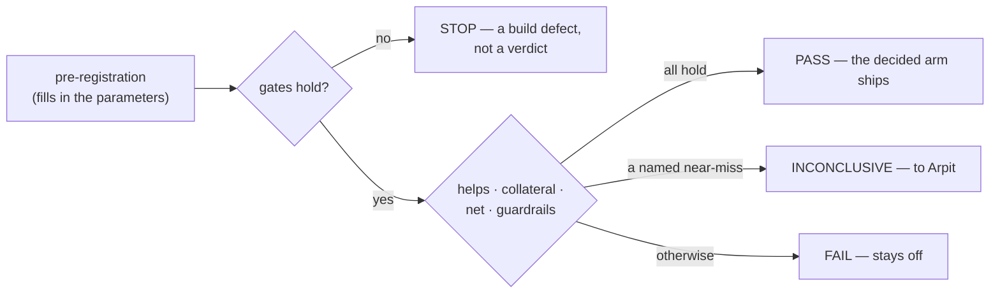

# SR-LAW-13 — L13 — a ranking change ships only through the standing bar

## §1 — For humans

> **This record is the HOME of law L13 — §2's first block IS the law**, and the
> rest of this record is its defaults, its outcome table and its rationale.
> [`CLAUDE.md` §Non-negotiable constraints](../CLAUDE.md) carries a
> **generated** one-line pointer, held equal by
> [`tests/test_claude_md_laws.py`](../tests/test_claude_md_laws.py) —
> [SR-LAW-0](0002_LAW-0-authority.md) decisions 1 and 5. ⚠ **`CLAUDE.md` is not
> the source**; amend the law here, then run `python scripts/gen-laws.py --write`.

**The one-line case.** Before this law, 44 pre-registrations each wrote their
own pass mark. On one day, 2026-10-10, the same feature met three different
bars: W-236's *zero rank-1 losses*, W-270's draft *net ≥ 6*, and a third
proposal. A bar chosen per test can be strict for one feature and lenient for
the next, and verdicts stop being comparable.

**The handle:** *A ranking change ships only through the standing bar.*
⚠ **A handle is not the law**; read the law in §2 below.

**The shape, in plain words** — the same for every ranking change:

| | question | default |
|---|---|---|
| **gates** | is the build what we think it is? | identical output when off; the run's own size bar |
| **helps** | does it clearly fix the questions it was built for? | SR-RS decision 19's paired floor, on the target slice |
| **limited collateral** | does it break only a few other questions? | at most 3 % of them, never fewer than 2 |
| **net positive** | is the whole set better off? | wins > losses |
| **guardrails** | does anything else quietly get worse? | hit@5, the quoted passage, the `grounded` band, latency |

**Diagram — Mermaid and its ASCII twin. Update both, always, together.**



<details>
<summary><b>ASCII twin</b> — the same diagram, for terminals, diffs, and any reader without a Mermaid renderer</summary>

```text
  pre-registration (fills in the parameters)
            |
            v
      gates hold? --no--> STOP  (a build defect, not a verdict)
            |
           yes
            v
  helps / collateral / net / guardrails
       |              |                 |
    all hold     named near-miss     otherwise
       v              v                 v
     PASS        INCONCLUSIVE         FAIL
  (decided arm    (to Arpit)       (stays off)
     ships)
```

</details>

---

## §2 — For agents

### The law (normative)

🔴 **This block IS law L13.** It is the only normative statement of it, and
[`CLAUDE.md` §Non-negotiable constraints](../CLAUDE.md) carries a **generated**
one-line pointer to it — rendered from this record's title by
[`scripts/gen-laws.py`](../scripts/gen-laws.py) and held equal by
[`tests/test_claude_md_laws.py`](../tests/test_claude_md_laws.py).
Amend it **here**, then run `python scripts/gen-laws.py --write`.
Amending a law needs Arpit's ruling, named in this record
([SR-LAW-0](0002_LAW-0-authority.md) decision 3).

<!-- LAW-TEXT:BEGIN L13 -->
- **L13** · **A ranking change ships only through the standing bar.** Every pre-registration that decides whether a change meant to improve what fux ranks may ship uses ONE shape and fills in only its parameters: **gates** (identical output when the change is off; the run's own size bar) · **helps** (on the target slice the change exists for, the paired net on the declared endpoint clears [SR-RS](0133_predictions.md) decision 19's floor at the observed flips) · **limited collateral** (on every other question, losses minus wins stay within the margin — by default 3 % of those questions, rounded down, and never below 2) · **net positive** (the whole-set net is above zero) · **guardrails** (the side measures this record names do not fall past their limits). **One arm is decided, and it is named before any number exists**; every other arm is reported only. **A question set on which one mechanism has already been decided may report another, never decide it.** A pre-registration may tighten any parameter; loosening one, or departing from the shape, needs Arpit's ruling named in it. The outcome is PASS, INCONCLUSIVE (handed to Arpit) or FAIL, by this record's table, and a run frozen before 2026-10-10 keeps the bar it froze.
<!-- LAW-TEXT:END L13 -->

### Context

- **Every bar was written per test.** 44 pre-registrations under
  `work/regression/` each chose their own clauses. Five used a *no new rank-1
  miss* clause; others used a net, a recall, or a band.
  [SR-RS](0133_predictions.md) supplies the pieces — decision 10b (a threshold
  never moves), decision 18 (a verdict table outranks a selection rule),
  decision 19 (the paired floor) — but never said what shape a ship bar has.
- **The case that forced it.** W-236 (section records) and W-269 (its gain-only
  variant) were both judged by a clause that allowed **zero** rank-1 losses
  anywhere. A ranking term that reaches every candidate moves the order of
  almost every query (W-269 moved it on 82 of 90), so a zero-loss clause blocks
  almost any change, however large its gain. W-269 at λ 2.0 fixed 12 questions
  at rank 1 and broke 5, and failed. W-270's first draft swung the other way
  with a whole-set *net ≥ 6*, which is looser than decision 19 itself once more
  than six questions flip.
- **The shape is the one medicine uses for a targeted treatment**: clearly
  better where it is aimed (superiority), not much worse anywhere else
  (non-inferiority within a stated margin).

### Decision

**1. What the law binds.** A change whose **purpose** is to improve a ranked
list fux returns — the documents `ask` and `find` order, or the passages
`answer` orders — and every change to a shipped ranking default.

- **Not bound:** a change that leaves every golden row identical (gate G0 alone
  shows it), and a defect fix whose ranking effect is a side effect. A defect fix
  that moves any rank-1 row on the golden set reports the moved rows and goes to
  Arpit before it merges.
- **Frozen runs keep their bars.** A pre-registration frozen before 2026-10-10
  is decided by the bar it froze ([SR-RS](0133_predictions.md) decisions 5 and
  10b). Reading an old run under L13 is **post-hoc**: it may be reported, it
  decides nothing, and a change it favours needs a new run under this law.

**2. The bar.** What is fixed is fixed for every change; what a pre-registration
fills in is listed beside it.

| row | fixed | the pre-registration fills in |
|---|---|---|
| **G · gates** | the change OFF is byte-identical to the engine without it, over every golden row; a change that adds committed bytes carries its own size bar | the feature's own gates (e.g. W-269's G3) |
| **C1 · helps** | the target slice's paired net on the endpoint **clears SR-RS decision 19 at the observed flips**, computed by [`tools/quality-controls/verdict.py`](../tools/quality-controls/verdict.py), never by hand | the slice (a tag on the question set); the endpoint (`hit@1`, `hit@5`, `section@1`, `primary@1`, with one sentence on why) |
| **C2 · limited collateral** | on every question outside the slice, `losses − wins ≤ margin` | the margin, only tighter than decision 3's default |
| **C3 · net positive** | the whole-set paired net on the endpoint is **above 0** | — |
| **GR · guardrails** | decision 3's side measures stay within their limits | extra guardrails the feature needs |
| **arms** | one decided arm, named before any number; the others are reported only | the decided arm and the reported grid |
| **data** | a fresh set, as decision 5 says | which set |

- **A change with no target slice** — `b`, the analyzer, a global weight —
  takes the whole set as its slice: C1 is decided on the whole set, C2 does not
  apply, and C3 is implied by C1.
- **Under L11 the slice is read from the scorer's counts**, never from a
  per-row tag. Where the slice is *the tagged questions that miss the endpoint
  at baseline*, a slice question cannot lose, so its net is its wins; C2 is the
  whole set's per-row flips less those wins. The frozen decider computes both.

**3. The defaults**, which a pre-registration may tighten and never loosen:

| | default |
|---|---|
| C2 margin | `max(2, floor(0.03 × questions outside the slice))` |
| slice size | the baseline arm's count of slice questions the change can win is **≥ 15**; below that the run **stops before any arm is read** |
| `hit@5` | falls by **at most 1** question |
| `section@1` (the scorer's `evidence_quoted`) | falls by **at most 2** |
| `grounded` band count | falls by **at most 2** |
| `ask` latency | the median rises by **at most 100 ms**, measured standalone on `rung-10000`, three runs per arm, never read from a loaded capture |

⚠ **The slice floor of 15 is stricter than the *pool ≥ 6* that steps used
before** (W-219). Six wins out of six flips is the only split that clears
decision 19 at six; at 15 a change has room to lose one and still clear.
**A run that needs a smaller slice says so and asks Arpit.**

**4. The outcome table governs; a selection rule only picks among values it
admits** ([SR-RS](0133_predictions.md) decision 18).

| outcome | condition |
|---|---|
| **STOP** | a gate fails, or the slice is below its floor — a build or data defect, never a verdict |
| **PASS** | C1, C2, C3 and every guardrail hold on the decided arm |
| **INCONCLUSIVE** → Arpit | either C1, C3 and the guardrails hold and C2 misses its margin by **1 or 2**; or C2, C3 and the guardrails hold and the slice net is **positive but below** decision 19's floor |
| **FAIL: drift** | C2 fails by more than 2, or C3 fails |
| **FAIL: no gain** | the slice net is 0 or below |
| **FAIL: guardrail** | a guardrail fails and no other row is INCONCLUSIVE |

- **The decider is frozen by hash before any build code exists**, and it is run
  by a hand that did not capture the arms ([SR-RS](0133_predictions.md)
  decision 6). Scoring stays under [L11](0013_LAW-11-sealed-answer-key.md).
- **A PASS ships only the decided arm's value.** A reported arm that would also
  have passed is a lead for a new run, never a default.

**5. Fresh data.** A question set on which a mechanism has been **decided**
may report a later mechanism aimed at the same slice, and may never decide it.
The later mechanism is decided on a set its family has not tuned against.
This is [SR-RS](0133_predictions.md) decision 9's *never ship off a single
corpus* applied to question sets, and it stops the second and third try on the
same 90 questions from becoming a search for the one that passes.

**6. What a pre-registration may change.** Any parameter in decision 2's
right-hand column, and any default in decision 3 in the **tighter** direction,
with no ruling. **Loosening a default, dropping a row, or adding a different
kind of clause needs Arpit's ruling, quoted in the pre-registration.** A
pre-registration that does neither states *"L13, defaults"* and its parameters.

**7. What this law does not restate.** How a run is filed, classified `blind` or
`informed`, authored, controlled and disclosed is [SR-RS](0133_predictions.md)'s
(decisions 10a, 11–15, 21c, 22–24). Decision 19's floor table is SR-RS's and is
read there. What *good* means for fux is [SR-WORK-QUALITY](0056_WORK-quality.md)'s.
L13 is the ship bar that sits on top of them.

### Consequences

- **Easier:** a pre-registration is mostly parameters, two verdicts can be
  compared, and nobody picks a lenient bar for a feature they like.
- **Harder:** a feature that fixes a narrow slice must still find **15**
  winnable questions, and a second attempt needs a fresh set, which is test-data
  work before any build.
- 🔴 **A cost paid deliberately: a change may now ship while breaking a few
  questions.** The default margin is 2 to 3 questions on a 90–125-question set.
  A user whose query is one of them sees a regression. Arpit traded that for
  not blocking every change that touches the order of all queries.
- **W-270 is the first run under this law.** Its draft clause 1 (*whole-set net
  ≥ 6*) is replaced by C1 + C3.

### Alternatives considered

- **Zero rank-1 losses (W-236's and W-269's clause 2).** Rejected: a term that
  reaches every candidate flips borderline queries, so the clause blocks almost
  any ranking change regardless of its gain.
- **A fixed whole-set net (W-270's draft, *net ≥ 6*).** Rejected: decision 19's
  floor grows with the flips, so a fixed six is looser than the project's own
  significance rule once more than six questions change.
- **A bar invented per test, as before.** Rejected: it is how three bars met
  one feature in one day.
- **A process record instead of a law.** Arpit chose a law: the bar decides
  what ships, and a record that a session may amend could be loosened by the
  session that wants a feature through.

### Reference (required)

- [SR-RS](0133_predictions.md) — decisions 5, 6, 9, 10b, 18, 19 and the
  measurement discipline this law sits on.
- [`work/regression/2026-10-10-section-records/VERDICT.md`](../work/regression/2026-10-10-section-records/VERDICT.md)
  and [`work/regression/2026-10-10-section-gain-only/VERDICT.md`](../work/regression/2026-10-10-section-gain-only/VERDICT.md)
  — the two runs whose clause 2 made the case.
- [`tools/quality-controls/verdict.py`](../tools/quality-controls/verdict.py) —
  where decision 19 is computed.
- [SR-LAW-11](0013_LAW-11-sealed-answer-key.md) — why a slice is read from counts.

### Veto condition

**Reopen if** a pre-registration frozen on or after 2026-10-10 decides a
ranking change by a bar that departs from decision 2's shape, or loosens a
decision 3 default, without Arpit's ruling quoted in it; or if a verdict ships
an arm that was not named as the decided arm before the score.

**How to check it:**

```bash
grep -L -E "L13|SR-LAW-13" work/regression/2026-1[0-2]-*/PRE-REGISTRATION.md
```

Every file listed is a pre-registration that does not cite this law. Read its
date and its subject: one frozen before 2026-10-10, or one that decides no
ranking change, is fine. Any other is a breach to raise.

---

## References

**Records** — [SR-RS](0133_predictions.md) · [SR-LAW-0](0002_LAW-0-authority.md) ·
[SR-LAW-11](0013_LAW-11-sealed-answer-key.md) · [SR-WORK-QUALITY](0056_WORK-quality.md) ·
[SR-LAWS](0001_LAWS.md)

**Code** — [`tools/quality-controls/verdict.py`](../tools/quality-controls/verdict.py)

**Measured evidence**

- [`work/regression/2026-10-10-section-records/VERDICT.md`](../work/regression/2026-10-10-section-records/VERDICT.md)
- [`work/regression/2026-10-10-section-gain-only/VERDICT.md`](../work/regression/2026-10-10-section-gain-only/VERDICT.md)
