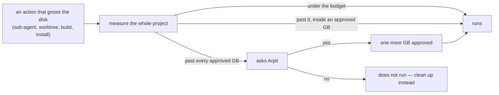

<!-- COMPONENTS-START — GENERATED from records/README.md's OWNERSHIP and DESCRIBES tables by scripts/gen-components.py. Do not edit by hand: change the table, then run `python scripts/gen-components.py --write`. -->

<!-- COMPONENTS-END -->

# SR-LAW-14 — L14 — `work/MACHINE.md`'s budget section is always followed

## §1 — For humans

**The law (L14).**

> **[`work/MACHINE.md`](../work/MACHINE.md)'s budget section is always followed** — by every session and every agent in it, Claude Code or Cowork, main agent or sub-agent. Today it holds one budget: **5 GB of disk per project, all agents combined.** Past it, **every further GB needs Arpit's approval, asked before that GB is used.** A number in that section changes only by Arpit's ruling; an agent never raises its own ceiling.

**Ruled by Arpit, 2026-10-24:** *"no agent in one project should consume more than 5 GB. Even sub agents shouldn't go beyond 5 GB … one main agent, there are two sub agents combined, it should not cross 5 GB."* — then *"So 5 GB is the limit. If it goes beyond it, ask me for my approval on every GB that it increases, and create a law that machine.md should always, machine.md budget section should always be followed."*

**Why it exists.** The laptop's disk reached 100 %. Agents ran in parallel, each
in its own worktree with its own build output, and nothing added them up — one
project's build folder alone reached 15 GB. A budget nobody measures is a wish;
this law makes it a number that is measured before every action that grows it.



<details>
<summary><b>ASCII twin</b></summary>

```text
   grows the disk --> measure the whole project --+--> under budget ............ runs
                                                   +--> past it, approved GB .... runs
                                                   +--> past every approved GB -> ask Arpit
                                                                                  yes: +1 GB, runs
                                                                                  no:  clean up instead
```

</details>

---

## §2 — For agents

### Context

`work/MACHINE.md` records how each surface behaves. Its **budget section** is
the one part of it that is not a description but a limit, and a limit only
holds if it outranks the session that wants to exceed it — so it is a law.

<!-- LAW-TEXT:BEGIN L14 -->
- **L14** · **The machine budget is always followed.** [`work/MACHINE.md`](../work/MACHINE.md)'s budget section binds every session and every agent in it — today, 5 GB of disk per project, all agents combined; past it, every further GB needs Arpit's approval before it is used. Only Arpit changes the number.
<!-- LAW-TEXT:END L14 -->

### Decision

1. **The budget section of `work/MACHINE.md` is normative.** The rest of that
   file describes surfaces; the `## Disk budget` section binds, as this law.
   Its `budget` row is the one place the number lives —
   `.claude/hooks/disk-budget.py` reads it from there.
2. **What counts, all together:** the repo (its `.git` and every worktree under
   it included), every git worktree outside it, and all build output — the
   main session and every sub-agent combined. Shared caches outside the repo
   (`~/.cargo`, the pnpm store, pip's cache) do not count.
3. **Under the budget nothing is asked. Past it, every further GB is approved
   before it is used** — one yes approves exactly one GB. A new sub-agent or
   worktree asks from 90 % of the approved ceiling, since one can cross it on
   its own. Back under the budget, the approvals are forgotten.
4. **Claude Code enforces it** with `.claude/hooks/disk-budget.py`: `PreToolUse`
   raises a permission prompt for an action that would grow the project into
   an unapproved GB; `PostToolUse` records a yes and says so the moment the
   project has grown past what was approved; every prompt shows the usage from
   80 % of the budget.
5. **A Cowork session runs no hooks, so it keeps the law by hand:** it measures
   (`du -sh` of the repo) before it starts agents, worktrees or builds, and asks
   Arpit in chat before going past the budget or an approved GB.
6. **Only Arpit changes the number** — the section's row is edited in the same
   change that records the ruling in the worklog. Going past it with approval
   is not changing it.

### Consequences

- Fewer agents run at once on a full project; the prompt makes the cost of the
  next one visible before it is paid.
- **What it cannot do:** a single command that is already running can grow past
  the approved GB before it finishes — the hook asks *before* an action and
  measures *after* it, and the next growing action asks again.
- A measurement is reused for 60 seconds, so a burst of tool calls costs one
  `du`.

### Alternatives considered

- **A hard refusal at 5 GB** — rejected by Arpit: past the budget the answer is
  a question per GB, not a wall.
- **A budget per agent** — rejected: the ruling is *combined*; a sub-agent spends
  the same disk as its parent.
- **The number in `.claude/settings.json`** — rejected: two homes for one number;
  `work/MACHINE.md` is the one the law names.

### Reference (required)

- [`.claude/hooks/disk-budget.py`](../.claude/hooks/disk-budget.py) — decision 4.
- [`work/MACHINE.md`](../work/MACHINE.md) §Disk budget — decision 1.

### Veto condition

**Reopen this decision if:** a project sits past its approved ceiling with nobody asked.

**How to check it:** `python3 .claude/hooks/disk-budget.py fresh` — the usage must be under the budget, or under the GB Arpit approved.

---

## References

**Code** — [`.claude/hooks/disk-budget.py`](../.claude/hooks/disk-budget.py)

**Project docs** — [`work/MACHINE.md`](../work/MACHINE.md)
