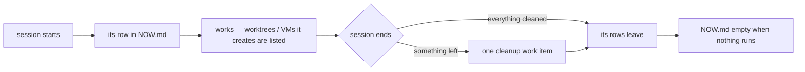

<!-- COMPONENTS-START — GENERATED from records/README.md's OWNERSHIP and DESCRIBES tables by scripts/gen-components.py. Do not edit by hand: change the table, then run `python scripts/gen-components.py --write`. -->

**Owns** — the components this record decides:

- [`.claude/hooks/now-ledger.py`](../.claude/hooks/now-ledger.py) · file

<!-- COMPONENTS-END -->

# SR-WORK-NOW — `work/NOW.md` holds only what is live

## §1 — For humans

**[`work/NOW.md`](../work/NOW.md) answers one question: what is being worked on
right now?** One row per live session — Claude Code or Cowork — and, under it,
whatever those sessions have created and not yet cleaned (a worktree, a VM).
When nothing is running, it is empty.

**When a session ends, it leaves nothing behind in NOW.md.** Anything it created
and did not clean becomes one work item first, so the cleanup is queued, not
forgotten — and then every row of that session is removed.

**Ruled by Arpit, 2026-10-24:** *"now.md should track everything that is being worked in the chat right now, either through Claude Cowork or through Claude Code. But once it ends, now.md should have nothing … when the session is about to end, if there is any cleanup that is supposed to happen and that hasn't been done … create work items, but make sure now.md is empty."*



<details>
<summary><b>ASCII twin</b></summary>

```text
   session starts --> its row --> works (what it creates is listed) --> session ends
                                                                          |
                                     something left? -> one cleanup work item
                                                                          |
                                         its rows leave --> NOW.md empty when nothing runs
```

</details>

---

## §2 — For agents

### Context

NOW.md began as one overwritten line, "where the last session stopped". Two
sessions overwrote each other's line, and a line written days ago still read as
the present. A file that claims to say what is happening now must lose a row the
moment that thing stops — and what a session leaves behind belongs in the queue,
where someone will pick it up, not in a live view.

### Decision

1. **`work/NOW.md` holds only what is being worked on right now — and is empty
   when nothing is** (Arpit, 2026-10-24). It is never a status note: what waits on
   someone lives in `work/OPEN-WORK.md` and `work/BLOCKED.json`; the next step
   lives in `work/INTERVIEW.md` and the worklog.
2. **One row per live session** under `## In flight` —
   `session · surface · started · working on`. The session keeps its own
   `working on` cell true (with the W-id when it has one) and never edits
   another session's row.
3. **What a live session creates is a row under `## Resources this session
   created`** until it is cleaned — a worktree, VM, container, scratch clone or
   per-lane build folder: `kind · where · host · session · created`. Git
   worktrees are added by `now-ledger.py`; a path row drops once the path is
   gone; a VM row is written and removed by hand.
4. **When a session ends, what it left is cleaned or queued, and then every row
   of that session leaves NOW.md.** A worktree is removed automatically when
   nothing in it can be lost, or else becomes a `🔴` item blocked on Arpit;
   any other kind becomes a `🟢 agent` cleanup item —
   [SR-WORK-CLEANUP](0070_WORK-cleanup.md) decides which.
5. **A dead session is closed the same way** at the next session's first
   prompt — one with no heartbeat for 6 hours, or, having none (a Cowork
   session), whose row started more than 6 hours ago.
6. **A Cowork session runs no hooks, so it keeps NOW.md by hand:** it adds its
   row when it starts, files the cleanup work item itself for anything it
   leaves, and removes its rows before it ends.
7. **NOW.md is tracked.** A commit made mid-session carries the live rows; at
   rest the file is its two empty tables.

### Consequences

- **Kept by `.claude/hooks/now-ledger.py`:** `start` on `SessionStart` (adds the
  row, closes dead sessions), `show` on every prompt, `sync` after Bash, Agent
  and worktree calls, `stop` on `Stop` (asks once for an empty `working on`
  cell), `end` on `SessionEnd` (cleans or queues what the session left — SR-WORK-CLEANUP — then removes the rows).
- A crash loses nothing that matters: the row survives until the next session
  closes it, and its leftovers become a work item then.
- `require-progress.sh` ([SR-WORK-SESSION](./0060_WORK-session.md)) still nudges a session that
  changed files without ever saying what it was doing.

### Alternatives considered

- **One overwritten line** — the rule until 2026-10-24; retired: a second session
  overwrote the first, and a line days old still read as now.
- **Resource rows that stay until cleaned** — proposed the same day, never
  installed; rejected by Arpit: NOW.md must be empty when nothing runs, and a
  leftover is a work item.
- **Untracking NOW.md** — rejected: it is a registered doc, and a Cowork session
  on another surface reads it from the tree.

### Reference (required)

- [`.claude/hooks/now-ledger.py`](../.claude/hooks/now-ledger.py) — decisions 2–5.
- [`work/NOW.md`](../work/NOW.md) — the file itself.

### Veto condition

**Reopen this decision if:** NOW.md carries a row older than 6 hours while nobody is working.

**How to check it:** `python3 .claude/hooks/now-ledger.py show </dev/null` closes dead sessions; afterwards every row left must belong to a session that is running.

---

## References

**Records** — [SR-WORK-CLEANUP](./0070_WORK-cleanup.md) · [SR-WORK-SESSION](./0060_WORK-session.md) · [SR-WORK-OPEN-QUEUE](./0051_WORK-open-queue.md)

**Code** — [`.claude/hooks/now-ledger.py`](../.claude/hooks/now-ledger.py)

**Project docs** — [`work/NOW.md`](../work/NOW.md) · [`work/OPEN-WORK.md`](../work/OPEN-WORK.md)
