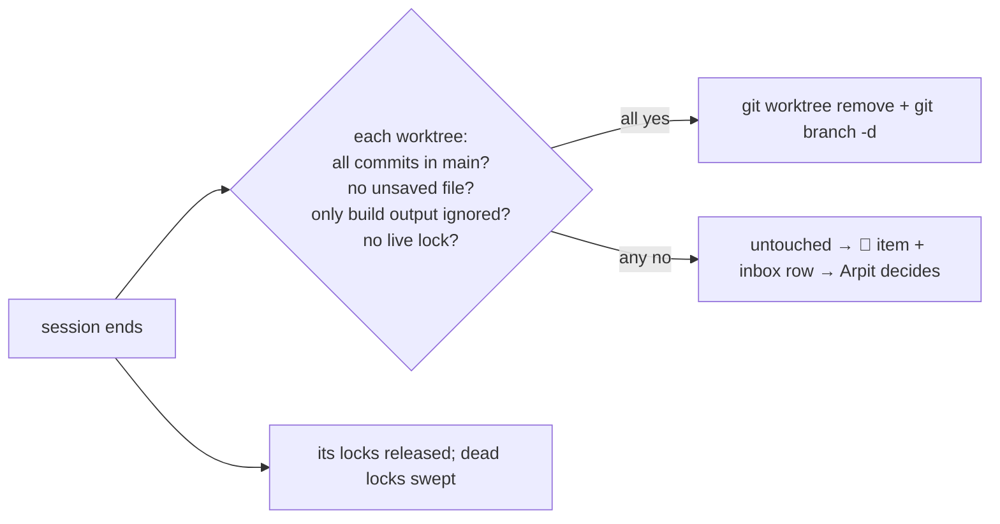

<!-- COMPONENTS-START — GENERATED from records/README.md's OWNERSHIP and DESCRIBES tables by scripts/gen-components.py. Do not edit by hand: change the table, then run `python scripts/gen-components.py --write`. -->

**Owns** — the components this record decides:

- [`.claude/hooks/release-locks.sh`](../.claude/hooks/release-locks.sh) · file
- [`.claude/hooks/worktree-cleanup.py`](../.claude/hooks/worktree-cleanup.py) · file

<!-- COMPONENTS-END -->

# SR-WORK-CLEANUP — worktrees, lock files, leftovers

## §1 — For humans

**Cleanup happens by itself, and it never loses anything.** When a session ends,
each worktree it made is removed — but only if every commit in it is already in
`main` and no file in it would be lost. If anything would be lost, nothing is
touched: the worktree becomes a **red item, blocked on Arpit**, who decides
whether to keep it or drop it. Every lock a session takes is cleaned too.

**Ruled by Arpit, 2026-10-24:** *"whenever .lock file is created, it needs to be cleaned out as well"* — and then *"whenever a work tree's cleanup happens, always make sure everything is merged into main branch and no data is lost. If any data is supposed to be lost, mark it as red, block it on me, and I'll make a call. Otherwise, automatically do the cleanup when the session ends. Create a work SR for work trees, lock files, cleanup."*



<details>
<summary><b>ASCII twin</b></summary>

```text
   session ends --> each worktree: all commits in main? no unsaved file?
                                   only build output ignored? no live lock?
                       all yes --> git worktree remove + git branch -d
                       any no  --> untouched -> red item + inbox row -> Arpit decides
                --> its locks released; dead locks swept
```

</details>

---

## §2 — For agents

### Context

Agents create worktrees by the dozen and lock files by the hundred. Left alone
they filled the disk and wedged git; cleaned carelessly, they would delete the
one unmerged commit or unsaved file that mattered. The line between the two is
mechanical — *would anything be lost?* — so the cleanup is automatic on one side
of it and Arpit's call on the other.

### Decision

**Worktrees**

1. **A worktree is cleaned when its session ends — automatically, and only when
   nothing can be lost.** Nothing is lost when all four hold: (a) its `HEAD` is
   already in `main` — every commit merged; (b) it has no modified, staged,
   deleted or untracked file; (c) every ignored file in it is build output (the
   list in `worktree-cleanup.py`: `target`, `node_modules`, `dist`, `build`,
   `.venv`, the tool caches …); (d) no live process holds its lock.
2. **Cleaning is `git worktree remove` — never `--force` — then `git branch -d` —
   never `-D` — then `git worktree prune`.** Git refuses either one if the check
   in decision 1 was wrong, so a bug there cannot lose data.
3. **If anything would be lost, it is red.** The worktree is left untouched. One
   `🔴` work item, ball `arpit`, lists each such worktree with its reasons, and a
   row goes into the *Blocked on Arpit* inbox. Arpit rules per worktree:
   **keep** (merge it or commit the files; the next cleanup removes it) or
   **drop** (only then may an agent use `--force` or `-D`).
4. **Cleanup never merges.** A merge is a code decision with conflicts in it; an
   unmerged branch is a question for Arpit, not a chore.
5. **A dead session's worktrees** ([SR-WORK-NOW](0069_WORK-now.md) decision 5) are cleaned
   the same way at the next session's first prompt.
6. **At any time:** `python3 .claude/hooks/worktree-cleanup.py` reports every
   worktree's verdict; `--apply` removes the safe ones. A red one is never
   touched.

**Other leftovers**

7. **A VM, container or scratch clone** cannot be checked by git, so it becomes a
   `🟢 agent` cleanup item under the same rule: clean it only if nothing is lost;
   otherwise turn the item red and put it to Arpit.

**Lock files**

8. **Every lock a session takes is cleaned.** Per-asset write locks
   (`.claude/.locks/<key>/`, taken by `session-lock.sh` —
   [SR-WORK-BLOCKERS](0064_WORK-blockers.md) decision 7) are keyed by the session's id, swept
   by `session-lock.sh` on every write once past their 900-second TTL, and a
   session's own are released by `release-locks.sh` on `Stop` and `SessionEnd`.
9. **A git lock file** — `index.lock`, `HEAD.lock`, a ref's or a worktree's
   `.lock` — older than 10 minutes while no git process runs is removed by
   `release-locks.sh`; on a surface that cannot unlink it is renamed into
   `.git/_stale_locks/`.
10. **A worktree lock whose pid is dead is stale** and is lifted as part of
    decision 2; one held by a live process, or naming no pid, is red (decision
    3). `work/NOW.md`'s own lock (`.claude/.now.lock`) is reclaimed after 30
    seconds.

**Surfaces**

11. **The Cowork bridge cannot unlink, so a Cowork session cannot clean.** It
    files the item instead — `🟢` if nothing would be lost, `🔴` with an inbox
    row if something would.

### Consequences

- `SessionEnd` can take seconds while a worktree is removed; its hook timeout is
  60 seconds. A removal cut short leaves tracked files missing, which the next
  check reads as red — the safe direction.
- An ignored file outside the build-output list is red even if it could be
  regenerated. That is deliberate; the list grows only by Arpit's ruling.
- `.claude/hooks/now-ledger.py` ([SR-WORK-NOW](0069_WORK-now.md)) calls this record's
  module at `SessionEnd` and files the items of decisions 3 and 7.

### Alternatives considered

- **Merge before cleaning** — rejected: decision 4.
- **Remove whatever is pushed upstream** — rejected: the bar is *in `main`*, not
  *somewhere on a remote*.
- **A periodic sweep** — rejected: the end of a session is when the owner of a
  worktree is known; a dead session is caught at the next prompt anyway.

### Reference (required)

- [`.claude/hooks/worktree-cleanup.py`](../.claude/hooks/worktree-cleanup.py) — decisions 1–6 and 10.
- [`.claude/hooks/release-locks.sh`](../.claude/hooks/release-locks.sh) — decisions 8–9.
- [`.claude/hooks/now-ledger.py`](../.claude/hooks/now-ledger.py) — calls them at `SessionEnd` (SR-WORK-NOW's).

### Veto condition

**Reopen this decision if:** a cleanup removed a commit or a file that was not in `main`.

**How to check it:** `grep -rnE -- "--force|branch -D|git clean" .claude/hooks/` must print nothing — the hooks never force, so git refuses any removal that would lose data.

---

## References

**Records** — [SR-WORK-NOW](0069_WORK-now.md) · [SR-WORK-BLOCKERS](0064_WORK-blockers.md) · [SR-WORK-OPEN-QUEUE](0051_WORK-open-queue.md)

**Code** — [`.claude/hooks/worktree-cleanup.py`](../.claude/hooks/worktree-cleanup.py) · [`.claude/hooks/release-locks.sh`](../.claude/hooks/release-locks.sh)

**Project docs** — [`work/NOW.md`](../work/NOW.md) · [`work/OPEN-WORK.md`](../work/OPEN-WORK.md)
