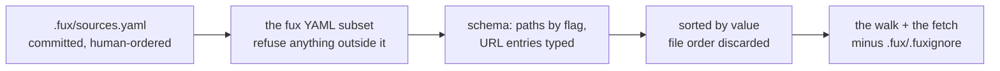

<!-- COMPONENTS-START — GENERATED from records/README.md's OWNERSHIP and DESCRIBES tables by scripts/gen-components.py. Do not edit by hand: change the table, then run `python scripts/gen-components.py --write`. -->

**Owns** — the components this record decides:

- [`node/src/ingest/sourcelist.mjs`](../node/src/ingest/sourcelist.mjs) · file
- [`node/src/ingest/yamlsubset.mjs`](../node/src/ingest/yamlsubset.mjs) · file
- [`src/fux/acquire/sourcelist.py`](../src/fux/acquire/sourcelist.py) · file
- [`src/fux/acquire/sourcesfile.py`](../src/fux/acquire/sourcesfile.py) · file
- [`src/fux/acquire/yamlsubset.py`](../src/fux/acquire/yamlsubset.py) · file

<!-- COMPONENTS-END -->

# SR-SOURCES — `.fux/sources.yaml`, the one committed include manifest

## §1 — For humans

**What fux indexes is one committed file**, `.fux/sources.yaml`. It lists two
kinds of source — paths in your repository and URLs fux fetches — and nothing
else. It is committed, so changing it changes the index every teammate clones.

```yaml
# .fux/sources.yaml — what fux indexes. Includes only; exclusions go in .fux/.fuxignore.

paths:
  include:
    - CHANGELOG.md
    - docs
    - records
  archived:          # indexed as history
    - archive
  enrich:            # in scope for `fux enrich`
    - docs

urls:
  - url: https://wiki.corp/display/ENG/runbook
    fetch: cdp
    decoder: html
    ttl: 7d
```

Three properties decide its shape.

- **Includes only.** Anything you do *not* want indexed goes in
  [`.fux/.fuxignore`](0144_fuxignore.md), the one place exclusion is spelled.
  Nothing in this file subtracts, and an entry starting with `!` is refused with
  a message that names `.fux/.fuxignore` — `!` has one meaning in `.fux/`, and
  it is `.fuxignore`'s *re-include*.
- **Order is for humans.** The loader sorts, so you may group entries however
  helps a reader and it cannot change a single committed byte
  ([SR-INGEST](0106_ingest.md)'s byte-reproducibility, applied to config).
- **Every value is text unless its key says otherwise.** The file is a strict
  YAML *subset* that fux reads itself: a path named `no`, `on` or `1.10` is that
  path, never `false` or a number. Anything outside the subset — `{}` / `[]`,
  anchors, tags, `---`, `|` blocks, tabs, a duplicate key, a path or URL listed
  twice — is a loud error naming the line.

**A path in any list is indexed; the list it sits in is its flag.** `include`
sets none, `archived` marks the documents as history (a declaration, never
derived from a path name — [SR-ARCHIVED-CONTENT](0134_archived-content.md)), and
`enrich` puts them in scope for `fux enrich` ([SR-ENRICH](0137_enrich.md)). A
path in two flag lists carries both flags.

**A URL entry states how it is reached and how it is read.** `url`, `fetch` and
`decoder` are required — there is no default fetcher and no default decoder —
and `keep`, `ttl`, `enrich`, `archived` and `update` are optional.
`fux add <URL>` writes the whole entry for you, with every attribute stated, and
fetches it once.

**You rarely edit it by hand, and when you do nothing is lost.** `fux add` and
`fux remove` edit the file *textually* — one line into the right list, or one
entry block under `urls:` — so every comment and your hand order survive.

**Diagram — Mermaid and its ASCII twin. Update both, always, together.**



<details>
<summary><b>ASCII twin</b> — the same diagram, for terminals, diffs, and any reader without a Mermaid renderer</summary>

```text
  .fux/sources.yaml     yaml subset          schema                sorted          walk / fetch
  +----------------+   +--------------+   +------------------+   +-------------+   +------------------+
  | committed      |-->| refuse {} [] |-->| paths: by flag   |-->| order is    |-->| minus            |
  | human-ordered  |   | & * ! --- |  |   | urls: typed      |   | DISCARDED   |   | .fux/.fuxignore  |
  +----------------+   +--------------+   +------------------+   +-------------+   +------------------+
                              |                    |
                              v                    v
                        error: <file>:<lineno>  (both readers, same words)
```

</details>

---

## §2 — For agents

### Context

**It has to merge.** The list reaches thousands of entries maintained by people
who do not coordinate. One entry per line is what lets two additions in the same
week land without a conflict.

**It has to be reviewable.** A source entering the index is a decision about
what an agent treats as authoritative. It belongs in a diff a human reads.

**It must not affect committed bytes.** Two people can hold the same set in
different orders; the index must not know. L4 applied to config.

**It has to be hand-editable** (Arpit, 2026-10-24: *"This looks very
unstructured and might be a bit hard to edit by hand"* → *"I would like to go
with YAML"*). That ruling is why the format is YAML rather than TOML, and why it
is a *subset*: generic YAML's implicit typing (`no` → false, `1.10` → 1.1) is
exactly the kind of silent reinterpretation a committed source list cannot
afford.

This record replaced two line-grammar files, `.fux/sources/dirs` and
`.fux/sources/urls` (W-294, Arpit 2026-10-24). They already shared one parser and
differed only in an attribute set; the real duplication was exclusion spelled in
two homes with opposite `!`. The directory list's record, SR-DIR-LIST, was
retired in the same change.

### Decision

**1. One committed include manifest, `.fux/sources.yaml`.** Its path is
`fux.toml [sources] sources_file` ([SR-CONFIG](0113_config.md)); the format is
not configurable. Declared committed by [SR-DOTFUX](0102_fux-directory.md). The
retired `dirs_file` and `urls_file` keys **error with instructions**
(SR-CONFIG decision 10), and while either retired list still exists on disk
**fux refuses to run** rather than guess which file was meant — the message
names `fux setup` (decision 20).

**2. The format is the fux YAML subset — read by fux's own hand-rolled reader,
twice.** L2 forbids a YAML package (and Python has no stdlib YAML), so
[`yamlsubset.py`](../src/fux/acquire/yamlsubset.py) and its Node twin
[`yamlsubset.mjs`](../node/src/ingest/yamlsubset.mjs) are hand-rolled, the
`config/toml.mjs` precedent.

- **Read:** block maps, block lists, plain / single-quoted / double-quoted
  strings, and `#` comments — at a line's start, or after whitespace, so
  `page#frag` is text and `page #frag` is a comment (YAML's own rule, which is
  also what keeps a URL fragment from being eaten).
- **Refused, loudly, `file:lineno`:** flow `{}` / `[]`, anchors `&` and aliases
  `*`, tags `!`, `---` / multiple documents, block scalars `|` `>`, tab
  indentation, duplicate keys.
- **Typing is the schema's, never YAML's guess.** Every path and URL is text;
  `keep`, `enrich`, `archived` accept only `true` / `false`; `ttl` is a duration
  (`0` or `<n><s|m|h|d>`); `update` is `auto` / `never`. So `no`, `on`, `null`,
  `~`, `1.10` and `010` stay text where text is expected.
- ⚠ **Accepted, not closed:** a generic YAML tool (an editor linter, a `yq`
  pipe) may read `no` as false. fux's reading is the authoritative one.

**3. The shape is two optional top-level keys and nothing else.**

- `paths:` — a map of the lists `include`, `archived`, `enrich`. Any may be
  absent; none may be empty. **A path in any list is indexed, and each list it
  is in sets that flag** (`include` sets none).
- `urls:` — a list of maps. Keys `url fetch decoder keep ttl enrich archived
  update`; `url`, `fetch` and `decoder` are required.
- **The kind is the section, never inferred** from a `scheme://` prefix.

**4. Includes only — `!` is refused.** An entry beginning `!` (a YAML tag, so the
subset refuses it anyway) gets a message that says exclusion lives in
[`.fux/.fuxignore`](0144_fuxignore.md) and gives the anchored pattern to write
there — the [SR-TYPES](0128_types-list.md) decision 2a / 12 precedent of a
refusal that names its fix. Exclusion's grammar, order semantics and the
ingest-written blocks are SR-FUXIGNORE's, and the conjunction that decides
whether a path is indexed — listed here, not excluded there, admitted by
`.fux/config/formats.toml` — has no precedence ([SR-INGEST](0106_ingest.md)
decision 24).

**5. The loader sorts; a duplicate is an error.** File order is presentation
only, and both readers sort by value by code point. **A path twice in one list,
or a URL twice, is a loud error naming both lines** — the file is hand-edited, and
a silent dedupe would hide a merge mistake. (A path in two *different* flag
lists is not a duplicate; it is two flags.)

**6. The list is intent, not state.** An entry present means *this document
belongs in the index*. A fetch that fails keeps the prior record and reports a
skip; only removing the entry removes the document
([SR-URL-INGEST](0107_url-ingest.md) decision 3). **The file never records fetch
outcomes.** A listed path that is not on disk stops `fux ingest` (exit 1);
`fux doctor`'s `listed directories exist` row names it ahead of time.

**7. An unknown key is a loud error naming `file:lineno`** — at the top level,
under `paths:`, and in a URL entry. A reader that does not know a key refuses
rather than guesses: silently ignoring one is how a typo'd `archvied:` quietly
indexes history as current.

**8. A path is repo-relative and names one place.** Not absolute, no `..`
segment, and never a URL — a `scheme://` under `paths:` is refused naming
`urls:`. `docs` and `docs/` are one path: the writer normalises the trailing
slash away before writing (URLs are exempt — a trailing slash there is the
server's business).

**9. A URL entry is `http(s)`, or it is a loud error naming `file:lineno`** —
never a silent skip. A typo'd scheme that quietly fetches nothing is worse than a
stopped run, because the corpus is then wrong in a way nothing surfaces.

**10. Three layers, one order.** The built-in default, then the source-wide
`[sources.url]` setting, then the entry. An entry beats both, for its own URL
only. `fetch` and `decoder` have no lower layer (decisions 16–17).

**11. Both key sets are closed.** Adding a key — a path list or a URL
attribute — is a change to this record, which is what makes decision 7's error
safe to be strict about: it is never wrong, because there is nothing legitimate
it can reject. **Closed is about KEYS, never values** — `fetch` and `decoder`
name files the consumer owns (decision 15).

### The attribute set

**Complete.** The *default* column is what a missing optional attribute means
to the reader; a fux-written entry states every attribute (decision 12), so in a
generated file it never happens.

| key | values | default when absent | defined by | changes committed bytes? |
|---|---|---|---|---|
| **`fetch`** | a module stem in `.fux/fetchers/` | **none — REQUIRED** | [SR-FETCHER](0117_fetcher.md) · [SR-HTTP-FETCHER](0119_http-fetcher.md) · [SR-CDP-FETCHER](0118_cdp-fetcher.md) | no — it selects who retrieves the document |
| **`decoder`** | a module stem in `.fux/decoders/` or a built-in, plus the reserved `prose` | **none — REQUIRED** | decision 17 · [SR-DECODE](0139_decode.md) | 🔴 **yes, and the only one** — it decides which decoder turns the bytes into the Markdown that is parsed |
| `keep` | `true` · `false` | `true` | [SR-ACQUIRED](0145_acquired-plane.md) decision 4 | no |
| `ttl` | `0` or `<n><s\|m\|h\|d>` | `24h`, or the source-wide value | [SR-URL-FRESHNESS](0147_url-freshness.md) | no — ask-time freshness |
| `enrich` | `true` · `false` | `false` | [SR-ENRICH](0137_enrich.md) | indirectly — a scope's documents gain a `ctx` field |
| `archived` | `true` · `false` | `false` | [SR-ARCHIVED-CONTENT](0134_archived-content.md) | no — it routes ranking |
| `update` | `auto` · `never` | `auto` | decision 14 | no — whether fux goes out at all |

**The path flags** are the `paths:` lists themselves — `archived` and `enrich`,
with the same meaning as the URL keys of the same name, and both **declared,
never derived**: no path heuristic and no `archive/` special case in code.

**Considered for the set and excluded:** fetcher tunables (`wait=`, `port=`,
`timeout=` — one fetcher's vocabulary, carried by `[sources.url.config]`
without fux learning it, [SR-FETCHER](0117_fetcher.md) decision 8); content
overrides (`title=`, `summary=` — the document owns its content,
[SR-EXTRACTED](0115_extracted-mode.md)); `snapshot` (a committed copy of
content is L3's reserved exception and opens only by amending L3); `tag`
(URL documents have no frontmatter; a tag would need its own decision in
SR-ENRICH, not a line here).

**12. A fux-written URL entry states every attribute, with the REPO's policy.**
`fux add` resolves `[sources.url]` before rendering, so the entry carries the
consumer's `ttl`, `keep`, `enrich`, `update` — an explicit flag beating both. A
generated entry holds no implicit state, and a policy change is a one-word diff.
⚠ Editing `[sources.url]` later does not reach an existing entry; the entry has
already spoken.

**13. The reader is lenient; the writer is strict.** A missing optional attribute
takes its default when read, so a hand-written entry still loads. An entry
missing any attribute **was not written by fux**, and `fux doctor`'s
completeness row reports it ([SR-DOCTOR](0152_doctor.md)). `fetch` and `decoder`
are the two exemptions — required, because neither has a layer below to be
lenient with.

**14. `update = auto | never` — whether `fux ingest` goes out for an entry at
all** (Arpit, ruling R-1).

- **Two words and no duration.** `ttl` is ASK-time ([SR-URL-FRESHNESS](0147_url-freshness.md));
  `update` is UPDATE-time. A duration here would make the two indistinguishable
  at a glance.
- **`fux add <URL> --no-update` writes `update: never` and still fetches once** —
  one fetch is what makes the entry ingestable. `cmd_add` passes the URL it just
  wrote as `first_fetch`, the one populator of that set.
- **The skip is `POLICY` and happens BEFORE the fetcher is resolved** — a fetcher
  import runs consumer module-level code, so pinned means *no import, no connect,
  no socket*. Pinning freezes a document; it never drops one.
- **`update: never` + `keep: false` is legal, lossy, and disclosed** by
  `fux doctor`; the coherent pair is `never` + `keep: true`, which answers
  `as-ingested` from `.fux/acquired/` ([SR-ACQUIRED](0145_acquired-plane.md)).
- 🔴 **This is not the ETag saving.** It buys bandwidth by giving up freshness;
  request-stage interception is not costed, not built and not authorised here
  ([SR-CDP-FETCHER](0118_cdp-fetcher.md) decision 12).

**15. `fetch` is typed by NAME SHAPE** (Arpit, W-178).
A consumer drops `.fux/fetchers/glassbox.py` in, writes `fetch: glassbox`, and
ingests — fetchers and decoders are one consumer-plane pattern. The validator
checks a module stem's shape (the same regex `decoder` uses) and **never
existence**: importing a fetcher to validate an entry would run consumer code
that may open a socket on a path L5 fences. Existence is checked at use time
and by `fux doctor`'s `fetcher bindings` row.

**16. `fetch` is REQUIRED** (Arpit, W-199). There is no source-wide fallback
(`[sources.url] fetcher` is deleted, [SR-FETCHER](0117_fetcher.md) decision 16a):
*"There is no default fetch. It is a mandatory argument."* `fux add` resolves
the routes table once and writes the stem; a later route change moves nothing,
and `fux doctor`'s `pinned fetchers` row reports the disagreement.

**17. `decoder` is REQUIRED — the other half of the pipe** (Arpit, 2026-09-18).
A URL has no trustworthy extension, so the entry names its decoder: a built-in,
a file in `.fux/decoders/`, or the reserved word `prose` for bytes that are
already text (`.fux/decoders/prose.py` is refused, [SR-DECODE](0139_decode.md)
decision 21). **Written once, at `fux add`, from what was observed**; the ingest
path never consults a header for routing again ([SR-URL-INGEST](0107_url-ingest.md)
decision 6a). The entry wins over the header; where they disagree about a format
with a signature the magic floor refuses the response ([SR-REFUSAL](0146_refusals.md)),
and `fux doctor`'s `url decoders` and `observed types` rows report the drift.
⚠ `fux add <URL>` opens the network twice — once to observe, once in the ingest
that follows; `--decoder <stem>` skips the observation.

**18. The writer edits text; it never re-renders the file.** `fux add` inserts
one line into the right `paths:` list, or one entry block under `urls:`, at its
sorted position, creating the section or list if absent; an add of an entry
already listed updates it in place. `fux remove` deletes that line or block.
Every comment, blank-line grouping and the rest of the hand order survive, and
the file is written LF-only with exactly one trailing newline regardless of host
OS. [SR-CLI](0101_cli-surface.md) owns the verbs; this decision is what they may
do to the file.

- **Removal has two branches, and which one it took is stated.** A path with its
  own entry is deleted **here**. A path covered by a listed ancestor gets an
  anchored pattern written to **`.fux/.fuxignore`** — the ancestor stays, so a
  sibling added later is still indexed. A path that is neither is an error
  naming both checks: *nothing to remove* and *you typed the wrong path* must
  not look the same. A URL is always removed by deleting its block.
- **An added file does not outrank the type allowlist.** `fux add
  docs/architecture.pdf` writes the entry, and the document is still skipped if
  `.fux/config/formats.toml` does not admit it — the verb says so and names the
  command that would. A `.fuxignore` `!` line may re-include, because it is a
  committed line a reader can find; a verb invocation leaves nothing to find
  ([SR-FUXIGNORE](0144_fuxignore.md) decision 4).
- **`fux add <URL>` fetches, and the fetch does not gate the write.** The entry is
  recorded first and stays recorded when the fetch fails; the failure is reported
  and exits 1. The *list* is not a function of network weather.

**19. Two readers, one outcome — held by a differential test.** The Python
reader ([`sourcesfile.py`](../src/fux/acquire/sourcesfile.py) over
`yamlsubset.py`) feeds the ingest; the Node reader
([`sourcelist.mjs`](../node/src/ingest/sourcelist.mjs) over `yamlsubset.mjs`)
feeds the query plane's archived set. Neither may accept a file the other
refuses, and both must say so in the same words:
[`tests/test_sources_yaml_differential.py`](../tests/test_sources_yaml_differential.py)
feeds both the same fixtures — every refusal, every typing trap — and compares
results, error text included. `tests/test_node_config_parity.py` holds Node's
URL attribute table equal to Python's `URLS` spec. The file name, section names
and every message live in `constants.toml` ([L12](0014_LAW-12-values-live-in-config.md)),
read by both planes.

**20. `fux setup` converts the retired lists, once, write-if-missing.** `dirs` +
`urls` → `.fux/sources.yaml`: plain path lines → `include`, `archived=true` →
`archived`, `enrich=true` → `enrich`, URL lines → entries with the attributes
they stated, comments carried where they sit. Each surviving `!` line becomes an
**anchored** pattern appended below the ingest blocks in `.fux/.fuxignore`. Then
the old lists are removed and `fux.toml`'s keys are rewritten to
`sources_file`. 🔴 **Order is a law: the `.fuxignore` write lands BEFORE `dirs`
is deleted** — on this repo the `!work/golden*` lines were an
[L11](0013_LAW-11-sealed-answer-key.md) guard, and a tree that excludes nothing
for one step is a breach, not a bug. **Breaking, by ruling:** there is no
reader for the old files beyond this conversion (the W-177 / W-199 stance).

<!-- L12-VALUES-START -->

**Where this record's fixed values live — [L12](0014_LAW-12-values-live-in-config.md).**
The manifest's file name, its section and list names, the retired files' names
and every refusal text are read from [`src/fux/constants.toml`](../src/fux/constants.toml)
(`[files] sources`, `[sources_file]`, `[sources_messages]`, `[yaml_subset]`,
`[source_attributes]`) by both planes, and a missing key stops the process naming
it ([SR-CONSTANTS](0159_constants.md)). `parse_duration` and the host-glob
matcher hold no numeral.

<!-- L12-VALUES-END -->

### Consequences

- **The breaking change costs a consumer one `fux setup`**, and the refusal
  that fires until they run it names the command.
- **Exclusion has one home and `!` one meaning.** The collision SR-FUXIGNORE
  used to call *accepted, not mitigated* — `!` subtracting in one `.fux/` file and
  re-including in the next — is closed.
- **A duplicate is now visible.** The cost: a clean-looking merge that lists a
  URL twice stops the load until someone deletes one entry, where the old
  grammar silently deduped it.
- **A second hand-rolled parser exists, in a second language.** That is the price
  of the YAML ruling plus L2, and decision 19's differential test is what keeps
  it from becoming the drift a second parser usually is.
- **Generic YAML tooling may disagree on a few scalars** (decision 2). The file's
  meaning is fux's reading.

### Alternatives considered

- **TOML** — the recommendation: readers already existed on both planes, and
  eight sibling `.fux/config/*.toml` files use it. Arpit chose YAML for
  hand-editing (2026-10-24); the price, a new reader twice, is accepted above.
- **One file holding exclusions too** — rejected: includes are loader-sorted and
  order-free (L4 on config) while an ignore file is last-match-wins, so order
  would matter in half of one file, `!` would need two meanings, and ~77
  ingest-written block lines would bury the ~10 source lines.
- **Per-entry attributes on paths** (`- {path: docs, archived: true}`) —
  rejected: a plain path would carry `{}`. Grouped flag lists keep the common case
  a bare list item. URLs keep per-entry attributes because `fetch` / `decoder`
  are mandatory on each.
- **Full YAML via a library** — refused by L2, and refused on its merits: implicit
  typing is the failure mode the subset exists to remove.
- **Silent dedupe** — rejected (decision 5): on a hand-edited file it hides the
  mistake a merge made.
- **A TOML array in `fux.toml`** — the original shape: one diff hunk, one merge
  conflict, and a corpus decision buried in config.

### Reference (required)

- The format and both writer operations —
  [`src/fux/acquire/sourcesfile.py`](../src/fux/acquire/sourcesfile.py) (`parse`,
  `set_path`, `set_url`, `remove`, `convert_legacy`), over
  [`src/fux/acquire/yamlsubset.py`](../src/fux/acquire/yamlsubset.py).
- The attribute specs and validators shared with `formats.toml`'s vocabulary —
  [`src/fux/acquire/sourcelist.py`](../src/fux/acquire/sourcelist.py) (`URLS`,
  `PATHS`, `parse_duration`).
- The Node twins — [`node/src/ingest/sourcelist.mjs`](../node/src/ingest/sourcelist.mjs),
  [`node/src/ingest/yamlsubset.mjs`](../node/src/ingest/yamlsubset.mjs).
- The two readers held equal —
  [`tests/test_sources_yaml_differential.py`](../tests/test_sources_yaml_differential.py).
- This repository's own manifest — [`.fux/sources.yaml`](../.fux/sources.yaml).
- YAML 1.2.2, §6.6 (comments) and §10 (the core schema's implicit typing this
  subset declines): <https://yaml.org/spec/1.2.2/>

### Veto condition

**Reopen this decision if** an entry is wanted that the subset cannot hold
without a refused construct (a multi-line value, a flow collection, an anchor) —
the subset would have to grow rather than bend. **Or** if the two readers are
ever found to disagree on a committed file: decision 19 is then not holding, and
a single shared reader (or generated code) becomes the question.

**How to check it:**

```bash
# 1. do the two readers still agree, error text included?
uv run pytest -q tests/test_sources_yaml_differential.py
# expect: all pass

# 2. does any committed manifest carry a construct the subset refuses?
grep -nE '^\s*-?\s*[!&*{\[]|: [|>]\s*$|^---' .fux/sources.yaml
# expect: no output

# 3. has a YAML dependency crept in?
grep -nEi 'pyyaml|ruamel|"yaml"|js-yaml' pyproject.toml node/package.json
# expect: no output — L2
```

---

## References

*Every source this record cites, gathered in one place. §2's **Reference
(required)** names the grounding; this is the complete list. An archived
document is never listed here — the body may name one, but archive is not
evidence.*

**Records** — [SR-LAWS](0001_LAWS.md) · [SR-LAW-11](0013_LAW-11-sealed-answer-key.md) ·
[SR-LAW-12](0014_LAW-12-values-live-in-config.md) · [SR-CLI](0101_cli-surface.md) ·
[SR-DOTFUX](0102_fux-directory.md) · [SR-INGEST](0106_ingest.md) ·
[SR-URL-INGEST](0107_url-ingest.md) · [SR-CONFIG](0113_config.md) ·
[SR-EXTRACTED](0115_extracted-mode.md) · [SR-FETCHER](0117_fetcher.md) ·
[SR-CDP-FETCHER](0118_cdp-fetcher.md) · [SR-HTTP-FETCHER](0119_http-fetcher.md) ·
[SR-TYPES](0128_types-list.md) · [SR-ARCHIVED-CONTENT](0134_archived-content.md) ·
[SR-ENRICH](0137_enrich.md) · [SR-DECODE](0139_decode.md) ·
[SR-FUXIGNORE](0144_fuxignore.md) · [SR-ACQUIRED](0145_acquired-plane.md) ·
[SR-REFUSAL](0146_refusals.md) · [SR-URL-FRESHNESS](0147_url-freshness.md) ·
[SR-DOCTOR](0152_doctor.md) · [SR-CONSTANTS](0159_constants.md)

**Code**

- [`src/fux/acquire/sourcesfile.py`](../src/fux/acquire/sourcesfile.py)
- [`src/fux/acquire/yamlsubset.py`](../src/fux/acquire/yamlsubset.py)
- [`src/fux/acquire/sourcelist.py`](../src/fux/acquire/sourcelist.py)
- [`node/src/ingest/sourcelist.mjs`](../node/src/ingest/sourcelist.mjs)
- [`node/src/ingest/yamlsubset.mjs`](../node/src/ingest/yamlsubset.mjs)
- [`tests/test_sources_yaml_differential.py`](../tests/test_sources_yaml_differential.py)

**Papers and specifications**

- YAML Ain't Markup Language, version 1.2.2 — the language this file is a strict
  subset of <https://yaml.org/spec/1.2.2/>
