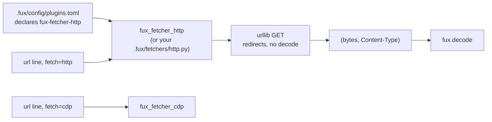

<!-- COMPONENTS-START — GENERATED from records/README.md's OWNERSHIP and DESCRIBES tables by scripts/gen-components.py. Do not edit by hand: change the table, then run `python scripts/gen-components.py --write`. -->

**Owns** — the components this record decides:

- [`packages/fux-fetcher-http/`](../packages/fux-fetcher-http) · dir

<!-- COMPONENTS-END -->

# SR-HTTP-FETCHER — the default fetcher

## §1 — For humans

Most documents worth indexing are served as HTML by a server that has already
rendered them. Requiring a browser for those is absurd — and that is exactly
what fux required for a while, because the only fetcher that existed drove
Chrome.

**The default is a plain GET.** A URL whose line carries no `fetch=` gets
`http.py`: `urllib.request`, follow redirects, return the bytes and the
`Content-Type` the server declared. A URL that needs a browser says so —
`fetch=cdp` — and that is the only way it happens.

The interesting part is **where it lives**. Putting `urllib` in `src/fux/`
would be the obvious move and would cost the adapter cap: core would hold
network code, and *"fux never fetches"* would become *"fux fetches, except when
it doesn't"*. Instead it is **its own package**, `fux-fetcher-http`, which
imports nothing from fux and which a repository runs only when its
`.fux/config/plugins.toml` declares it ([SR-PLUGINS](0165_plugins.md)). An engine fix
reaches you with the next install; and when you want to edit it, you copy it to
`.fux/fetchers/http.py`, which overrides the package and is yours — committed,
editable, reviewable.

**There is no automatic escalation.** If the plain GET returns a shell that
needed JavaScript, fux does not quietly retry through Chrome. It returns what it
got. Deciding a page needs a browser is a judgement a human makes once and
writes down, because the alternative is committed bytes that depend on how a
server felt that afternoon.

**Diagram — Mermaid and its ASCII twin. Update both, always, together.**



<details>
<summary><b>ASCII twin</b> — the same diagram, for terminals, diffs, and any reader without a Mermaid renderer</summary>

```text
  .fux/config/plugins.toml declares fux-fetcher-http
        |
        v
  fux_fetcher_http   <-- or YOUR .fux/fetchers/http.py, which overrides it
        ^
        |  url line with fetch=http
        |
  url line with fetch=cdp  -->  fux_fetcher_cdp

  both return (bytes, Content-Type); fux.decode converts.
  core src/fux/ still holds ZERO network lines — the fetcher is another
  distribution.  No escalation between the two, ever.
```

</details>

### Examples

**Captured from the build run** —
[`work/regression/2026-08-19-w54/report.md`](../work/regression/2026-08-19-w54/report.md).

*Before:* a URL source needed a browser, or a hand-written fetcher, for a page a
plain GET would have served.

```console
$ fux ingest
error: [sources.url] fetcher not found: .fux/fetchers/cdp.py
# exit 1
```

*After:* the default works with no fetcher decision at all, and the browser is
opt-in per line.

```console
$ cat .fux/sources.yaml
urls:
  - url: https://example.com/docs/api
    fetch: http
    decoder: html
  - url: https://wiki.corp/display/ENG/runbook
    fetch: cdp
    decoder: html

$ fux ingest
ingested 2 docs (2 changed), 0 skipped, 2 shards written
```

---

## §2 — For agents

### Context

The instruction was *by default a URL should be fetched without CDP*, and the
research agreed with the instinct's second half rather than its first: the
field's answer to "which pages need a browser" is either **explicit per-request
opt-in with no fallback** (`scrapy-playwright`) or **static-first with heuristic
escalation** (the crawler vendors). The heuristics exist because an open-web
crawler cannot enumerate its corpus. **Fux's URL list is committed and
enumerable**, so declaration is available, and declaration is strictly better:
it survives review, it diffs, and it produces the same bytes every run.

That left one genuinely open question — *where does the default fetcher live* —
and one defect that answered it: the default fetcher path already pointed at a
file fux neither wrote nor shipped, so "ship it and write it at setup" was
already the missing behaviour, not a new one.

### Decision

**1. A plain HTTP GET is the default.** A URL whose line carries no `fetch=`
attribute is fetched by `http.py`: `urllib.request`, redirects followed, the
response bytes and the `Content-Type` header returned to fux.

**2. It ships as its own package, `fux-fetcher-http`, and runs only when
declared** ([SR-PLUGINS](0165_plugins.md) P10) — never imported from `src/fux/`,
never written into the consumer's repo by `fux setup` or `ensure_layout`. The
package **imports nothing from fux and depends on nothing**, and fux executes it
only when a URL line says `fetch=http` and `.fux/config/plugins.toml` declares it at its
pinned version and digest. A repo that only wanted an index installs no network
code at all. **Core keeps zero network lines and zero network imports**, and the
adapter cap is structural rather than remembered. A consumer who needs a header,
a proxy or a token copies it to `.fux/fetchers/http.py`, which overrides the
package (P8). This repository's own unedited copy was deleted in W-289 phase 2
(2026-10-20), and [SR-DECODE](0139_decode.md)'s link to it repointed at the
package, so the declared `fux-fetcher-http` is what runs here too.

**3. There is no automatic escalation to another fetcher, ever.** Not on
non-2xx, not on an empty body, not on a rendered-shell heuristic. A plain GET
that returns something useless returns something useless, and a human writes
`fetch=cdp` on that line. [SR-FETCHER](0117_fetcher.md) decision 5 is the rule;
this is the case that would otherwise have broken it.

**4. ⚠ RETIRED 2026-09-20 (W-194), with ex-L5.** This read: *Hashed meta still
applies — ex-L5 is a property of the source, not of the transport, and a default
fetcher does not make a URL public.*

🔴 **The separation it drew is what survives, and it is worth more than the
rule was:** *what fetched a document* and *what may be committed about it* are
different questions, and a transport must never decide a policy. That is why
`fetch=` still records nothing on the record ([SR-SOURCES](0116_url-list.md)),
and it is the argument any future per-transport default has to get past.

**5. Both shipped fetchers are consumer code from birth.** Committed, editable,
never rewritten. Fux writing the first version does not make it fux's file — the
same relationship `.fux/README.md` already has.

**6. It converts nothing, and that is what makes agreement with `cdp.py`
structural.** `fetch()` returns bytes and a content type; `fux.decode` converts.

⚠ **The earlier version of this decision claimed something its test did not
check, and the claim survived for a week.** It said the HTML→Markdown pass here
was *"the same code"* as `cdp.py`'s and that a test asserted the two agree. It
was **four hand-maintained copies** — both working fetchers and both wheel
templates, the last two being what `fux setup` writes into every new consumer's
repo — and the cited test asserted the conversion was *deterministic* and
handled headings, **not that the copies agreed**. **A record asserting a
guarantee its cited test does not check is the failure mode Law zero exists
for.** There is now nothing left in either file that could disagree, and the
test asserts the copies are **absent** rather than that they currently match —
because a test that two copies agree passes right up until someone edits one.

**7. `MAX_PARALLEL = 8`.** A fresh `Request` per call makes `fetch` reentrant,
so this fetcher declares what is safe. ⚠ **That is a ceiling, not a request**:
an unconfigured repo gets `min(declared, DEFAULT_MAX_PARALLEL)`
([SR-CONFIG](0113_config.md) decision 7a), because *what is safe for this
module* was never a claim about what someone's intranet host can absorb. **If
the safe fetcher does not declare, the mechanism ships dead** — which is why it
declares rather than omitting.

**7a. `[sources.url.config] fetcher_max_parallel` overrides that `8`** (W-105,
2026-09-01). A consumer has always been able to change the constant — this file
is theirs — but changing it meant forking a shipped file over one integer, and a
forked file is a file that stops taking upstream fixes.

- **It does not move the capability/policy line, only who writes the capability
  down.** Fux still reads `MAX_PARALLEL` off the module and still takes
  `min(declared, configured)`; the number simply arrives from `configure()`
  instead of a literal. `configure()` runs before `resolve_parallel()` in
  `fetch_all`, which is what makes that work — **an ordering the two files do
  not state to each other, so a test asserts it.**
- ⚠ **The key is spelled the same in `cdp.py`, and it has to be.**
  `[sources.url.config]` reaches every fetcher verbatim
  ([SR-FETCHER](0117_fetcher.md) decision 8) and this file's `configure()`
  raises on a key it does not know, so an `http_`-prefixed name would break any
  repo that also loads `cdp.py`. **A tunable belonging in that table is one both
  fetchers have; anything else stays a module constant** —
  [SR-CDP-FETCHER](0118_cdp-fetcher.md) decision 4 carries the same rule from
  the other side.
- **It is `fetcher_max_parallel`, not `max_parallel`.** `[sources.url]
  max_parallel` is the politeness bound and this is the safety ceiling; two
  nested keys spelled alike is how the two get confused in a bug report.
- **Below 1 is refused, not clamped** — `_positive_int` names the key in the
  error. Same treatment `[sources.url] max_parallel` gets in
  [SR-CONFIG](0113_config.md): a silent clamp to 1 honours a number the
  consumer plainly did not mean.

### What it looks like

**Specimen, not a capture.** The shape is what decisions 1–3 fix; the exact
bytes are the package's.

**The whole fetcher.** It is short on purpose: the point of the contract is that
a useful fetcher is a page of stdlib, and the point of keeping it outside fux is
that this page is something you can copy into `.fux/fetchers/` and own.

```python
"""A plain GET — the fux-fetcher-http package, or your copy of it.

Copy it to .fux/fetchers/http.py to edit it: add headers, a proxy, a retry,
an auth token from your environment. Fux imports none of that — only the
entry points below.
"""
import urllib.request

MAX_PARALLEL = 8                  # a fresh Request per call: fetch is reentrant

_SETTINGS = {"timeout_s": 30, "user_agent": "fux/2.x"}

def configure(config: dict) -> None:
    _SETTINGS.update(config)          # [sources.url.config], verbatim

def fetch(url: str) -> tuple[bytes, str]:
    req = urllib.request.Request(url, headers={"User-Agent": _SETTINGS["user_agent"]})
    with urllib.request.urlopen(req, timeout=_SETTINGS["timeout_s"]) as resp:
        return resp.read(), resp.headers.get("Content-Type", "")
```

No `connect`/`close`: they are optional, and a stateless GET has no batch to
bracket ([SR-FETCHER](0117_fetcher.md) decision 2).

**The failure decision 3 refuses to paper over.** A client-rendered page returns
a shell, and fux indexes the shell:

```console
$ fux find "oncall rotation" --json | head -4
{
  "results": [
    {"score": 0.0000, "title": "Loading…", "loc": "https://app.corp/handbook"}
```

**A near-empty document is the signal**, and it is one a human reads once:

```console
$ cat .fux/sources.yaml
urls:
  - url: https://app.corp/handbook   # renders client-side
    fetch: cdp
    decoder: html
```

Fux does not retry through Chrome on its own. That is decision 3, and the
alternative — a classifier deciding what "too thin" means — is how a navigation
bar gets indexed as a runbook.

**2026-09-21 — the docstring gains the pipe; the GET does not move.**

`http.py` and its template twin now say that a fetcher retrieving bytes is only
half the sentence: the **line** names the decoder that converts them
([SR-SOURCES](0116_url-list.md) decision 17), `fux add` observes the type once,
and *if you are editing this file to change how a page becomes Markdown you are
in the wrong file* — which the docstring already said, and now says with the
mechanism that enforces it.

⚠ **Decision 3's no-escalation rule is untouched**, and the pipe strengthens the
argument for it: a plain GET that returns a rendered shell on a line declaring
`decoder=xlsx` is now **refused by the magic floor**
([SR-REFUSAL](0146_refusals.md)) rather than silently indexed as thin prose.

### Consequences

- ✅ **The thin-extraction case is REPORTED (2026-09-14, W-163).**
  `fux doctor`'s `url extraction depth` row names a `url:` record whose extracted
  text is a negligible share of its retained bytes — the shape this fetcher
  produces on a single-page app, where a full-size HTML shell decodes to its nav
  bar and the document indexes, answering nothing. Read from the committed index
  and `.fux/acquired/`; **no fetch, no second opinion about the page**.
  ⚠ **Advisory and deliberately loose.** It surfaces the obvious case and
  adjudicates no extraction quality; a tighter floor would need evidence nobody
  has gathered. `--cdp` is the remedy, and whether a given page needs a browser
  is the consumer's call about their own wiki.

- **URL ingestion works out of the box.** `[sources.url]` plus a list is enough;
  no fetcher decision is required to index a served page.
- **`fetch=` has exactly two values** — `http` (default, implicit) and `cdp`.
- **A shell page indexes as a shell page.** Decision 3 makes that visible rather
  than papered over. **This is the accepted cost of determinism**, and the
  alternative — a classifier — can silently index a navigation bar as a runbook.
- **Two shipped fetchers exist**, so `.fux/fetchers/` is genuinely plural and
  [SR-FETCHER](0117_fetcher.md) decision 6 stops being anticipatory.
- **A discovery aid is compatible with decision 3 and is not this record.**
  *"Which of my URLs came back suspiciously thin?"* is a real question;
  answering it in `fux doctor` as an **advisory** does not escalate anything.
  Advising is not escalating; retrying is.

### Alternatives considered

- **`urllib` inside `src/fux/`.** The obvious placement; L2 and L5 both survive
  (`urllib` is stdlib, and it would sit inside the same fence). Rejected because
  it spends the **adapter cap**, which is what has kept `src/fux/`
  dependency-free across two rebuilds. **Once core fetches once, every future
  "just add Confluence" argument gets easier.**
- **Static-first with automatic escalation to CDP.** What the crawler vendors
  do. Rejected under decision 3: same URL, two runs, different bytes, no record
  of why — L4 lost on the one path already excepted from it. Its own advantage
  (not paying browser cost per page) is delivered by declaration anyway.
- **Detect once, then write the verdict back into the URL list.** The strongest
  version of escalation, and genuinely deterministic after the first run. Held,
  not taken: it makes `ingest` a writer of a *human-maintained source file*,
  which is a new and larger behaviour than this record needs. It would be an
  explicit opt-in command, never a default.
- **A chained fetcher list.** Rejected: it contradicts
  [SR-FETCHER](0117_fetcher.md) decision 4, and it is where the adapter cap
  leaks least visibly — core would own fallback policy while claiming to own no
  fetching.
- **Ship `http.py` inside the wheel and import it.** Rejected: a fetcher fux
  imports is a fetcher fux owns, which is decision 2 undone.

### Reference (required)

- The contract it implements — [SR-FETCHER](0117_fetcher.md); the package —
  [`packages/fux-fetcher-http/`](../packages/fux-fetcher-http/).
- How a repository declares and loads it — [SR-PLUGINS](0165_plugins.md).
- The defect that made "write it out" the answer, and the capture that closed
  it — [`2026-08-19-w54`](../work/regression/2026-08-19-w54/report.md) §1.
- The per-URL attribute that selects a non-default fetcher —
  [SR-SOURCES](0116_url-list.md).
- Prior art: explicit per-request opt-in, no automatic fallback —
  https://github.com/scrapy-plugins/scrapy-playwright
- The position this record rejects, stated by its proponents —
  https://webclaw.io/blog/javascript-rendering-api-browser-fallback-web-scraping

### Veto condition

**Reopen this decision if** `src/fux/` gains a network call reachable from
`fux ingest`, or if any code path selects a fetcher without a human having
written the choice into the URL list. Either means the placement in decision 2
or the no-escalation rule in decision 3 has been abandoned, and the cap is gone
whichever way it happened.

**How to check it:**

```bash
# 1. core still holds zero network lines
grep -rn "urllib\|http.client\|socket\|requests" src/fux/ --include=*.py
# expect: no output — writing a template is a file write, not a connection

# 2. no escalation: nothing picks a fetcher that a line did not name
grep -rniE "fallback|escalat|retry_with|if .*failed.*cdp" src/fux/acquire/urlsrc.py
# expect: no output

# 3. the fetcher is not engine code, and imports none
ls src/fux/templates/http.py* 2>/dev/null; grep -n "^from fux\|^import fux" packages/fux-fetcher-http/src/fux_fetcher_http/__init__.py
# expect: no output
```

---

## References

*Every source this record cites, gathered in one place. §2's **Reference
(required)** names the grounding; this is the complete list. An archived
document is never listed here — the body may name one, but archive is not
evidence.*

**Records** — [SR-LAWS](0001_LAWS.md) · [SR-DOTFUX](0102_fux-directory.md) ·
[SR-CONFIG](0113_config.md) · [SR-SOURCES](0116_url-list.md) ·
[SR-FETCHER](0117_fetcher.md) · [SR-CDP-FETCHER](0118_cdp-fetcher.md) ·
[SR-DECODE](0139_decode.md) · [SR-PLUGINS](0165_plugins.md)

**Code**

- [`packages/fux-fetcher-http/`](../packages/fux-fetcher-http/)
- [`src/fux/plugins.py`](../src/fux/plugins.py)
- [`tests/decode/test_decode.py`](../tests/decode/test_decode.py)

**Measured evidence**

- [`work/regression/2026-08-19-w54/report.md`](../work/regression/2026-08-19-w54/report.md)

**Papers and specifications**

- `scrapy-playwright` — prior art for a per-request browser opt-in with no
  automatic escalation
  <https://github.com/scrapy-plugins/scrapy-playwright>
- Automatic browser fallback, stated by its proponents — the position this
  record rejects
  <https://webclaw.io/blog/javascript-rendering-api-browser-fallback-web-scraping>
