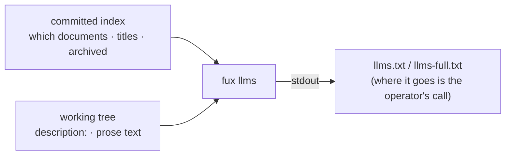

<!-- COMPONENTS-START — GENERATED from records/README.md's OWNERSHIP and DESCRIBES tables by scripts/gen-components.py. Do not edit by hand: change the table, then run `python scripts/gen-components.py --write`. -->

**Owns** — the components this record decides:

- [`scripts/gen-llms.py`](../scripts/gen-llms.py) · file
- [`src/fux/llms.py`](../src/fux/llms.py) · file

<!-- COMPONENTS-END -->

# SR-LLMS — llms.txt from the index

## §1 — For humans

[llms.txt](https://llmstxt.org/) is a Markdown file that tells a language
model what a project is and where its documents are: one H1, an optional
blockquote, then H2 sections of link lists (a name, its URL, an optional note), with a section
named `Optional` that a model may skip when its context is short.
`llms-full.txt` is a widely used convention, not part of the spec: the same
map followed by the documents' text.

**A fux index already knows the map** — which documents exist, what each is
called, which are archived. `fux llms` prints it. **fux contributes the
selection, never a copy**: the text comes from the working tree at the moment
you ask, and only to stdout.



<details>
<summary><b>ASCII twin</b> — the same diagram, for terminals, diffs, and any reader without a Mermaid renderer</summary>

```text
   committed index ---- which documents, their titles, archived? --+
                                                                   v
   working tree ------- each one's `description:`, prose text --> fux llms --stdout--> llms.txt
                                                                               (or llms-full.txt)
```

</details>

### Examples

From this repository:

```console
$ fux llms --in docs/GLOSSARY.md --title G --base-url https://raw.githubusercontent.com/arpitarya/fux/main/
# G

## docs

- [Glossary](https://raw.githubusercontent.com/arpitarya/fux/main/docs/GLOSSARY.md): Recurring terms in the fux repo, defined once, alphabetical.
```

---

## §2 — For agents

### Context

- **A model reading a repository cold reads its file tree**, which says
  nothing about which documents matter or what each one is for. The index
  holds titles; most documents in a fux corpus carry a one-line
  `description:`; the two together are an llms.txt.
- **L3 is the constraint that shapes it.** The index holds statistics, never
  content; an llms-full.txt is content. So fux may *render* one and may never
  *store* one — compare doc Fork 4, F1
  ([`editor-and-llms-surfaces.compare.md`](../work/compare/editor-and-llms-surfaces.compare.md)).

### Decision

1. **`fux llms` is a reader-layer verb that writes to stdout and nowhere
   else.** fux makes nothing about the corpus durable (L3); where the output
   goes is the operator's decision.
2. **The index decides which documents and their titles**: every record whose
   `loc` equals or starts with an `--in` prefix (all records when none is
   given), sorted by `loc` (L4). No selection matches → a `FuxError`, never an
   empty file.
3. **The shape is llms.txt's:** `# <title>` (default: the repository's
   directory name), `> <summary>` only when `--summary` is given, then one
   `## <section>` per top-level folder — the repository's root-level files
   first, under `[llms] root_section`; a URL document under its host — and
   **archived documents last, under `## Optional`**, the spec's skippable
   section, because they are history.
4. **The note on a link is the document's own `description:` frontmatter**,
   read from the file at render time and folded to one line; no description,
   no note. A URL document carries none: it is never fetched (L5).
5. **`--base-url U` prefixes every file link** (URL-quoted); without it links
   are repository-relative.
6. **`--full` appends each current prose document's body**, frontmatter
   removed, after a `---` separator and a `Source:` line, with the title as an
   H1 when the body opens without one. **Prose is the committed register's
   word**: a document a non-prose decoder reads — HTML, SVG, a spreadsheet —
   is listed and never inlined, because its bytes are not text a model should
   read as written. An archived document is listed and never inlined.
7. **The format's own words are `constants.toml [llms]`** — `Optional`, the
   root section, the separator, the source label (L12).
8. **This repository commits its own `llms.txt` and `llms-full.txt` at the
   root**, rendered by [`scripts/gen-llms.py`](../scripts/gen-llms.py) (`just
   llms`) with raw-GitHub links, and held byte-equal to that render by
   [`tests/test_llms.py`](../tests/test_llms.py). A copy inside the repository
   that owns the source is what L3 permits. `llms-full.txt` carries only what
   changes rarely: the README, the docs bundle, the paper and the Law records.

### Consequences

- **The committed pair lags the index by one ingest.** Titles come from the
  committed index; after retitling a listed document, run `fux ingest` and then
  `just llms`.
- **The repository's own `llms.txt` goes stale on any change to a listed
  document's description**, and the test says so with the command to run. That
  is the price of a generated view being bound (SR-LAW-0 decision 5).
- **PII redaction does not apply to `--full`**: it reads the working tree, as
  `fux_passage` and every answer quote do; the redaction ruleset governs the
  committed index alone ([SR-PII](0148_pii.md)).

### Alternatives considered

- **fux writing the files itself** — compare doc Fork 4, F2. Lost to L3: fux
  would be the one making a copy of the corpus durable.
- **No `--full`** — F3. Lost: the convention is what several agent hosts read,
  and stdout is safe.
- **Descriptions from the index** — the index holds no description field, and
  adding one would commit a sentence of content per document.

### Reference (required)

- [llmstxt.org](https://llmstxt.org/) — the llms.txt format.
- [`src/fux/llms.py`](../src/fux/llms.py); [`tests/test_llms.py`](../tests/test_llms.py).

### Veto condition

**Reopen this decision if:** a consumer needs URL documents' text in
`llms-full.txt` (that is a fetch, and L5's fence decides it), or the llms.txt
spec standardises a different full-text form.

**How to check it:** `python scripts/gen-llms.py` exits 0 while the
committed pair is current.

```console
$ python scripts/gen-llms.py; echo $?
0          # 2026-10-19 — not fired
```

---

## References

**Records** — [SR-LAW-3](0005_LAW-3-content-never-durable.md) · [SR-CLI](0101_cli-surface.md) · [SR-PII](0148_pii.md) · [SR-LSP](0163_lsp.md)

**Code**

- [`src/fux/llms.py`](../src/fux/llms.py)
- [`scripts/gen-llms.py`](../scripts/gen-llms.py)
- [`tests/test_llms.py`](../tests/test_llms.py)

**Project docs**

- [`work/compare/editor-and-llms-surfaces.compare.md`](../work/compare/editor-and-llms-surfaces.compare.md)

**Papers and specifications**

- Jeremy Howard, *The /llms.txt file* (2024) — the format this verb prints.
  <https://llmstxt.org/>
