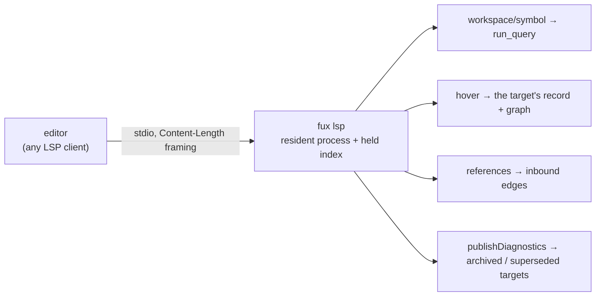

<!-- COMPONENTS-START — GENERATED from records/README.md's OWNERSHIP and DESCRIBES tables by scripts/gen-components.py. Do not edit by hand: change the table, then run `python scripts/gen-components.py --write`. -->

**Owns** — the components this record decides:

- [`src/fux/lsp.py`](../src/fux/lsp.py) · file

<!-- COMPONENTS-END -->

# SR-LSP — the Language Server

## §1 — For humans

`fux mcp` hands the index to an agent. Nothing handed it to the **person
editing the documents** — and the index already knows which documents exist,
what links to what, and what is archived or was superseded. `fux lsp` serves
that knowledge over the Language Server Protocol, the one protocol every
editor speaks, so VS Code, Neovim, Helix, Zed and JetBrains all reach the same
server.

**Four features, and none of them ranks or walks differently from a verb that
already exists:**

| in the editor | LSP method | what fux answers |
|---|---|---|
| Go to Symbol in Workspace | `workspace/symbol` | the query ranked by `run_query` — `fux ask`'s ranking — each hit placed at its best-matching heading |
| hover on a link | `textDocument/hover` | the target's title, archived or superseded (and by what), its commit date, links in and out |
| Find All References | `textDocument/references` | the documents that link to this one, at the link's own line |
| problems | `textDocument/publishDiagnostics` | a warning on every link to an archived or superseded document, as you type |



<details>
<summary><b>ASCII twin</b> — the same diagram, for terminals, diffs, and any reader without a Mermaid renderer</summary>

```text
   editor (any LSP client)
       |  stdio, Content-Length framing, LSP 3.17
       v
   fux lsp   (one resident process; the INDEX is held, re-keyed per request)
       +--> workspace/symbol          run_query -- `fux ask`'s ranking
       +--> textDocument/hover        the link target's record + its graph
       +--> textDocument/references   inbound edges = backlinks
       +--> publishDiagnostics        links to archived / superseded documents
```

</details>

### Examples

A whole session against this repository, framed by hand (trimmed):

```console
$ fux lsp
-> initialize
<- {"capabilities":{"positionEncoding":"utf-16","textDocumentSync":{"openClose":true,"change":1,...},
    "hoverProvider":true,"referencesProvider":true,"workspaceSymbolProvider":true},
    "serverInfo":{"name":"fux","version":"4.1.0"}}
-> textDocument/didOpen CLAUDE.md
<- textDocument/publishDiagnostics
   [{"range":{"start":{"line":395,"character":32},...},"severity":2,"source":"fux",
     "message":"links to an archived document: archive/README.md"}]
```

---

## §2 — For agents

### Context

- **An editor is a long-lived client**, like an agent host: one process per
  session, many requests. [SR-MCP](0136_mcp.md)'s reasoning holds — the
  interpreter's start-up is paid once, and the held index removes the shard
  parse from every request.
- **LSP's base protocol is a `Content-Length` header and a JSON body**
  ([LSP 3.17 §Base Protocol](https://microsoft.github.io/language-server-protocol/specifications/lsp/3.17/specification/#baseProtocol)).
  It is `json` and a byte stream; a library would bring every LSP feature to
  map four.
- **The design fork** — where the server runs and how the editor talks to it —
  is in [`editor-and-llms-surfaces.compare.md`](../work/compare/editor-and-llms-surfaces.compare.md),
  Fork 1 (L1, a Python verb).

### Decision

1. **`fux lsp` is a verb, stdlib-only, in the reader layer.** It is a
   long-running server, not a query ([SR-CLI](0101_cli-surface.md) §serve),
   and it imports nothing a reader-only install lacks.
2. **Four features, each a mapping of an existing reader:**
   `workspace/symbol` is `run_query` with `use_tune=True`; hover reads the
   target's record and `Graph` over `edges_from_records`, as `fux_related`
   does; references are the records whose `edges` name this document;
   diagnostics flag a link whose target record is `superseded` or `archived`.
   **No feature computes a score, a rank or an edge of its own.**
3. **Links are read from the live buffer, not from the committed edges.** A
   diagnostic must follow an unsaved edit, so inline links (bracketed text, then a parenthesised target) and
   reference definitions `[l]: target` are matched on the text the editor
   sent; the target is resolved against the document's folder (`/` is the
   repository root, `#anchor` and `?query` are dropped, a path that climbs out
   of the repository names nothing). The index answers only *what is that
   document*.
4. **Symbols are documents, kind `File`, located at the best-matching
   heading** — the first heading `headings_for` returns for the query, found in
   the file; line 0 when none matches. A `url:` document has no file and is not
   returned as a symbol.
5. **How many symbols a search returns is the person's number** — the `top`
   `fux ask` resolves from `.fux/output.toml` (`[cli.ask]`, then `[cli]`), read
   once at start-up. This is a surface for a person in an editor, so it reads
   the person's setting and not `[mcp]`'s; `--no-output-config` reads the
   template instead ([SR-OUTPUT](0143_output-defaults.md) decision 15).
6. **The index is resident** through `store.resident.Holder`, re-keyed before
   every request ([SR-MCP](0136_mcp.md) decision 13): an ingest is seen by the
   next request, never by a restart.
7. **Positions are UTF-16 code units**, LSP's default and the one encoding
   every client accepts; the server announces it as `positionEncoding`.
8. **The protocol obligations, each pinned by a test:** a notification is
   never answered; every request is — an unknown method gets `MethodNotFound`
   (`-32601`), a request before `initialize` gets `ServerNotInitialized`
   (`-32002`), a `FuxError` gets `RequestFailed` (`-32803`); a malformed body is
   a parse error and the server continues; `exit` returns `0` only after
   `shutdown`, otherwise `1`.
9. **Every fixed value is in `constants.toml [lsp]`** — the header name, the
   error codes, the enum values, the method names (L12); JSON-RPC's own version
   and reserved codes are `[mcp]`'s.
10. **`fux lsp` is excluded from `.fux/observers/` by name**, like `fux mcp`
    ([SR-OBSERVE](0157_observe.md)): a long-lived server calling consumer code
    per request is a different decision.
11. **No Node twin.** The verb is not a ranking surface and no parity test
    claims one; an editor that has Node also has the extension, which spawns
    this verb ([SR-VSCODE](0164_vscode.md)).

### Consequences

- **Any LSP client works with no fux-specific code** — the README of
  [`vscode/`](../vscode/README.md) shows Neovim's one line.
- **VS Code filters workspace symbols by their name**, so a ranked hit whose
  title does not spell the query is dropped from `Ctrl+T`. The extension's
  `Fux: Search the index` command is the full search; this method serves every
  other editor.
- **Diagnostics run on every change**: a regex over the buffer and a dict
  lookup per link against the held records. Cheap at the design point; a
  successor lookup (*superseded by what*) scans every record's edges, and runs
  only for a superseded target.
- **Link positions are found by the server's own regex**, which is not the
  ingest's link extractor: a link shape the ingest records and the regex does
  not match is a backlink placed at line 0 rather than at its line.

### Alternatives considered

- **A Node verb in `fux.mjs`, or the server inside the extension** — compare
  doc Fork 1 (L2, L3). Lost: one editor, or a third reader.
- **`vscode-languageclient` and a server library** — compare doc Fork 2.
  Lost to SR-MCP decision 1's reasoning: four features do not need a framework.
- **Definition (go to the link target)** — not built: every Markdown editor
  already resolves a relative link, and fux would answer the same thing.
- **A completion provider for link targets** — not built: four features, each
  something only the index knows.

### Reference (required)

- [LSP 3.17 specification](https://microsoft.github.io/language-server-protocol/specifications/lsp/3.17/specification/) — framing, lifecycle, the four methods, error codes.
- [`src/fux/lsp.py`](../src/fux/lsp.py); its tests — [`tests/test_lsp.py`](../tests/test_lsp.py)
  and [`tests_e2e/test_lsp_verb.py`](../tests_e2e/test_lsp_verb.py), which drives
  the real verb with the extension's own client.
- [`editor-and-llms-surfaces.compare.md`](../work/compare/editor-and-llms-surfaces.compare.md).

### Veto condition

**Reopen this decision if:** a second editor's users report the cold start of
`fux lsp` as the reason they stopped using it (compare doc reopen-trigger 1),
or a fifth LSP feature is asked for.

**How to check it:** the e2e session in `tests_e2e/test_lsp_verb.py` times the
whole exchange; a regression there is the first signal.

```console
$ uv run pytest -q tests_e2e/test_lsp_verb.py
...                                                                      [100%]
3 passed in 0.71s          # 2026-10-19 — not fired
```

---

## References

**Records** — [SR-MCP](0136_mcp.md) · [SR-CLI](0101_cli-surface.md) · [SR-OUTPUT](0143_output-defaults.md) · [SR-OBSERVE](0157_observe.md) · [SR-VSCODE](0164_vscode.md)

**Code**

- [`src/fux/lsp.py`](../src/fux/lsp.py)
- [`tests/test_lsp.py`](../tests/test_lsp.py)

**Project docs**

- [`work/compare/editor-and-llms-surfaces.compare.md`](../work/compare/editor-and-llms-surfaces.compare.md)

**Papers and specifications**

- Microsoft, *Language Server Protocol Specification 3.17* (2022) — the base protocol and every method this server answers.
  <https://microsoft.github.io/language-server-protocol/specifications/lsp/3.17/specification/>
