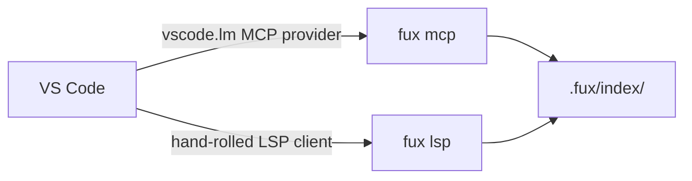

<!-- COMPONENTS-START — GENERATED from records/README.md's OWNERSHIP and DESCRIBES tables by scripts/gen-components.py. Do not edit by hand: change the table, then run `python scripts/gen-components.py --write`. -->

**Owns** — the components this record decides:

- [`scripts/build-vsix.py`](../scripts/build-vsix.py) · file
- [`vscode/`](../vscode) · dir

**Describes** — reaches into, does not own:

- [`src/fux/lsp.py`](../src/fux/lsp.py) · owned by [SR-LSP](0163_lsp.md)

<!-- COMPONENTS-END -->

# SR-VSCODE — the VS Code extension

## §1 — For humans

One install puts the index in VS Code two ways. **For agent mode**, the
extension registers `fux mcp` through VS Code's own MCP API for every folder
that has a `.fux/index/`, so Copilot and any other MCP client in the editor see
`fux_search`, `fux_passage` and `fux_related` with no `mcp.json` to write.
**For the person**, it runs `fux lsp` ([SR-LSP](0163_lsp.md)): a search
command, hovers on links, backlinks, and warnings on links to retired
documents.

**The extension holds no index logic.** Both halves are `fux` verbs, so it
needs `fux` on `PATH` (or `fux.command`), and it answers exactly what the CLI
would.



<details>
<summary><b>ASCII twin</b> — the same diagram, for terminals, diffs, and any reader without a Mermaid renderer</summary>

```text
   VS Code --- MCP provider (vscode.lm) ------> fux mcp --+
          \                                               +--> .fux/index/
           `-- LSP client (vscode/src/client.js) -> fux lsp --+
```

</details>

### Examples

```console
$ python scripts/build-vsix.py
vscode/dist/fux-4.1.0.vsix
$ code --install-extension vscode/dist/fux-4.1.0.vsix
Extension 'fux-4.1.0.vsix' was successfully installed.
```

---

## §2 — For agents

### Context

- **VS Code speaks MCP natively since 1.101**, and an extension registers a
  server with `contributes.mcpServerDefinitionProviders` plus
  `vscode.lm.registerMcpServerDefinitionProvider`; the server definition is
  `new McpStdioServerDefinition(label, command, args?, env?, version?)` with a
  settable `cwd` (`@types/vscode@1.101.0`).
- **VS Code has no built-in generic LSP client** — extensions bring
  `vscode-languageclient` or their own. The three forks this record settles
  (client, packaging, distribution) are in
  [`editor-and-llms-surfaces.compare.md`](../work/compare/editor-and-llms-surfaces.compare.md),
  Forks 2 and 3.

### Decision

1. **The extension lives in [`vscode/`](../vscode/) and depends on nothing**:
   the `vscode` module the host provides, and Node's standard library. L2's
   decision is the absence of one.
2. **MCP: one stdio server per folder holding `.fux/index/`**, labelled
   `fux · <folder>`, command `fux.command`, args `["mcp"]`, `cwd` the folder,
   version the extension's. The provider fires its change event on a folder or
   a `fux.*` setting change. `fux.mcp.enable` turns it off.
3. **LSP: one `fux lsp` process per such folder**, through
   [`vscode/src/client.js`](../vscode/src/client.js) — Content-Length framing
   that buffers across chunks, request/response by id, notifications by
   method name, a server-sent request answered `MethodNotFound` rather than
   left to hang, pending requests rejected when the process exits. The client
   imports no `vscode`, so it is unit-tested under plain Node.
4. **The four server features map to four VS Code providers** — workspace
   symbols, hover and references for `file` Markdown documents, and a
   diagnostic collection — and Markdown buffers in those folders are synced in
   full on open, change, save and close.
5. **`Fux: Search the index` is the search a person should use**: a quick pick
   over `workspace/symbol` with `alwaysShow`, because VS Code's own symbol
   picker filters a ranked hit out when its title does not spell the query.
6. **L10: one bundled file ships.** [`scripts/build-vsix.py`](../scripts/build-vsix.py)
   wraps every module under `vscode/src/` into `dist/extension.js` with a
   generated header naming the version; bundled, not minified. `dist/` is
   gitignored.
7. **The `.vsix` is zipped by the standard library, deterministically** — the
   two XML files a VSIX needs, the manifest, the bundle, the README and the
   repository's `LICENSE`, sorted, each entry dated 1980-01-01.
8. **It is released on the engine's version**: `vscode/package.json` is a site
   in `scripts/check-version-parity.py` ([SR-WORK-RELEASE](0063_WORK-release.md)
   decisions 3–5), and `publish.yml`'s `publish-vsix` job builds it and attaches
   it to the GitHub release. **No marketplace listing**: VS Code Marketplace and
   Open VSX each need a publisher and a token on Arpit's accounts.
9. **CI runs the client's units and builds the `.vsix`** on every push, in the
   FAST `build` job; `tests_e2e/test_lsp_verb.py` drives the real `fux lsp`
   with this client.

### Consequences

- **A user installs two things**: `fux` (pip) and the `.vsix`. The extension
  says so in its output channel when `fux` cannot be spawned, naming the
  setting.
- **Nothing in CI starts VS Code itself.** The client is tested against the real
  server, and the package was installed into a scratch `--extensions-dir` by
  `code --install-extension` when it was built; activation inside a running
  editor is checked by hand.
- **A marketplace listing is one job away** once a publisher exists — the same
  `.vsix`, uploaded.

### Alternatives considered

- **`vscode-languageclient` plus a bundler** — compare doc Fork 2, C2. Lost:
  a dependency and a build tool for four features.
- **`vsce package`** — a dev dependency, and its output embeds the time it ran.
- **Bundling the Node reader and serving MCP with VS Code's own Node** —
  zero install for search, but a second copy of the reader inside an editor
  package, and still no `fux lsp`. Not built.

### Reference (required)

- [VS Code — MCP developer guide](https://code.visualstudio.com/api/extension-guides/ai/mcp) and `@types/vscode@1.101.0`.
- [`vscode/`](../vscode/); [`vscode/test/client.test.js`](../vscode/test/client.test.js);
  [`tests_e2e/test_lsp_verb.py`](../tests_e2e/test_lsp_verb.py).

### Veto condition

**Reopen this decision if:** Arpit opens a Marketplace or Open VSX publisher
(decision 8 gains a job), or the client needs a fifth LSP feature (compare doc
reopen-trigger 2).

**How to check it:** the client's units.

```console
$ node --test vscode/test/client.test.js
ℹ pass 9
ℹ fail 0          # 2026-10-19 — not fired
```

---

## References

**Records** — [SR-LSP](0163_lsp.md) · [SR-MCP](0136_mcp.md) · [SR-WORK-RELEASE](0063_WORK-release.md) · [SR-LAW-10](0012_LAW-10-bundled-output.md)

**Code**

- [`vscode/src/extension.js`](../vscode/src/extension.js) · [`vscode/src/client.js`](../vscode/src/client.js)
- [`scripts/build-vsix.py`](../scripts/build-vsix.py)

**Project docs**

- [`work/compare/editor-and-llms-surfaces.compare.md`](../work/compare/editor-and-llms-surfaces.compare.md)

**Papers and specifications**

- Microsoft, *Extension API — MCP servers* (2025) — the provider contribution point and API.
  <https://code.visualstudio.com/api/extension-guides/ai/mcp>
