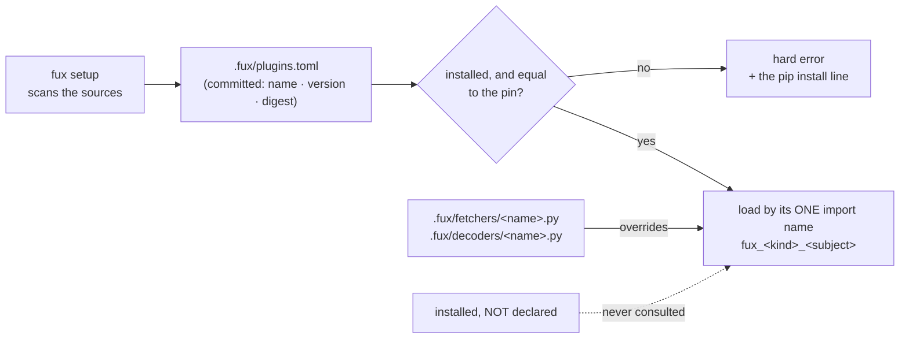

<!-- COMPONENTS-START — GENERATED from records/README.md's OWNERSHIP and DESCRIBES tables by scripts/gen-components.py. Do not edit by hand: change the table, then run `python scripts/gen-components.py --write`. -->

**Owns** — the components this record decides:

- [`.fux/plugins.toml`](../.fux/plugins.toml) · file
- [`src/fux/plugins.py`](../src/fux/plugins.py) · file
- [`tests/test_plugin_fence.py`](../tests/test_plugin_fence.py) · file
- [`tests/test_plugin_packages.py`](../tests/test_plugin_packages.py) · file
- [`tests/test_plugins.py`](../tests/test_plugins.py) · file

<!-- COMPONENTS-END -->

# SR-PLUGINS — plugin packages: declared, pinned, refused loudly

## §1 — For humans

**fux-engine reads Markdown and prose on its own. Everything else is a package your
repository declares.** A PDF reader, an Office reader, the two URL fetchers — each is
a separately published package (`fux-decoder-pdf`, `fux-fetcher-cdp`, …), and a
repository runs one only when its committed `.fux/plugins.toml` names it, at exactly
one version and digest.

**The point is that two machines cannot disagree.** A package somebody happened to
install and nobody declared never runs. A declared package that is missing, or
installed at a different version, or whose files differ from the pin, stops fux with
the one line that fixes it. `fux setup` scans your sources, writes the declaration,
and prints that line; it installs nothing.

**Your own file still wins.** A `.fux/fetchers/http.py` or `.fux/decoders/pdf.py` in
your repository overrides the package of the same name.



<details>
<summary><b>ASCII twin</b> — the same diagram, for terminals, diffs, and any reader without a Mermaid renderer</summary>

```text
  fux setup (scans the sources)
        |
        v
  .fux/plugins.toml   (committed: name, version, digest per package)
        |
        v
  installed, and equal to the pin? --no--> hard error + the pip install line
        | yes
        v
  load by its ONE import name: fux_<kind>_<subject>   <-- .fux/fetchers/<name>.py
        ^                                                  .fux/decoders/<name>.py
        :                                                  (your file overrides)
  installed but NOT declared  .....never consulted.....
```

</details>

### Examples

This repository's own declaration, written by `fux setup` from its sources (trimmed):

```console
$ fux doctor | grep plugins
[OK] plugins declared: 12 package(s) declared (12 first-party, 0 third-party): fux-decoder-config, fux-decoder-html, fux-decoder-image, fux-decoder-json, fux-decoder-mail, fux-decoder-office, fux-decoder-pdf, fux-decoder-sheet, fux-decoder-svg, fux-extension-table, fux-fetcher-cdp, fux-fetcher-http
[OK] plugins installed: 12 declared package(s), each installed at its pin
[OK] plugins cover sources: every format in the sources has a declared package
```

---

## §2 — For agents

### Context

[SR-LAW-2](0004_LAW-2-zero-cost.md)'s old form refused anything optional: one install
carried all seventeen decoders and both fetchers, so two clones could never differ by
what they had installed. It also meant every repository carried code for formats it
never held, and that `fux setup` seeded copies of decoders and fetchers into the
consumer's tree — copies an engine fix could never reach again.

Arpit's ruling of 2026-10-19 (W-289) chose option **C — declared, pinned, committed**
over **A** (repository-local files only, no packages) and **B** (packages discovered
through entry points). B fails L4: what ran would be a function of what the machine
had installed. SR-LAW-2 was amended in the same ruling: *a capability may be opt-in
only when the committed repository chooses it; no capability may depend on what a
machine happens to have installed.* This record is the mechanism that makes that
sentence true.

### Decision

**P2. The declaration is `.fux/plugins.toml`, committed.** One `[[package]]` row per
package: `name`, `version`, `digest`, and — for a third-party decoder only —
`suffixes`. A first-party row may not restate its suffixes: the first-party table is
`src/fux/constants.toml [plugins.packages]`, fixed identity a repository cannot
redefine. A row with an unknown key, a duplicate name, or two packages claiming one
suffix is refused by name. The file is read once per process, before any package
runs ([SR-DOTFUX](0102_fux-directory.md) declares the child).

**P3. Declared, never detected.** A package runs only when declared. An installed
package nobody declared is never consulted — there is no fallback to *"whatever is
installed"*. ([SR-TYPES](0128_types-list.md) decision 1 already forbids deriving the
type list from the live registry; the default list becoming *prose plus every suffix
a declared package claims* is phase 2's.)

**P4. Missing or drifted is a hard error.** A declared package that is not installed,
installed at a version other than the pin, pinned without a digest, or whose files
hash to another digest, is a `FuxError` naming the package, the expected version and
digest, and the install line. A first-party package must be pinned at fux's own
version. A declared package whose dependency is undeclared is the same error. `fux
doctor` and `fux setup` still run, and report it; every other verb that needs the
package refuses.

**The digest** is `sha256:` over the import package's files in the line format the
wheel's `RECORD` uses — `<path>,sha256=<urlsafe base64>` — sorted, with CRLF read as
LF. It is computed from the files `importlib.util.find_spec` locates, **never by
importing the package**, and it is **not** the hash of the `RECORD` file itself, which
also lists `INSTALLER` and `direct_url.json` and so differs between pip, uv and an
editable checkout of the same release.

**P5. Never silent.** A suffix present in the configured sources that a first-party
package reads and no declared package does is reported with its count and the package
that reads it: by `fux doctor` (the `plugins cover sources` row) and, in phase 2, by
`fux ingest` on stderr. A corpus that loses its PDFs looks exactly like one that never
had any.

**P6. `fux setup` scans and proposes; it installs nothing.** It walks the configured
directories — the same roots, `!` exclusions and hand-written `.fuxignore` lines
ingest honours, **pruning an excluded directory rather than entering it** — reads the
URL list's `fetch=` and `decoder=` names, adds the HTML decoder for any fetcher, closes
over dependencies, writes the declaration and prints **one** install line. On a later
run it adds a row the sources now need, pins a row that has no digest once its package
is installed, and removes nothing. **`fux setup --pin`** re-pins every row from what is
installed — the one deliberate act after an upgrade, never implicit. No network from
fux (L5).

**P7. Discovery by one fixed import name.** A package named `fux-<kind>-<subject>` is
imported as `fux_<kind>_<subject>` and by nothing else. **No entry-point scan**, so an
installed package fux was not told about has no way in. A fetcher is loaded as a fresh
module per call, never registered in `sys.modules`, because its `configure()` writes
module globals.

**P8. Precedence: the consumer's file, then the declared package, then nothing.**
`.fux/fetchers/<name>.py` beats the package declaring `fetch=<name>`;
`.fux/decoders/<module>.py` beats the declared package carrying that module. The
fetcher half is built; the decoder half is phase 2's, beside the decoder registry.

**P10. A fetcher package stays import-isolated.** It imports nothing from `fux` and
depends on nothing ([SR-FETCHER](0117_fetcher.md) decision 1); fux executes one only
when a URL line names it, through `plugins.load`, on a fenced path. **No offline path
reaches one** — `fux ingest --no-fetch` and `fux doctor` locate and hash a declared
fetcher and never run it — which is how [SR-CDP-FETCHER](0118_cdp-fetcher.md) decision
9 stays true with the WebSocket code in a separate distribution. A declared fetcher
without a declared `fux-decoder-html` is a `fux doctor` error: every fetcher emits HTML.

**P11. Lockstep.** Every first-party package is released on fux's own version, built
from this one tree, and published by the same workflow
([SR-WORK-RELEASE](0063_WORK-release.md) decision 15: six names become twenty-one).
Independent versions would need a compatibility matrix; refused.

**P12. The register names the distribution.** REGISTER's `decoder` column gains the
package — `pkg:fux-decoder-pdf@4.2.0/pdf@3` — so a committed row says which
distribution read it ([SR-INGEST](0106_ingest.md)). Phase 2's.

**P13. The L4 gate.** Two environments on one repository, one with an extra undeclared
package installed, build byte-identical indexes; one with a declared package at a
different version refuses and writes no index. The fetcher half is held today; the
decoder half lands with phase 2's gate.

**The fifteen first-party packages**, by `constants.toml [plugins.packages]`:

| package | reads | depends on |
|---|---|---|
| `fux-decoder-json` | `.json` `.jsonl` | — |
| `fux-decoder-config` | `.toml` `.yaml` `.yml` `.ini` `.cfg` `.properties` | — |
| `fux-decoder-html` | `.html` `.htm` `.xhtml` | `fux-extension-table` |
| `fux-decoder-sheet` | `.xlsx` `.xlsm` `.csv` `.tsv` | `fux-extension-table` |
| `fux-decoder-office` | `.docx` `.docm` `.pptx` `.pptm` | `fux-extension-table` |
| `fux-decoder-pdf` · `-xml` · `-svg` · `-drawio` · `-image` · `-mail` · `-rtf` | one format each | — |
| `fux-fetcher-http` · `fux-fetcher-cdp` | `fetch=http` · `fetch=cdp` | **nothing from fux** |
| `fux-extension-table` | — (declared beside a dependent, never chosen alone) | `fux-core` |

### Consequences

- **Breaking for every consumer, once.** After the upgrade a repository needs `fux
  setup`, the install line it prints, and a commit of `.fux/plugins.toml`. `fux
  doctor` says so in one line on the first run.
- **Engine fixes reach consumers again**, because setup seeds no copy
  ([SR-FETCHER](0117_fetcher.md) decision 6). A copy an older setup left keeps
  overriding; `fux doctor`'s `seeded copies removable` row names every unedited one.
- **Typosquats are possible** — PyPI has no namespaces, so a `fux-decoder-*` name fux
  does not own can be published by anyone. The pin is the defence: a declared package
  runs only at its digest. `fux doctor` marks the first-party set.
- ⚠ **Phase 1 built the mechanism and the fetchers; the decoders are still built-in.**
  Until phase 2 moves the decoder modules into their packages and gates the registry
  on the declaration, a declared decoder package changes nothing ingest does, and an
  undeclared format is still read. The `plugins cover sources` row says what phase 2
  would stop reading.
- **The per-fetcher `[sources.url.config.<name>]` tables are no longer scaffolded.**
  They were derived from the two templates, which may not be installed when setup runs.

### Alternatives considered

- **A — repository-local files only.** Every format a file in `.fux/decoders/`. Lost:
  the copies an engine fix can never reach are the defect P9 exists to end.
- **B — discovered entry points.** Lost to L4: what ran would be what the machine had.
- **Optional extras (`fux-engine[pdf]`).** Refused twice by SR-LAW-2: the choice lives
  on the machine, not in the repository.
- **Pinning the `RECORD` file's own hash.** Lost: it lists installer-written files, so
  pip, uv and an editable checkout of one release would never agree.

### Reference (required)

- [`work/open/W-289-plugin-packages.md`](../work/open/W-289-plugin-packages.md) — the
  ruling, the package table and the design this record states.
- [`src/fux/plugins.py`](../src/fux/plugins.py) and its tests.

### Veto condition

**Reopen this decision if any of these becomes true:**

1. **A package runs that `.fux/plugins.toml` does not declare, or runs although it
   differs from its pin.** `plugins.load` is the only place one is executed.
2. **Two environments on one repository build different indexes** because of what each
   had installed (P13).
3. **An engine module imports a plugin package by name.**

**How to check it:** `uv run pytest -q tests/test_plugins.py tests/test_plugin_fence.py tests/test_plugin_packages.py`.

---

## References

*Every source this record cites, gathered in one place. §2's **Reference
(required)** names the grounding; this is the complete list. An archived
document is never listed here — the body may name one, but archive is not
evidence.*

**Records** — [SR-LAW-2](0004_LAW-2-zero-cost.md) · [SR-DOTFUX](0102_fux-directory.md) · [SR-INGEST](0106_ingest.md) · [SR-FETCHER](0117_fetcher.md) · [SR-CDP-FETCHER](0118_cdp-fetcher.md) · [SR-TYPES](0128_types-list.md) · [SR-WORK-RELEASE](0063_WORK-release.md)

**Code**

- [`src/fux/plugins.py`](../src/fux/plugins.py)
- [`src/fux/constants.toml`](../src/fux/constants.toml)
- [`tests/test_plugins.py`](../tests/test_plugins.py)
- [`tests/test_plugin_fence.py`](../tests/test_plugin_fence.py)
- [`tests/test_plugin_packages.py`](../tests/test_plugin_packages.py)

**Project docs**

- [`work/open/W-289-plugin-packages.md`](../work/open/W-289-plugin-packages.md)
