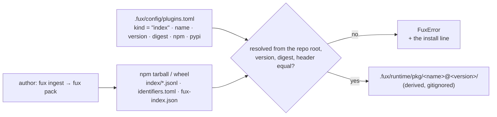

<!-- COMPONENTS-START — GENERATED from records/README.md's OWNERSHIP and DESCRIBES tables by scripts/gen-components.py. Do not edit by hand: change the table, then run `python scripts/gen-components.py --write`. -->

**Owns** — the components this record decides:

- [`node/src/config/plugins.mjs`](../node/src/config/plugins.mjs) · file
- [`node/src/derive/segments.mjs`](../node/src/derive/segments.mjs) · file
- [`node/src/refer/pkgsrc.mjs`](../node/src/refer/pkgsrc.mjs) · file
- [`node/test/plugins-index.test.mjs`](../node/test/plugins-index.test.mjs) · file
- [`src/fux/acquire/pkgsrc.py`](../src/fux/acquire/pkgsrc.py) · file
- [`src/fux/derive/segments.py`](../src/fux/derive/segments.py) · file
- [`src/fux/schemas/fux-index.schema.json`](../src/fux/schemas/fux-index.schema.json) · file
- [`tests/fixtures/pkg-index/`](../tests/fixtures/pkg-index) · dir
- [`tests/test_pkg_index.py`](../tests/test_pkg_index.py) · file

<!-- COMPONENTS-END -->

# SR-PKG-INDEX — a package that ships a fux index

## §1 — For humans

**A library can ship its documentation already indexed.** The library's author runs
`fux ingest` on the docs and packs the result — a few shard files, the
`identifiers.toml` they were built under and a small manifest — into a package
published on npm, on PyPI, or both. A consumer who wants those docs searchable
beside their own declares the package once, in the committed
`.fux/config/plugins.toml`, at one version and one digest. There is no ingest on
the consumer's side, so an npm-only machine with no Python gets the package's docs
too.

**The package is data, never code.** fux reads its files and runs nothing from it.
**And it is pinned exactly like a decoder package** ([SR-PLUGINS](0165_plugins.md)
P4): a pinned index that is not installed, is installed at another version, or
whose shard bytes differ from the pin stops fux with the one line that fixes it —
in Python and in Node alike, so two machines on one repository can never search
different things.

**Once verified, the segment is inflated** into `.fux/runtime/pkg/<name>@<version>/`
— gitignored and rebuilt only when the pin changes — by the same builder that
fills `.fux/runtime/` for the repository itself.



<details>
<summary><b>ASCII twin</b> — the same diagram, for terminals, diffs, and any reader without a Mermaid renderer</summary>

```text
  author: fux ingest -> fux pack
        |
        v
  npm tarball / wheel: index/*.jsonl, identifiers.toml, fux-index.json
        |
        v
  resolved from the repo root; version, digest, header equal?  <-- .fux/config/plugins.toml
        |                                                            kind = "index", name, version,
        | no --> FuxError + the install line                         digest, npm, pypi
        | yes
        v
  .fux/runtime/pkg/<name>@<version>/   (derived, gitignored)
```

</details>

---

## §2 — For agents

### Context

Ingest is Python-only, so a consumer on an npm-only install can never ingest a
package's docs. A segment built where the package is built needs no ingest at all.
The pin machinery already exists ([SR-PLUGINS](0165_plugins.md) P2–P4, P7): a
shipped index is one more declared, pinned, refused-loudly thing rather than a
second mechanism. W-298 step 1 measured the shape before it was built (19 of 20
against a bar of 16, 2026-10-25), which opened the gate for the four items this
record serves: W-299 (the pin and the runtime), W-300 (the merged query), W-301
(`pkg:` locations) and W-302 (`fux pack`).

### Decision

**1. A shipped index is a segment, and a segment is data.** A segment is a
directory holding exactly:

| file | what it is |
|---|---|
| `index/*.jsonl` | the document shards, byte for byte what `fux ingest` committed |
| `identifiers.toml` | the identifier rules the shards were built under |
| `fux-index.json` | the manifest — decision 3 |

An index row loads no module and runs nothing, which is why it is not an entry
point and why SR-PLUGINS P10's isolation is moot for it. **Where the segment sits in
a distribution:** on npm, at the package root (beside `package.json`); on PyPI, as
the import package named by the distribution's normalised name (`acme-docs-index` →
`acme_docs_index/`), which needs no `__init__.py` — a namespace package resolves.
The file names and the segment-file set are `src/fux/constants.toml
[plugins.index]` (L12).

**2. The pin is one `[[package]]` row with `kind = "index"` in
`.fux/config/plugins.toml`** (Arpit, 2026-10-25: *"plugins.toml, kind = \"index\""*,
over a `packages:` section in `sources.yaml`). Its keys are exactly `name`,
`version`, `digest`, `kind`, `npm`, `pypi` (`[plugins.index] keys`):

- `name` — the pin's own name, the directory name under `runtime/pkg/`; lowercase,
  matching `[plugins.index] name_pattern`.
- `version` — the index package's version; both distributions carry the same one.
- `digest` — decision 4.
- `npm`, `pypi` — the index package's name on each registry; **at least one**.

**Refused by name**: an unknown key, a `suffixes` key (an index reads no format),
a name declared twice — across decoder and index rows alike — and a row with
neither `npm` nor `pypi`. **`fux setup` never proposes an index row on its own**
(SR-PLUGINS P6): it scans sources, and no source names an index nobody declared.
`fux setup --index <pypi name> [--index-npm <npm name>]` writes one when told,
from what is installed; `fux setup --pin` re-pins every index row whose PyPI
distribution is installed, and leaves an npm-only row as written.

**3. The manifest `fux-index.json`** carries `fux_version` (the engine that packed
it), `index_header` (the shards' header line, parsed), `content` (`npm`, `pypi`,
`version` — the **docs** package the index describes, which W-301 reads), `docs`
(the document count) and `digest` (decision 4). Its declared shape is
[`src/fux/schemas/fux-index.schema.json`](../src/fux/schemas/fux-index.schema.json),
owned here; W-302 writes it and validates against it. **The pin never trusts the
manifest's numbers**: the reader checks the manifest's `digest` against the digest
it computes, refuses on disagreement, and reads the header off the shards
themselves (decision 6).

**4. The digest covers the segment files only** — `sha256:` over every file
`[plugins.index] segment` names (`index/*.jsonl`, `identifiers.toml`), relative to
the segment root, in SR-PLUGINS P4's RECORD-line form (`<path>,sha256=<urlsafe
b64>`, sorted, CRLF read as LF). **Never the wheel or the tarball**: those differ
between pip, uv and npm for identical segments — P4's `RECORD` lesson applied.
One digest therefore covers both registries, and anyone reproduces it from the
same docs (L4). `plugins.segment_digest` is the one Python implementation and
`node/src/config/plugins.mjs::segmentDigest` its twin; `fux pack` imports the
Python one.

> ⚠ **A deviation from W-299's step 2, flagged for Arpit's ratification — NOT yet
> ratified.** The item names `fux-index.json` among the files the digest covers.
> It cannot be: the manifest *carries* the digest, and a file cannot contain its
> own hash. The manifest is therefore outside the digest, and what it could vouch
> for is checked independently — its `digest` against the computed one, the
> header against the shards. A manifest edited to carry other `content` or `docs`
> values verifies; W-301's version check on the docs package (its step 4,
> decision 11, built 2026-10-25) is what catches a lying `content.version`.

**5. Located by module resolution, never by a path.** Python: the PyPI
distribution's version from `importlib.metadata`, its segment from
`importlib.util.find_spec(<import name>)`, which must resolve to exactly one
directory holding the manifest. Node: `createRequire(<repo root>/package.json)`,
then the first `<dir>/<npm>/package.json` along `require.resolve.paths(<npm>)` —
**from the repository root, never from fux's own install**, so two consumers
sharing one global fux resolve their own packages. Neither imports or executes
anything.

**6. Lockstep header compatibility** (Arpit, 2026-10-25, *"wire compat =
lockstep"*). Every shard's header must carry the reader's own `_format`,
`analyzer` and `tf_fields` (`[plugins.index] header_keys` against `[index]`); a
segment with any other is **foreign** and refused by name, never scored and never
skipped. **The `identifiers` digest MAY differ** — a package built under other
identifier rules is legal, and W-300 hashes the query once per distinct digest.

**7. Missing or drifted is a hard error, verb-wide** — SR-PLUGINS P4 extended to
index rows. In this order, each a `FuxError` naming the package and the install
line (`pip install <pypi>==<version>` or `npm install <npm>@<version>`, printed
and never run, L5):

1. the row has no name for this runtime's registry (`pypi` for Python, `npm` for
   Node) — this runtime cannot read the package, so it would search something the
   other does not;
2. not installed; 3. installed at another version; 4. pinned without a digest;
5. installed but resolving to no segment (no manifest); 6. drifted — the computed
digest is not the pin's; 7. the manifest's `digest` disagrees with the shards;
8. a foreign header (decision 6).

Python runs it inside `plugins.require` (so `cli._require_plugins` refuses every
verb outside `PLUGINS_EXEMPT`); Node runs `requireIndexPackages` before every verb,
beside the PII gate. **The texts are one set of words in both runtimes**, held by a
differential test.

**8. The runtime: `.fux/runtime/pkg/<name>@<version>/`** — a derived, gitignored
child of `.fux/runtime/` ([SR-DOTFUX](0102_fux-directory.md)), named by
`[plugins.index] runtime_child`. It is laid out as a repository: the verified shards
in `.fux/index/`, the segment's `identifiers.toml` in `.fux/config/`, and
`.fux/runtime/` built from them by the repository's own builder (`derive.build` in
Python, `derive/build.mjs` in Node — byte-identical output, the W-242 law), so
every root-keyed reader opens a pinned package as it opens a repository. A
`[plugins.index] pin_stamp` file holds the pin digest it was built from, written
last: **rebuilt when the pin digest changes, untouched when it does not**, and a
directory no pin names is removed. `fux build` and every runtime rebuild do it, in
both runtimes, after verification — so a drifted segment is refused before a byte
of it is read for the build.

**9. The scale ceiling counts the merged corpus** (Arpit, 2026-10-25, *"10k
ceiling counts the merged corpus"*; [SR-WORK-SCALE](0057_WORK-scale.md)): the
repository's documents plus every pinned segment's. `fux doctor` prints one `index
packages` row per pin and one `merged corpus` row with the total, which warns above
10 000 ([SR-DOCTOR](0152_doctor.md)).

**10. The merged query** (Arpit, 2026-10-25, *"scope = repo|packages|all, default
all"*) — one ranking over the repository and every pinned segment, statistics
summed, with `scope` choosing the segments. **Ratified, built by W-300**, which
states its mechanism here when it lands.

**11. `pkg:` locations — a hit in a segment names the DOCS package, and its
passage is read inside the installed package** (Arpit, 2026-10-25: *"This looks
good to me."*; built by W-301). The mechanism is
[`src/fux/acquire/pkgsrc.py`](../src/fux/acquire/pkgsrc.py), twinned by
[`node/src/refer/pkgsrc.mjs`](../node/src/refer/pkgsrc.mjs):

- **The manifest's `content` is required** (`npm` and/or `pypi`, and `version` —
  decision 3; the schema marks it `always` and `pkgsrc` refuses a `content` with
  neither name or no version by name). It is read off the **verified** segment
  (`plugins.locate_index` first), and only through `pkgsrc.segment(pin)`.
- **The location** is `pkg:<docs package>@<content.version>#<the record's loc>` —
  the npm name when `content` has one, else the PyPI name, so the string is the
  same in both runtimes (`[pkg_location]`). The record's own `id` stays `file:`
  ([SR-RECORD](0109_index-record.md)); `pkg:` is composed at render time and
  never stored. `pkgsrc.hit_fields(id, loc, segment)` is the ONE function that
  produces a hit's `location` and `package` (the pin's name — the **index**
  package, for provenance); a repository hit gets its own id and `null`.
- **Reading one**: parse (the first `#` splits the fragment, the last `@` before
  it the version, so a scoped npm name survives) → find the pin whose verified
  `content` names that package at that version, else refused → resolve the docs
  package **by module resolution from the repository root**, never a path
  (Python: `importlib.metadata` for the version of `content.pypi` and
  `find_spec(<normalised name>)` for its one directory, located never imported;
  Node: `content.npm` through `createRequire(<repo>/package.json)`) → 🔴 **an
  installed docs version other than `content.version` is a `FuxError` naming
  both and the install line** (`pip install <pypi>==<version>` / `npm install
  <npm>@<version>`, printed, never run) — so a lying `content.version`
  (decision 4's open door) and a hoisted second copy of the docs package are
  both caught here → join the fragment and contain it with
  `acquire/source.py::contain`, which collapses `..` **before** the check and
  holds the address to **its own** package's root (the allowed roots are the
  repository root ∪ every pinned docs root, and each caller passes the one its
  address names) → read the file **in place** (L3) and hash it with
  `content_sha`.
- ⚠ **The fresh sha is `content_sha`, not `git hash-object`**, a deviation from
  the item's wording, flagged for Arpit: every `sha` in this engine is the
  ledger's blake2b ([SR-RECORD](0109_index-record.md)), the segment's record
  carries that one, and only that one lets the fresh read be compared with the
  indexed one (SR-REFER decision 5). The test asserts it equals the ledger hash
  of the installed bytes **and** the segment record's `sha`.
- **Every verb that reads only the repository's own documents refuses a `pkg:`
  id by name** (`[pkg_location_refusals] refused`) rather than reading it as
  `file:pkg:…`: `fux correct`, `fux explain`/`graph`/`path`, `fux inspect`'s
  document X-ray, and `fux_related`. `fux_passage` and the refer plane accept it
  ([SR-MCP](0136_mcp.md) decisions 7 and 7a, [SR-REFER](0127_refer-plane.md)
  decision 29). The refusal texts are one set of words in both runtimes; only
  the install line and the registry key differ.
- **Where a merged ranking calls it** (W-300): for a hit whose record came from a
  segment, `pkgsrc.hit_fields(record_id, loc, seg)` where the hit is rendered
  (`mcp.py::_search`, `verbs/mcp.mjs::fuxSearch` — both pass `None` today), and
  `pkgsrc.location(seg, loc)` as the `doc_id` it hands the refer plane
  (`refer()`'s candidates, Node `answer.mjs::obtain`), with `pkgsrc.segments(root)`
  computed once per call.

### Consequences

- **A package's docs become searchable on a Node-only machine** — the consumer
  never ingests them.
- **Every reading verb now hashes each pinned segment's shards**, the cost P4
  already pays for a declared decoder package. A segment is small (one package's
  docs) and the hash is over files, not a walk.
- **Both runtimes must hold the package.** A row with only `npm` refuses every
  Python verb, and one with only `pypi` every Node verb: answering from a smaller
  corpus on one machine would be the divergence the pin exists to stop.
- **The section plane is not part of a segment.** `[plugins.index] segment` is
  `index/*.jsonl`, which does not reach `index/sections/`; a segment whose records
  declare sections fails the build's own `nsec` check when inflated. A packer built
  without `[index] section_records` produces none.
- **A segment pinned under a different `_format` or analyzer is refused** — the
  price of lockstep: an author re-packs on every analyzer or format bump.

### Alternatives considered

- **A `packages:` section in `.fux/sources.yaml`** — lost to Arpit's ruling: the
  pin is a dependency of the index, and `plugins.toml` is where dependencies are
  declared, pinned and refused.
- **A digest over the whole distribution** — differs between pip, uv and npm for
  identical segments (SR-PLUGINS' `RECORD` lesson).
- **Locating the package by a path in the row** — a path is a function of the
  machine; module resolution is a function of what the repository's own install
  declares.
- **A per-segment compatibility matrix instead of lockstep** — refused with the
  ruling; the reader would need to understand every older format.

### Reference (required)

- [`archive/open/W-299-index-package-pin.md`](../archive/open/W-299-index-package-pin.md) (closed 2026-10-25)
  — the ruling quoted above and the steps this record states.
- [`src/fux/plugins.py`](../src/fux/plugins.py) — the row, the digest, the checks.
- [`src/fux/derive/segments.py`](../src/fux/derive/segments.py) — the inflation.
- [`work/open/W-301-pkg-locations-read-in-place.md`](../work/open/W-301-pkg-locations-read-in-place.md)
  — decision 11's ruling and steps.
- [`src/fux/acquire/pkgsrc.py`](../src/fux/acquire/pkgsrc.py) — the `pkg:` location, its reader and its refusals.

### Veto condition

**Reopen this decision if any of these becomes true:**

1. **A pinned segment is read** — searched or inflated — **while its computed digest
   differs from the pin.**
2. **Python and Node disagree** on whether a pin verifies, or on the refusal's text.
3. **The same pin inflates to different bytes** in Python and in Node.
4. **A `pkg:` location is read outside its own docs package's root**, from a docs
   package installed at another version than the manifest's `content.version`, or
   from anything but the installed file itself (a copy) — or Python and Node
   return different bytes, sha or refusal text for one location.

**How to check it:** `.venv/bin/python -m pytest -q tests/test_pkg_index.py` and
`node --test node/test/plugins-index.test.mjs`.

---

## References

*Every source this record cites, gathered in one place. §2's **Reference
(required)** names the grounding; this is the complete list. An archived
document is never listed here — the body may name one, but archive is not
evidence.*

**Records** — [SR-PLUGINS](0165_plugins.md) · [SR-DOTFUX](0102_fux-directory.md) · [SR-WORK-SCALE](0057_WORK-scale.md) · [SR-DOCTOR](0152_doctor.md) · [SR-RECORD](0109_index-record.md) · [SR-MCP](0136_mcp.md) · [SR-REFER](0127_refer-plane.md)

**Code**

- [`src/fux/plugins.py`](../src/fux/plugins.py)
- [`src/fux/derive/segments.py`](../src/fux/derive/segments.py)
- [`src/fux/schemas/fux-index.schema.json`](../src/fux/schemas/fux-index.schema.json)
- [`src/fux/constants.toml`](../src/fux/constants.toml)
- [`node/src/config/plugins.mjs`](../node/src/config/plugins.mjs)
- [`node/src/derive/segments.mjs`](../node/src/derive/segments.mjs)
- [`tests/test_pkg_index.py`](../tests/test_pkg_index.py)
- [`node/test/plugins-index.test.mjs`](../node/test/plugins-index.test.mjs)
- [`src/fux/acquire/pkgsrc.py`](../src/fux/acquire/pkgsrc.py)
- [`node/src/refer/pkgsrc.mjs`](../node/src/refer/pkgsrc.mjs)

**Project docs**

- [`archive/open/W-299-index-package-pin.md`](../archive/open/W-299-index-package-pin.md) (closed 2026-10-25)
- [`work/open/W-301-pkg-locations-read-in-place.md`](../work/open/W-301-pkg-locations-read-in-place.md)
